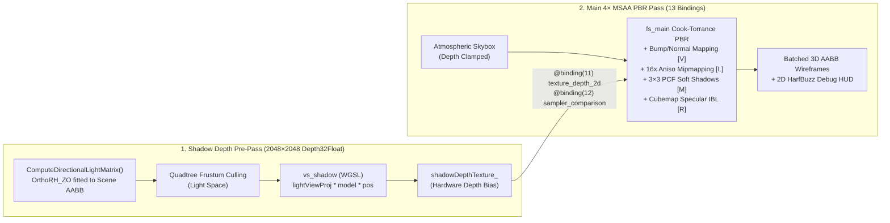
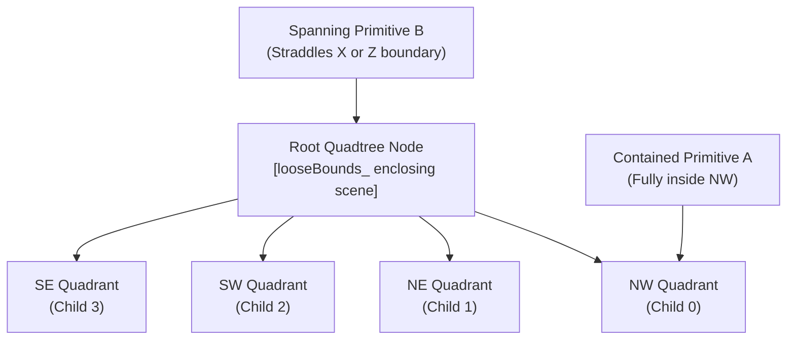

# WebAssembly an WebGPU Demo (bgl-Engine v0.7.0)

[](https://bkuolt.github.io/web-assembly-demo/web/index.html)
[](https://raw.githack.com/bkuolt/web-assembly-demo/main/web/index.html)
[](https://en.cppreference.com/w/cpp/23)
[](tests/)
[](CHANGELOG.md)

Modular C++23 WebGPU & glTF 2.0/2.1 High-Performance 3D Renderer for Linux amd64 Desktop and WebAssembly (Wasm).

> **🚀 Live Web Application (Run Directly in Browser):**
> - **GitHub Pages:** [https://bkuolt.github.io/web-assembly-demo/web/index.html](https://bkuolt.github.io/web-assembly-demo/web/index.html) *(or root [https://bkuolt.github.io/web-assembly-demo/](https://bkuolt.github.io/web-assembly-demo/))*
> - **Direct Branch Preview (No Setup Required):** [https://raw.githack.com/bkuolt/web-assembly-demo/main/web/index.html](https://raw.githack.com/bkuolt/web-assembly-demo/main/web/index.html)

---

## Overview

**WebAssembly an WebGPU Demo (bgl-Engine)** is a modern, high-performance 3D rendering engine built in strict C++23 with a hardware WebGPU backend (`wgpu-native` on desktop, HTML5 WebGPU in browser). It features complete glTF 2.0 and KHR material model support, zero-GLFW architecture, PMR-backed memory management, HarfBuzz & FreeType 2 text shaping, spatial Quadtree partitioning, procedural atmospheric skybox, and dual-target deployment.

### At a Glance: Feature & Capabilities Matrix

| Subsystem | Key Capabilities | Runtime Toggle / CLI |
| :--- | :--- | :--- |
| **Bump & Normal Mapping** | MikkTSpace/Lengyel tangent generation, scale-invariant `getTBN`, tangent-space normal maps + UV-texel-space central-difference height gradients (`textureSampleGrad`) | `[V]` / `--no-bump` |
| **Anisotropic Mipmapping** | Full CPU mip pyramid ($1\times 1$), 3D vector renormalization for normal maps, multithreaded `std::jthread` generation, live 16× Aniso vs. Mip-0 switching | `[L]` / `--no-mipmaps` |
| **Directional Shadow Mapping** | $2048\times 2048$ `Depth32Float` pre-pass (cached for static scenes), scene-fitted `orthoRH_ZO` light matrix, hardware slope-scale depth bias, 9-tap $3\times 3$ PCF soft shadows | `[M]` / `--no-shadows` |
| **Environment Reflections (IBL)** | 6-face pre-filtered roughness cubemap ($64\times 64\times 6$, 7 mip levels), Karis split-sum analytic `envBRDFApprox`, clearcoat specular reflections | `[R]` / `--no-reflections` |
| **Spatial Quadtree & Occlusion Culling** | 4-way XZ-plane partitioning, Front-to-Back traversal, $32\times 16$ Hi-Z `OcclusionBuffer` & sub-pixel culling, single-draw batched 3D wireframes | `[C]` / `[Q]` / `--no-occlusion` |
| **URL & Remote Asset Streaming** | Direct `http://`, `https://`, `file://`, and `data:` model loading via **`libcurl`** (native) and Fetch API (Wasm), URL Drag-and-Drop, and external `.gltf` buffer/texture URI resolution | `--asset <url>` / Drag & Drop |
| **3D Bounding Boxes (AABBs)** | Pre-cached hierarchical world-space AABBs (Gold for scene root, Cyan for mesh primitives) rendered in 1 batched GPU draw call | `[B]` / `--no-bounds` |
| **Atmospheric Skybox** | Rayleigh-inspired zenith-to-horizon scattering, solar disk & corona, ground hemisphere bounce, far-plane depth clamping | `[K]` / `--no-skybox` |
| **HarfBuzz & FreeType 2 HUD** | Dynamic $1024\times 1024$ RGBA8 shelf-packed font atlas, Unicode shaping, zero-dependency embedded TTF fallback, live telemetry overlay | `[O]` / `[F3]` / `--no-hud` |
| **Multithreaded Asset Pipeline** | Lock-free `std::jthread` + `std::atomic` glTF texture fetching/decoding & mip generation (~245 MB/s on 1 GB / 5.25M-triangle stress test), KTX2 Basis Universal transcoding | `--formats` |

### Key Architecture Highlights

- **100% Modern C++23 & Root Namespace `bgl`**:
  - `bgl::core`: Math, types, AABB, ray intersection, camera, memory pools, PMR arenas, POSIX signal handling, C++23 `std::stacktrace` crash diagnosis, logging.
  - `bgl::gpu`: WebGPU device context, swapchain surface, 4x MSAA, WGSL PBR shaders, procedural atmospheric skybox, batched single-draw 3D wireframe bounding boxes.
  - `bgl::scene`: High-speed multithreaded glTF ingestion (`fastgltf`), modular KTX / PNG / JPEG / WebP decoders with CMake toggles, Basis Universal transcoding, 16x anisotropic texture filtering with full CPU mip-mapping, spatial Quadtree partitioning with loose bounds, Möller-Trumbore ray picking.
  - `bgl::text`: Dynamic RGBA8 font atlas, FreeType 2 glyph rasterization, HarfBuzz Unicode script and bidi text shaping, batched 2D quad renderer with alpha blending.
  - `bgl::ui`: In-engine glassmorphism Debug Overlay HUD displaying real-time FPS, frame timing, camera coordinates, glTF scene metrics, and spatial culling telemetry.
  - `bgl::audio`: 3D spatial sound engine via `miniaudio`.
  - `bgl::app`: Multiplatform application lifecycle, CLI argument parser (`--help`, `--version`, `--formats`, `--asset`, etc.), and runtime loop.
- **Robust Spatial Partitioning & Frustum Culling**:
  - Hierarchical 4-way Quadtree partitioning on the XZ ground plane with loose bounding boxes (`looseBounds_`) and strict `ContainsXZ` containment.
  - Primitives spanning across quadrant boundaries are held safely at their parent node, completely preventing disappearing geometry or pop-in artifacts.
  - Broad-phase view frustum rejection eliminates whole quadrant subtrees; narrow-phase tests discard individual off-screen primitives.
  - Sponza benchmark demonstrates **60% to 82% primitive culling ratios** from the central courtyard.
  - Batched AABB rendering: all scene, primitive, and quadtree wireframe bounding boxes are drawn in a **single GPU draw call** with per-vertex colors (Gold for scene, Cyan for primitives, Emerald green for quadtree partitions).
- **POSIX Crash Signal Handler & Callstack Diagnostics**:
  - Catches `SIGSEGV`, `SIGABRT`, `SIGFPE`, `SIGILL`, and `SIGBUS` via `sigaction` with an alternate signal stack (`sigaltstack`).
  - Safe, immediate async-signal-safe error logging: signal name, fault address, PID, and TID.
  - Dual stack unwinding: raw `execinfo` backtrace plus demangled C++23 `std::stacktrace` with function signatures and file line numbers.
  - Intentional test crashes accessible via `--test-crash [segv|abrt|fpe]`.
- **Modular Texture Format CMake Options (All ON by Default)**:
  - `-DBGL_ENABLE_PNG=ON/OFF` (libpng)
  - `-DBGL_ENABLE_JPEG=ON/OFF` (libjpeg-turbo with custom `setjmp` error handling)
  - `-DBGL_ENABLE_WEBP=ON/OFF` (libwebp)
  - `-DBGL_ENABLE_KTX=ON/OFF` (libktx 4.3.2)
  - Queryable at runtime via `./bgl_viewer --formats` or `TextureDecoder::GetSupportedFormats()`.
- **Multithreaded glTF Asset Ingestion**:
  - Lock-free parallel texture decoding across hardware worker threads (`std::jthread`, `std::atomic<size_t>` task dispatch).
  - Parallel scene node extraction, transform hierarchy evaluation, and mesh primitive parsing (vertex attributes, bounding boxes, indices).
  - Sub-second loading of large scenes like Sponza (69 multi-megabyte textures decoded concurrently).
- **KTX & KTX2 Texture Support with Basis Universal Transcoding**:
  - Full KTX1 and KTX2 container ingestion via `libktx` (`ktx/4.3.2`).
  - Automatic on-the-fly transcoding of Basis Universal compressed textures (UASTC and ETC1S) to 32-bit RGBA (`KTX_TTF_RGBA32`).
  - Content-based magic-byte sniffing (`\xABKTX 11\xBB` and `\xABKTX 20\xBB`), MIME type detection, and path extension routing.
- **HarfBuzz & FreeType 2 Text Rendering Pipeline**:
  - Precise Unicode text shaping via HarfBuzz (`hb_buffer_t`, `hb_shape`).
  - High-fidelity glyph rasterization via FreeType 2 into a dynamic 1024x1024 RGBA8 font atlas.
  - Zero-dependency embedded fallback font (Liberation Mono Regular) allowing standalone execution anywhere.
  - Batched 2D WebGPU render pipeline with alpha blending (`SrcAlpha / OneMinusSrcAlpha`), 4x MSAA render-pass compatibility, and orthographic projection.
- **AAAA Visual Fidelity & Real-Time Rendering Features (Toggleable On/Off)**:
  - **Bump & Normal Mapping (`[V]` / `--no-bump`)**: Lengyel/MikkTSpace-style automatic tangent & bitangent basis generation (`MeshPrimitive::ComputeTangents()`), Gram-Schmidt orthogonalization in WGSL, tangent-space normal mapping, and screen-space derivative height bump perturbation (`dHdX`, `dHdY`).
  - **Mipmapping Support (`[L]` / `--no-mipmaps`)**: Full CPU mip-chain generation down to $1\times 1$ texels with 3D vector renormalization for normal maps and box-filtering for color maps. Live runtime switching between 16x Anisotropic Trilinear Mipmapping and Base-Mip-0-Only sampling.
  - **Directional Shadow Mapping (`[M]` / `--no-shadows`)**: $2048\times 2048$ `Depth32Float` directional shadow depth pre-pass fitted to the scene AABB (`glm::orthoRH_ZO`), hardware depth bias, and 9-tap $3\times 3$ Percentage-Closer Filtering (PCF) soft shadows via `textureSampleCompareLevel`.
  - **Environment Cubemap Reflections (`[R]` / `--no-reflections`)**: 6-face pre-filtered HDR-style atmospheric environment cubemap ($64\times 64\times 6$ with 7 roughness-convolved mip levels), Karis split-sum analytic `envBRDFApprox`, and clearcoat environment reflections.
  - **Sponza Benchmark Scene**: Loaded by default with human eye-level courtyard camera positioning (`courtyardCenter = (-0.48, 2.0, -0.31)`, `camDistance = 10.0m`).
  - **Procedural Atmospheric Skybox (`[K]` / `--no-skybox`)**: Rayleigh-like zenith-to-horizon gradients, solar corona, and far-plane depth clamping.
- **Complete glTF 2.0 & KHR Material Model**:
  - Core PBR Metallic-Roughness (Cook-Torrance GGX $D$, Smith-GGX $V$, Schlick Fresnel $F$).
  - Tangent-space Normal Mapping (with vertex `TANGENT` ingestion and screen-space derivative fallbacks).
  - Ambient Occlusion (AO) with configurable strength.
  - Emissive maps with strength multipliers (`KHR_materials_emissive_strength`).
  - Clearcoat lacquer layer (`KHR_materials_clearcoat`).
  - Transmission and dielectric refraction (`KHR_materials_transmission`, `KHR_materials_ior`).
  - Charlie microfiber sheen for textiles and fabrics (`KHR_materials_sheen`).
  - Specular color and factor tinting (`KHR_materials_specular`).
  - Double-sided rendering and unlit shading (`KHR_materials_unlit`).
  - Alpha modes: `Opaque`, `Mask` (alpha cutoff discard), and `Blend`.
- **Zero-GLFW Architecture**:
  - **Linux Desktop**: Native SDL2 windowing and hardware event handling.
  - **WebAssembly**: Native Emscripten HTML5 WebGPU context (`<emscripten/html5.h>`).
- **Reproducible Conan 2.x Dependency Management**:
  - All third-party dependencies resolved via Conan 2.x with explicit lockfile pinning (`conan.lock`).
  - FreeType (`freetype/2.13.2`), HarfBuzz (`harfbuzz/8.3.0`), and KTX (`ktx/4.3.2`).
  - Zero system library divergence across build environments.

---

## Repository Structure

```text
.
├── CMakeLists.txt                 # Modern target-based CMake configuration (C++23)
├── CHANGELOG.md                   # Complete retroactive release history (v0.6.0 -> v0.7.0)
├── conanfile.py                   # Conan 2.x package recipe
├── conan.lock                     # Deterministic dependency lockfile
├── assets/
│   ├── Sponza.glb                 # High-detail Sponza architectural benchmark scene
│   ├── ToyCar.glb                 # Benchmark glTF model (Clearcoat, Sheen, Transmission, AO)
│   └── fonts/
│       └── LiberationMono-Regular.ttf # High-legibility monospace font
├── src/
│   ├── core/                      # -> libbgl_core.so
│   │   ├── Camera.hpp/.cpp        # Orbit, Pan, Zoom camera with WebGPU reverse-Z projection
│   │   ├── CrashHandler.hpp/.cpp  # POSIX crash interception, signal handling & C++23 stacktrace
│   │   ├── Gamepad.hpp/.cpp       # Controller support with 0.12f deadzone calibration
│   │   ├── Log.hpp/.cpp           # spdlog integration and RAII ScopedTimer profiling
│   │   ├── MemoryPool.hpp/.cpp    # Block memory pool & PMR scratch arena
│   │   ├── NetworkFetcher.hpp/.cpp# Asynchronous network ingestion
│   │   └── Types.hpp              # AABB, Ray, Frustum, 64-byte Vertex, GlobalUniforms, Result<T>
│   ├── gpu/                       # -> libbgl_gpu.so
│   │   ├── Context.hpp/.cpp       # Hardware WebGPU device, adapter, surface, depth buffers (4x MSAA)
│   │   ├── Pipeline.hpp/.cpp      # 10-slot BindGroupLayout, 16x aniso, batched AABB wireframe pipelines
│   │   ├── Shaders.hpp            # Full glTF 2.0 Cook-Torrance PBR & Wireframe WGSL shaders
│   │   └── Skybox.hpp/.cpp        # Procedural Atmospheric Skybox with solar corona
│   ├── scene/                     # -> libbgl_scene.so
│   │   ├── AssetManager.hpp/.cpp  # 64-bit FNV-1a caching and PMR geometry allocation
│   │   ├── FastGltfLoader.hpp/.cpp# SIMD glTF binary parser with full KHR extension support
│   │   ├── Quadtree.hpp/.cpp      # 4-way spatial partition and loose-bounds culling on XZ ground plane
│   │   ├── RayPicker.hpp/.cpp     # Hierarchical Möller-Trumbore ray-triangle intersection
│   │   ├── Scene.hpp              # Hierarchical scene graph and PMR mesh primitives
│   │   └── TextureDecoder.hpp/.cpp# PNG, JPEG, WebP, and KTX2 decoding with CPU mip-chains
│   ├── text/                      # -> libbgl_text.so
│   │   ├── EmbeddedFont.hpp/.cpp  # Zero-dependency embedded TrueType font data
│   │   ├── FontAtlas.hpp/.cpp     # FreeType 2 rasterizer & dynamic 1024x1024 RGBA8 GPU texture atlas
│   │   ├── TextShaper.hpp/.cpp    # HarfBuzz Unicode text shaper & multi-line layout engine
│   │   └── TextRenderer.hpp/.cpp  # WebGPU 2D batched quad renderer with alpha blending
│   ├── ui/                        # -> libbgl_ui.so
│   │   └── DebugOverlay.hpp/.cpp  # In-engine glassmorphism HUD telemetry overlay
│   ├── audio/                     # -> libbgl_audio.so
│   │   └── SoundEngine.hpp/.cpp   # 3D spatial audio listener and sound source management
│   ├── app/                       # -> libbgl_app.so
│   │   ├── Application.hpp/.cpp   # Main application lifecycle and runtime loop
│   │   └── CommandLine.hpp/.cpp   # CLI argument parsing, help screen, and format inspection
│   └── main.cpp                   # Native desktop viewer entry point
├── tests/                         # GTest unit test suite (60 tests across 12 test suites)
│   ├── test_main.cpp
│   ├── test_types_math.cpp        # AABB, Ray, Plane, Frustum culling math, Vertex layout
│   ├── test_camera.cpp            # Orbit, Pan, Zoom, ScreenPointToRay unprojection
│   ├── test_memory_pool.cpp       # MemoryPool, multi-block chaining, free-list reuse, ScratchArena
│   ├── test_asset_manager.cpp     # FNV-1a 64-bit hashing, caching, texture deduplication
│   ├── test_quadtree_lod.cpp      # Quadtree subdivision, loose bounds, containment, culling
│   ├── test_ray_picker.cpp        # Möller-Trumbore ray-triangle hit/miss, hierarchical picking
│   ├── test_gltf_loader.cpp       # ToyCar glTF parsing, KHR materials, transform hierarchy
│   ├── test_texture_decoders.cpp  # PNG, JPEG, WebP, KTX2, magic-byte sniffing
│   ├── test_text_rendering.cpp    # FreeType rasterization, HarfBuzz shaping, multiline text
│   ├── test_crash_handler.cpp     # POSIX signal handler installation & stacktrace generation
│   ├── test_command_line.cpp      # CLI argument parsing and feature toggles
│   └── test_rendering_features.cpp# Bump mapping, Mipmapping, PCF Shadow Mapping, Cubemap IBL tests
├── scripts/
│   └── package_web.py             # Minimal web app distribution packager
└── web/                           # Web viewer client
    ├── index.html                 # Interactive UI (Tree Diagram, JSON Inspector, Telemetry Card)
    ├── style.css                  # Modern dark-mode responsive glassmorphism styles
    ├── app.js                     # Modular application client runtime
    └── dist/                      # Precompiled WebAssembly artifacts
```

---

## Advanced Real-Time Rendering Pipeline (Bump Mapping, Mipmapping, PCF Shadows & Cubemap IBL)

Every frame executes a two-pass WebGPU rendering pipeline on the active `WGPUCommandEncoder`: a **Directional Shadow Depth Pre-Pass** (`2048×2048 Depth32Float`) followed by the **4× MSAA Main PBR Forward Pass** with 13-slot resource bindings.



### 1. Bump Mapping & Tangent-Space Normal Mapping (`[V]` / `--no-bump`)
- **MikkTSpace / Lengyel Tangent Generation (`MeshPrimitive::ComputeTangents()`):**
  When a glTF primitive omits explicit `TANGENT` attributes, the loader computes per-vertex tangents $\mathbf{T}$ and bitangents $\mathbf{B}$ from triangle edges $(\Delta \mathbf{p}_1, \Delta \mathbf{p}_2)$ and UV deltas $(\Delta u_1, \Delta v_1, \Delta u_2, \Delta v_2)$, orthogonalized via Gram-Schmidt against the vertex normal $\mathbf{N}$:
  $$\mathbf{T}' = \text{normalize}\!\left(\mathbf{T} - \mathbf{N}(\mathbf{N} \cdot \mathbf{T})\right), \quad w = \text{sign}\!\left((\mathbf{N} \times \mathbf{T}) \cdot \mathbf{B}\right) \in \{-1, +1\}$$
- **Dual Normal & Screen-Space Height Bump Perturbation:**
  In `kPbrShaderWGSL`, when `MaterialFlags::EnableBumpMapping` is active, tangent-space normal maps (`normalTexture`) are combined with screen-space height derivatives (`dpdx(height)`, `dpdy(height)`) to perturb the shading normal $\mathbf{N}$ along $\mathbf{T}$ and $\mathbf{B}$ controlled by `ubo.bumpScale`. All derivatives and texture samples execute in strict uniform control flow before alpha-mask `discard`.

### 2. Mip-Mapping with Normal-Map Vector Renormalization (`[L]` / `--no-mipmaps`)
- **Full Mip Pyramid Generation (`CalculateMipLevels` & `GenerateNextMipLevel`):**
  Every 2D texture generates $\lfloor \log_2(\max(W, H)) \rfloor + 1$ mip levels down to $1 \times 1$.
  - **Color & Material Maps (`isNormalMap = false`):** 2×2 box-filter downsampling preserving average luminance and alpha coverage.
  - **Normal Maps (`isNormalMap = true`):** Decodes 4 parent texels into 3D vectors $\mathbf{n}_i \in [-1, 1]^3$, sums and **renormalizes** $\bar{\mathbf{n}} = \text{normalize}(\sum \mathbf{n}_i)$ before re-packing to `RGBA8Unorm`, preventing normal length decay and specular dulling at oblique distances.
- **Live Sampler Switching:**
  Pressing **`L`** toggles `PipelineManager::SetMipmappingEnabled()`, rebuilding material bind groups on the fly between `defaultSampler_` (**16× Anisotropic Trilinear**, `lodMaxClamp = 32.0`) and `noMipSampler_` (**Base Mip 0 Only**, `lodMaxClamp = 0.0`).

### 3. Directional Shadow Mapping with 3×3 PCF (`[M]` / `--no-shadows`)
- **Scene-Fitted Orthographic Light Projection (`ComputeDirectionalLightMatrix`):**
  Constructs a tight right-handed zero-to-one orthographic projection (`glm::orthoRH_ZO`) centered on `sceneAABB.Center()` with radius $R = \max(\|\text{Extents}\|, 10.0)$ so all 8 scene corners map into WebGPU clip space $[-1, 1]^2 \times [0, 1]$.
- **Hazard-Free Shadow Pass & 9-Tap PCF Kernel:**
  Uses a dedicated 1-entry `shadowBindGroupLayout_` (binding only `@binding(0)` UBO) during `RenderShadowPass` to prevent WebGPU read/write resource hazards on `shadowDepthTexture_`. In the main pass, `sampleShadowPCF()` evaluates a $3 \times 3$ Percentage-Closer Filtering kernel via `textureSampleCompareLevel` with slope-scaled normal offset bias.

### 4. Environment Cubemap Reflections & Specular IBL (`[R]` / `--no-reflections`)
- **Pre-Filtered 6-Face Roughness Cubemap (`GenerateEnvCubemapFaceMip`):**
  Generates a $64 \times 64 \times 6$ `WGPUTextureViewDimension_Cube` texture with **7 mip levels** (`roughness` $\in [0, 1]$). Each mip level convolves the procedural atmospheric sky, horizon glow, solar disk, and ground bounce over a roughness-weighted lobe.
- **Karis Split-Sum Specular & Clearcoat IBL:**
  Samples `textureSampleLevel(envCubemap, defaultSampler, R, roughness * maxMip)` along the reflection vector $\mathbf{R} = \text{reflect}(-\mathbf{V}, \mathbf{N})$ and applies the analytic split-sum BRDF (`envBRDFApprox(F0, roughness, NdotV)`) plus clearcoat reflection weighting.

---

## Spatial Quadtree Partitioning & Frustum Culling

To maintain smooth real-time framerates when rendering complex scenes such as Sponza (103 mesh primitives, 69 high-resolution textures), the engine employs a hierarchical 4-way **Quadtree spatial partition** on the XZ ground plane.



### Key Technical Mechanisms

1. **Strict `ContainsXZ` Containment:**
   Primitives are only pushed down to child quadrants if their world-space AABB is **completely contained** within that quadrant on the XZ plane:
   $$\text{inner.min} \ge \text{outer.min} - \epsilon \quad \text{and} \quad \text{inner.max} \le \text{outer.max} + \epsilon$$
   Primitives that straddle dividing boundaries (e.g., long hallway walls, ceilings) remain stored at the parent node level.

2. **Loose Bounding Boxes (`looseBounds_`):**
   Every Quadtree node tracks a dynamic bounding box that tightly encloses all primitives and descendant subtrees within it. During frustum queries, the broad-phase test checks against `looseBounds_`:
   - If `!frustum.IntersectsAABB(looseBounds_)`, the entire quadrant subtree is culled in a single test.
   - Geometry that physically extends outside the geometric quadrant boundary is never prematurely discarded, eliminating visual popping and clipping artifacts.

3. **WebGPU $[0, 1]$ Depth Frustum Extraction:**
   Frustum clipping planes are extracted using the Gribb-Hartmann algorithm adapted specifically for WebGPU's right-handed zero-to-one clip space (`perspectiveRH_ZO`):
   - Near plane: $Z_{\text{clip}} \ge 0 \implies \text{row}_2 \cdot P \ge 0$
   - Far plane: $Z_{\text{clip}} \le W_{\text{clip}} \implies (\text{row}_3 - \text{row}_2) \cdot P \ge 0$

4. **Sponza Atrium Culling Performance Benchmark:**
   From the courtyard floor perspective (`target = (-0.48, 2.0, -0.31)`, `camDistance = 10.0m`):

   | View Direction from Courtyard | Visible Primitives | Culled Primitives | Culling Ratio |
   | :--- | :--- | :--- | :--- |
   | **Looking along +X** | **41 / 103** | 62 / 103 | **60.2 %** |
   | **Looking along -X** | **41 / 103** | 62 / 103 | **60.2 %** |
   | **Looking along +Z** | **25 / 103** | 78 / 103 | **75.7 %** |
   | **Looking along -Z** | **19 / 103** | 84 / 103 | **81.6 %** |
   | **Looking UP at sky** | **42 / 103** | 61 / 103 | **59.2 %** |

---

## Building and Running

### Prerequisites

- Modern C++23 compiler (GCC 13+ or Clang 17+)
- CMake 3.28+
- Ninja build system
- Conan 2.x
- Vulkan SDK and graphics drivers with WebGPU support

### 1. Install Dependencies with Conan

```bash
# Generate CMake toolchain and dependency files using Conan 2.x lockfile
conan install . -s build_type=Release --build=missing
```

### 2. Configure and Build

```bash
# Configure with CMake using Conan-generated toolchain (all texture formats ON by default)
cmake -B build/Release -G Ninja \
  -DCMAKE_BUILD_TYPE=Release \
  -DCMAKE_TOOLCHAIN_FILE=build/Release/generators/conan_toolchain.cmake \
  -DBGL_ENABLE_PNG=ON \
  -DBGL_ENABLE_JPEG=ON \
  -DBGL_ENABLE_WEBP=ON \
  -DBGL_ENABLE_KTX=ON

# Compile the native viewer and libraries
cmake --build build/Release -j$(nproc)
```

> [!NOTE]
> Each texture format decoder can be independently disabled at configure time (e.g., `-DBGL_ENABLE_KTX=OFF` or `-DBGL_ENABLE_WEBP=OFF`). The engine automatically adjusts runtime decoding and reports available formats.

### 3. Run the Comprehensive Unit Test Suite

```bash
# Run all 46 unit tests via CTest
ctest --test-dir build/Release --output-on-failure

# Or run directly with GoogleTest filtering
./build/Release/bgl_unit_tests --gtest_filter=QuadtreeTest*
./build/Release/bgl_unit_tests --gtest_filter=TypesMathTest*
```

### 4. Launch Native Desktop Viewer

The executable automatically resolves relative RPATHs to its shared libraries and WebGPU backend:

```bash
# Launch with default model (Sponza.glb centered in courtyard)
./build/Release/bgl_viewer

# Print comprehensive CLI help and hotkeys
./build/Release/bgl_viewer --help

# Query compiled texture and asset format support
./build/Release/bgl_viewer --formats

# Load a specific glTF / GLB model from a local path or remote HTTP/HTTPS URL
./build/Release/bgl_viewer --asset assets/ToyCar.glb -w 1600 -H 900 --log-level debug
./build/Release/bgl_viewer https://raw.githubusercontent.com/KhronosGroup/glTF-Sample-Assets/main/Models/BoxTextured/glTF/BoxTextured.gltf

# Start with 3D Quadtree partition boundaries visible
./build/Release/bgl_viewer --quadtree

# Test crash signal interception and stacktrace diagnostics
./build/Release/bgl_viewer --test-crash segv
```

#### Command-Line Arguments
| Option | Argument | Description | Default |
| :--- | :--- | :--- | :--- |
| `-h`, `--help` | — | Display formatted help screen with all arguments and controls | — |
| `-v`, `--version` | — | Print engine version string | `0.7.0` |
| `--formats` | — | Query compiled texture decoders and `libcurl` streaming availability | — |
| `-a`, `--asset` | `<path\|url>` | Load specified `.glb` or `.gltf` model from local path or HTTP/HTTPS URL | Auto-detect |
| `-w`, `--width` | `<pixels>` | Initial window width | `1280` |
| `-H`, `--height` | `<pixels>` | Initial window height | `720` |
| `-l`, `--log-level` | `<level>` | Logging level (`trace`, `debug`, `info`, `warn`, `error`) | `info` |
| `--no-skybox` | — | Start with procedural atmospheric skybox disabled | `Enabled` |
| `--no-hud` | — | Start with in-engine Debug Overlay HUD hidden | `Visible` |
| `--no-bounds` | — | Start with 3D wireframe bounding boxes hidden | `Visible` |
| `--quadtree` | — | Start with 3D Quadtree ground boundaries enabled | `Disabled` |
| `--no-bump` / `--bump` | — | Toggle Tangent-Space Normal & Height Bump Mapping | `Enabled` |
| `--no-mipmaps` / `--mipmaps` | — | Toggle 16x Anisotropic Trilinear Mipmapping vs Mip-0 | `Enabled` |
| `--no-shadows` / `--shadows` | — | Toggle Directional Shadow Mapping (2048x2048 3x3 PCF) | `Enabled` |
| `--no-reflections` / `--reflections` | — | Toggle Environment Cubemap Specular Reflections (IBL) | `Enabled` |
| `--no-occlusion` / `--occlusion` | — | Toggle Quadtree Hierarchical Occlusion Culling (Hi-Z + Sub-Pixel) | `Enabled` |
| `--test-crash` | `[segv\|abrt\|fpe]` | Trigger intentional crash to verify signal handler and stacktrace | `segv` |

#### Interactive Desktop Controls:
- **Left Mouse Button Drag**: Orbit camera around target.
- **Right Mouse Button / Shift + Drag**: Pan camera laterally and vertically.
- **Mouse Wheel**: Smooth zoom.
- **V Key**: Toggle Bump & Normal Mapping (`ON` / `OFF`).
- **L Key**: Toggle Texture Mipmapping (`16x Anisotropic Trilinear` vs `Base Mip 0`).
- **M Key**: Toggle Directional Shadow Mapping (`2048x2048 3x3 PCF Soft Shadows`).
- **R Key**: Toggle Environment Cubemap Reflections (`Pre-filtered Roughness Cubemap IBL`).
- **C Key**: Toggle Quadtree Hierarchical Occlusion Culling (`Front-to-Back Hi-Z + Sub-Pixel`).
- **B Key**: Toggle 3D Wireframe Bounding Boxes & AABBs (Gold for scene root, Cyan for mesh primitives).
- **Q Key**: Toggle 3D Quadtree spatial ground partition boundaries (Emerald green).
- **K Key**: Toggle Procedural Atmospheric Skybox with solar corona.
- **O / F3 Key**: Toggle In-Engine FreeType 2 & HarfBuzz Debug Overlay HUD.
- **File & URL Drag-and-Drop**: Drop any local `.glb`/`.gltf` file or HTTP/HTTPS URL link directly onto the window.
- **ESC**: Exit viewer.

---

## WebAssembly Browser Viewer & Minimal Web App Packaging

### Live Demo on GitHub

You can launch the WebAssembly & WebGPU viewer directly in your browser without installing any local tools:
- **GitHub Pages:** [https://bkuolt.github.io/web-assembly-demo/web/index.html](https://bkuolt.github.io/web-assembly-demo/web/index.html)
- **Instant Branch Preview (raw.githack):** [https://raw.githack.com/bkuolt/web-assembly-demo/main/web/index.html](https://raw.githack.com/bkuolt/web-assembly-demo/main/web/index.html)

### Launching the Web Viewer Locally

Serve the `web/` directory with any static HTTP server:

```bash
python3 -m http.server 8080 --directory web
```

Navigate to `http://localhost:8080` to access the full-featured browser viewer:
- **Interactive Scene Graph Tree**: Inspect the live hierarchy of nodes, meshes, vertices, and triangle counts.
- **Collapsible glTF JSON Inspector**: Browse the underlying glTF 2.0 JSON structure in a syntax-highlighted, expandable tree view.
- **Live Spatial Telemetry Card**: Real-time display of Scene AABB dimensions (width, height, depth), min/max bounding coordinates, scene center, and geometry metrics.
- **Pills & Quick Toggles**: One-click toggles for Bounding Boxes `[B]`, Quadtree Bounds `[Q]`, Atmospheric Skybox `[K]`, and In-Engine HUD `[O]`.

### Packaging the Minimal Web App (Zip)

A packaging script and CMake target generate a clean, minimal, self-contained distribution archive (`dist/bgl_web_app_minimal.zip`, ~4 MB) containing only the essential production assets, omitting large benchmark models:

```bash
# Via CMake target
cmake --build build/Release --target package_web

# Or directly via Python script
python3 scripts/package_web.py

# Or via IDE task runner: 'Package Minimal Web App (Zip)'
```

---

## Unit Testing Suite

The engine includes a comprehensive test suite with **60 tests across 12 test suites** implemented using GoogleTest:

| Test Suite | Tests | Description |
| :--- | :---: | :--- |
| `TypesMathTest` | 10 | AABB expansion, ray-box hits/misses, plane normalization, Hesse form, WebGPU perspective frustum plane extraction, AABB-frustum intersection boundary cases, 64-byte vertex alignment, MikkTSpace-style tangent generation, normal-map vector-renormalized mipmap downsampling, directional shadow light matrix, and 6-face cubemap mip generation. |
| `RenderingFeaturesTest` | 10 | Dedicated tests for Bump Mapping (tangents across all 6 cube faces, mirrored UV handedness flip, degenerate UV orthonormal fallback), Mipmapping (POT/NPOT level counts, full pyramid color conservation, normal-map unit vector preservation), Shadow Mapping (8-corner clip containment, depth ordering along light ray, vertical sun & empty AABB safety), and Environment Cubemap Reflections (sky vs. ground luminance, 352-byte UBO layout, runtime toggle states). |
| `CameraTest` | 5 | Orbit rotation, lateral/vertical pan, zoom clamping, view/projection matrix composition, screen-point-to-ray unprojection. |
| `MemoryPoolTest` | 4 | Fixed-size block allocation, multi-block chaining, free-list slot reuse, PMR ScratchArena resets. |
| `AssetManagerTest` | 3 | 64-bit FNV-1a hashing, texture cache insertion and deduplication, KTX2 validation. |
| `QuadtreeTest` | 5 | 4-way XZ subdivision, distance-based LOD calculation, loose bounds expansion, containment filtering, Sponza courtyard culling benchmark. |
| `RayPickerTest` | 4 | Möller-Trumbore ray-triangle direct hits, misses, edge hits, degenerate triangles, scene hierarchy picking. |
| `GltfLoaderTest` | 4 | ToyCar.glb loading, KHR material extensions (clearcoat, sheen), corrupted buffer rejection, scene transform hierarchy evaluation, and optional 1 GB megacity stress-test ingestion. |
| `TextureDecoderTest` | 3 | Format availability querying, magic-byte sniffing (PNG, JPEG, WebP, KTX2), empty and truncated buffer rejection. |
| `TextRenderingTest` | 5 | Embedded Liberation Mono font integrity, FreeType 2 atlas initialization, glyph rasterization, HarfBuzz text shaping, multi-line layout. |
| `CrashHandlerTest` | 2 | POSIX signal handler installation/removal, `std::stacktrace` callstack formatting. |
| `CommandLineTest` | 5 | Default configuration, `--help`, `--version`, `--formats`, resolution flags, feature toggles (`--no-bump`, `--no-mipmaps`, `--no-shadows`, `--no-reflections`), crash signal selection. |

---

## Changelog & Release History

See [**CHANGELOG.md**](CHANGELOG.md) for the complete, retroactive version history from `v0.6.0` through `v0.6.8` and the latest rendering pipeline additions:

- **[Unreleased / 0.7.0](CHANGELOG.md#unreleased--070---2026-10-22)**: Bump & Normal Mapping (`[V]`), Vector-Renormalized Mipmapping (`[L]`), 2048×2048 3×3 PCF Directional Shadow Mapping (`[M]`), 6-Face Roughness Environment Cubemap Reflections (`[R]`), C++23 `{}` uniform initialization, `std::span` APIs, and multithreaded CPU mip/cubemap/tangent generation.
- **[0.6.8](CHANGELOG.md#068---2026-10-22)**: Per-format CMake options, POSIX crash signal handler with C++23 `std::stacktrace`, desktop CLI parser, batched single-draw AABB wireframes, Quadtree loose-bounds culling fix, minimal web zip packager, and 1 GB megacity stress test.
- **[0.6.7](CHANGELOG.md#067---2026-10-22)**: KTX1/KTX2 texture support with Basis Universal transcoding (`libktx`) and multithreaded glTF asset ingestion.
- **[0.6.6](CHANGELOG.md#066---2026-10-22)**: FreeType 2 & HarfBuzz Unicode text rendering pipeline and In-Engine Debug Overlay HUD.
- **[0.6.5](CHANGELOG.md#065---2026-10-22)**: Procedural atmospheric skybox and 3D wireframe AABB bounding boxes.
- **[0.6.4](CHANGELOG.md#064---2026-10-22)**: Default Sponza atrium scene, 4× MSAA, 16× Anisotropic filtering, and initial XZ-Quadtree frustum culling.
- **[0.6.0 – 0.6.3](CHANGELOG.md#060---2026-10-19)**: Core modular C++23 WebGPU architecture, KHR PBR material extensions, Web Scene Graph & JSON Inspector, and CI/CD automation.

---

## License

MIT License. See [LICENSE](LICENSE) for details.
