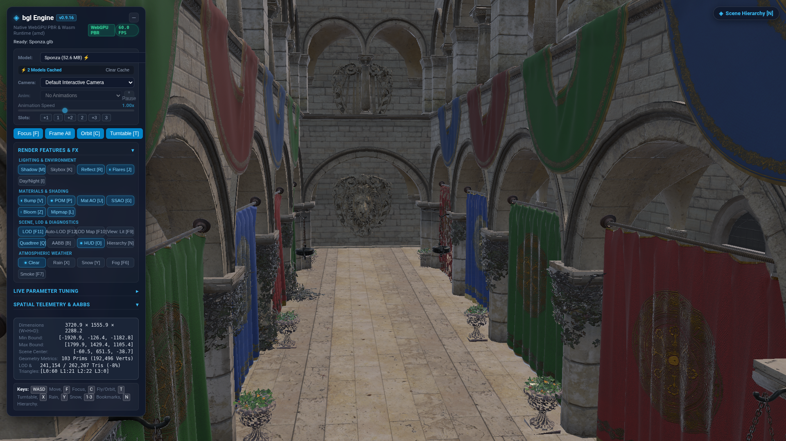
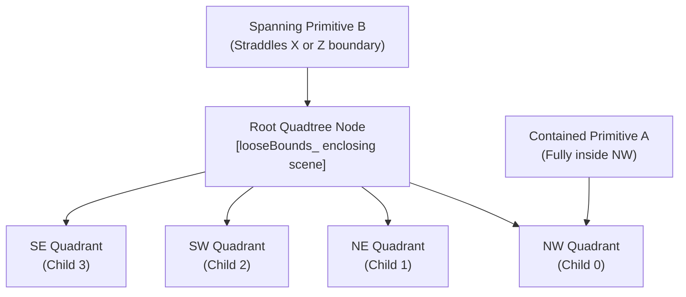

# bgl Engine (v1.0.0)

# 🎮 **[👉 RUN LIVE DEMO IN BROWSER (GitHub Pages / GitHack Preview) 👈](https://raw.githack.com/bkuolt/web-assembly-demo/main/web/index.html)**

[](https://raw.githack.com/bkuolt/web-assembly-demo/main/web/index.html)
[](https://bkuolt.github.io/web-assembly-demo/docs/)
[](https://en.cppreference.com/w/cpp/23)
[](tests/)
[](CHANGELOG.md)

## bgl Engine

**bgl Engine** is a modular C++23 3D graphics engine powered by WebGPU (`wgpu-native` on Linux desktop). It provides full glTF 2.0/2.1 PBR rendering, HDR Image-Based Lighting (IBL), Forward+ clustered lighting, directional PCF shadows, and a cinematic post-processing pipeline behind a clean, backend-free public API (`#include <bgl/bgl.hpp>`). The interactive desktop viewer in [`apps/viewer/`](apps/viewer/) is a reference application built on top of the engine.

### Quickstart (`samples/01_hello_engine/main.cpp`)

```cpp
// Minimal bgl Engine app: load a glTF model, orbit cleanly, and drive the sleek SDF GUI.
// Run from the repository root:  ./build/Release/sample_01_hello_engine
#include <bgl/bgl.hpp>

class HelloEngine : public bgl::App {
public:
    void OnStart() override {
        bgl::gui::SetDefaultFont("sans");
        if (auto result = GetEngine().LoadModel("assets/ToyCar.glb"); !result) {
            bgl::gui::ShowMessage("Load Failed", result.error(), bgl::gui::MessageType::Error);
        }
    }

    void OnUpdate(float deltaTime) override {
        if (bgl::Input::IsKeyPressed(bgl::Key::Escape)) {
            Quit();
        }
        if (autoOrbit_) {
            GetEngine().GetCamera().Orbit(0.3f * deltaTime, 0.0f);
        }
    }

    void OnGui() override {
        bgl::gui::Begin("Hello bgl");
        if (bgl::gui::Section("Scene Controls", true)) {
            bgl::gui::Slider("Exposure", GetEngine().Settings().exposure, 0.2f, 4.0f);
            bgl::gui::Tooltip("Adjust HDR camera exposure");
            bgl::gui::Checkbox("Auto Orbit", autoOrbit_);
            if (bgl::gui::Button("About bgl GUI")) {
                bgl::gui::ShowMessage("bgl Engine GUI",
                                      "Frosted-glass SDF widgets with hover highlights and OS font discovery.");
            }
        }
        bgl::gui::End();
    }

private:
    bool autoOrbit_{true};
};

BGL_RUN(HelloEngine)
```

```bash
task build
./build/Release/sample_01_hello_engine
```

### Core Concepts

| Concept | Role | Public Header |
| :--- | :--- | :--- |
| **`bgl::App` & `BGL_RUN`** | Lifecycle hooks (`OnStart`, `OnUpdate`, `OnGui`, `OnResize`, `OnFileDrop`, `OnShutdown`) | [`include/bgl/App.hpp`](include/bgl/App.hpp) |
| **`bgl::Engine`** | Facade owning window, GPU device, renderer, camera, and active scene | [`include/bgl/Engine.hpp`](include/bgl/Engine.hpp) |
| **`bgl::Input`** | Frame-buffered polling for keyboard & mouse (`IsKeyDown/Pressed/Released`, `MouseDelta`) | [`include/bgl/Input.hpp`](include/bgl/Input.hpp) |
| **`bgl::RenderSettings`** | Plain-data rendering & post-processing options applied automatically every frame | [`include/bgl/Settings.hpp`](include/bgl/Settings.hpp) |
| **`bgl::gui`** | Immediate-mode frosted-glass UI (`Begin`, `End`, `Section`, widgets, `Tooltip`, optional hover, `MessageBox`, `LoadingScreen`, `DiscoverFonts`/`LoadFont`/`SetDefaultFont`/`PushFont`) | [`include/bgl/Gui.hpp`](include/bgl/Gui.hpp) |
| **`bgl::Entity`** | Lightweight handle to a scene node (transform, parent/child hierarchy, punctual lights) | [`include/bgl/Entity.hpp`](include/bgl/Entity.hpp) |

### Using bgl Engine as a Library

```cmake
add_subdirectory(bgl-engine)                       # or FetchContent
target_link_libraries(my_game PRIVATE bgl::engine)
```

> **Note:** The Conan 2.x dependencies (`conanfile.py` / `conan.lock`) and `third_party/wgpu-native` must be available in your build environment. See [docs/GETTING_STARTED.md](docs/GETTING_STARTED.md) for details.

### Reference Viewer (`apps/viewer`)

The full-featured desktop viewer (`bgl_viewer`) lives in [`apps/viewer/`](apps/viewer/) as a reference application of the bgl Engine. See the keyboard shortcuts and CLI reference below, or [docs/ARCHITECTURE.md](docs/ARCHITECTURE.md) and [docs/CHEATSHEET.md](docs/CHEATSHEET.md) for engine internals.

---

Modular C++23 WebGPU & glTF 2.0/2.1 High-Performance 3D Renderer for Linux amd64 Desktop and WebAssembly (Wasm).


*Crytek Sponza Atrium (`assets/Sponza.glb`, 103 primitives, 69 PBR textures, 262,267 triangles) rendered in real time by **bgl-Engine v1.0.0** with Cook-Torrance GGX PBR, 16× Anisotropic Mipmapping, MikkTSpace Normal & Bump Mapping, Parallax Occlusion Mapping (POM), and Multi-Level Mesh & Shader LOD (`LOD0`–`LOD3`).*

> **🚀 Live Web Application & Online Documentation (GitHub):**
> - **GitHub Pages Web App:** [https://bkuolt.github.io/web-assembly-demo/](https://bkuolt.github.io/web-assembly-demo/)
> - **Direct Live Preview (GitHack, Instant):** [https://raw.githack.com/bkuolt/web-assembly-demo/main/web/index.html](https://raw.githack.com/bkuolt/web-assembly-demo/main/web/index.html)
> - **Online Doxygen API Reference (GitHub Pages):** [https://bkuolt.github.io/web-assembly-demo/docs/](https://bkuolt.github.io/web-assembly-demo/docs/) *(automatically built & deployed via CI from `Doxyfile`)*
> - **Web Architecture & Client Documentation:** [📖 Read `web/README.md`](web/README.md) for complete native WebGPU Cook-Torrance PBR specifications, zero-allocation rendering, and gesture guides.

---

## Overview

**bgl Engine** is a modern, high-performance 3D graphics engine built in strict C++23 with a hardware WebGPU backend (`wgpu-native` on desktop) paired with a browser viewer powered by a freestanding C++23 Emscripten WebAssembly core (`bgl_engine.wasm`) and a native JS WebGPU WGSL renderer (`BglWebGpuRenderer`). It features complete glTF 2.0 and KHR material model support, HDR rendering (RGBA16Float) with advanced tonemapping, GPU compute culling & ray picking, live RAM & VRAM telemetry, PS5 DualSense console controller feel, Parallax Occlusion Mapping (POM) with self-shadowing, Multi-Bounce Ambient Occlusion, Directional Sun Lens Flares, true Image-Based Lighting (IBL), Forward+ clustered lighting, zero-GLFW architecture, PMR-backed memory management, HarfBuzz & FreeType 2 text shaping, spatial Quadtree partitioning, procedural atmospheric skybox, and dual-target deployment.

### At a Glance: Feature & Capabilities Matrix

| Subsystem | Key Capabilities | Runtime Toggle / CLI |
| :--- | :--- | :--- |
| **Multi-Level LOD & Debug Views** | 4-stage Mesh & Shader LOD (`LOD0`–`LOD3`), Screen-Space Error (SSE) Quadtree selection, Shadow-Pass `LOD1`, $4\times 4$ Bayer dithered cross-fade, Adaptive 60 FPS Auto-LOD, and 7 Diagnostic Views (`Lit`, `LOD Heatmap`, `Normals`, `PBR`, `UV`, `Clay + Wireframe`, `Toon / Cel`) | `[F9]`–`[F12]` / `[;]`/`[']` / `--lod-bias` / `--lod-heatmap` / `--debug-view` |
| **SDF Glassmorphic Studio UI & Async Model Switcher** | Single-batch 2D SDF UI (`sdRoundedBox`, drop shadows, frosted HDR glass backdrop blur), draggable studio panels, scrollable 19-model glTF Dropdown (`assets/`, `web/assets/`, Khronos samples), non-blocking `std::jthread` loader with `ProgressBar` + frosted `DrawLoadingBanner`, FPS sparkline, interactive HSV `ColorEdit3`, and scissor scroll areas | `[F2]` / Studio UI Panel |
| **Cinematic Post-Processing Suite** | `Depth24Plus` -> `R32Float` linear depth resolve, half-res Depth GTAO + bilateral blur, 5-mip Jimenez Bloom pyramid, GPU Auto-Exposure, Hi-Z SSR reflections, Vogel bokeh DoF, depth-gated Sun God Rays, edge chromatic aberration, 5 Color Grading presets, Film Grain, and FXAA 3.11 | Studio UI / `[X]` / `[Z]` / `[G]` / `[J]` |
| **Extended KHR PBR & Shaders** | `KHR_materials_iridescence` thin-film interference, `KHR_materials_anisotropy`, wrapped SSS backlight, roughness-aware 5-mip frosted refraction glass, 3D selection silhouette rim (`outline.wgsl`), procedural rain puddles, and Rayleigh/Mie + FBM volumetric cloud skybox | Automatic / Studio UI |
| **glTF 2.0 Animations & Skinning** | Full skeletal animation (128 joints with inverse bind matrices), morph target delta blending, decoupled TRS local transforms, and keyframe interpolation (`LINEAR`, `STEP`, `CUBICSPLINE` Hermite) | Automatic / glTF Animations |
| **Native WebGPU PBR Engine** | Hardware-accelerated native WebGPU browser engine (`BglWebGpuRenderer`, Cook-Torrance GGX PBR, 7-slot multi-texture bind groups, WGSL shaders, Khronos PBR Neutral tonemapping) | Automatic / Native WebGPU |
| **GPU Compute Offloading** | Parallel view-frustum culling (`GpuCuller`) and parallel ray-bounding picking (`GpuRayPicker`) using WebGPU compute shaders and atomic operations | Automatic / Live GPU compute |
| **RAM & VRAM Telemetry** | Real-time resident set size (RAM in MB) from OS kernel and atomic WebGPU VRAM buffer/texture tracking displayed on in-engine HUD | In-Engine HUD (`[O]` / `[F3]`) |
| **PS5 DualSense Feel** | Native DualSense recognition (`0x054c`), exponential aim response curve ($mag^{2.1}$), pitch dampening ($0.70$), smooth look damping, and rumble | Auto-detected / HUD Badge |
| **Click-Picking & Outline** | Ray unprojection with Möller-Trumbore triangle picking, vibrant 3D selection outline, bidirectional sync with hierarchy tree | Click in 3D / Click in tree |
| **Focus [F] & Bookmarks** | `[F]` frames selection, `Home` frames scene, 9 viewpoints saved/recalled via `Ctrl+1..9` / `1..9` or UI slots | `[F]` / `[Home]` / `[1]`–`[9]` |
| **Fly / WASD & Turntable** | Dual navigation modes (Orbit & Fly for walking Sponza interior) plus continuous turntable autorotation with speed slider | `[C]` / `[T]` / UI buttons |
| **glTF Cameras from File** | Complete parsing of perspective and orthographic `fastgltf::Camera` instances mapped to scene transforms, selectable via dropdown | UI Camera Dropdown |
| **Touch Controls (Web)** | 1-finger orbit, 2-finger pinch-zoom, and 2-finger pan gestures with event prevention for mobile/tablet browsers | Touch gestures on canvas |
| **Dual Gamepad Support** | Native `SDL_GameController` on desktop, HTML5 Web Gamepad API in browser, 0.12 radial deadzone, dual-stick orbit/fly/pan | Gamepad sticks & triggers |
| **Live Sun / Day-Night Cycle** | Dynamic 24-hour diurnal progression (`[I]` / `[F8]`) with golden-hour sunset & lunar night lighting; Skybox, PCF shadows, lens flares, and specular highlights follow live | `[I]` / `[F8]` / Slider / `--day-night-cycle` |
| **Alpha-Tested Shadows** | Directional shadow pre-pass tests material textures and cutoff ($\alpha < \alpha_{\text{cutoff}}$) for `MASK` and `BLEND` foliage/cutouts, casting accurate silhouette shadows | Automatic (`alphaMode == MASK`) |
| **Screen-Space AO (SSAO/GTAO)** | Real-time depth/contrast horizon gradient sampling complementing material occlusion maps and micro-cavities | `[G]` / Slider / HUD |
| **HDR Emissive Bloom** | Linear HDR bright-pass extraction with golden-angle multi-ring scatter glow for radiant emissive materials | `[Z]` / Slider / HUD |
| **True Transmission & Refraction** | Full `KHR_materials_volume` support, view-space Snell's law screen refraction, and physical Beer-Lambert volume extinction | Automatic (`KHR_materials_volume`) |
| **Native Compressed Textures** | Automatic KTX2 Basis Universal transcoding to native BC7, ASTC 4×4, or ETC2 based on WebGPU adapter capabilities | Automatic GPU feature detection |
| **Parallax Occlusion Mapping (POM)** | Steep parallax raymarching (8–32 view-adaptive layers) with secant interpolation and light-facing self-shadowing for deep 3D surface immersion | `[P]` / Slider / HUD |
| **Atmospheric Weather (Rain, Snow, Fog, Smoke)** | Directional rain streaks & droplet ripples (`[X]`/`[F4]`), drifting snowflakes & accumulation (`[Y]`/`[F5]`), exponential height/distance mist (`[F6]`), and rising turbulent FBM smoke plumes (`[F7]`) | `[X]`/`[Y]`/`[F4]`–`[F7]` / `--rain` / `--snow` / `--fog` / `--smoke` |
| **Ambient Occlusion (AO)** | glTF occlusion texture + micro-cavity + horizon contact + Jimenez multi-bounce color conservation with live intensity tuning | `[U]` / Slider / `--no-ao` |
| **Directional Sun Lens Flares** | Real-time post-processing lens flare with solar corona glow, anamorphic horizontal streaks, chromatic ghosts, optical halo rings, and screen-edge fade | `[J]` / Slider / HUD |
| **Full Keyboard Navigation** | Smooth WASD & Arrow key 3D camera pan/fly, `+` / `-` keys for zoom in / out with step clamping | `[W]`/`[A]`/`[S]`/`[D]` / `[+]`/`[-]` |
| **HDR Rendering & Tonemapping** | Multisampled 4× MSAA `RGBA16Float` HDR render targets, Khronos PBR Neutral, AgX (Blender 4 curve), and ACES Filmic tonemapping with dynamic exposure control | `[X]` / `[+]`/`[-]` / `--exposure` |
| **Image-Based Lighting (IBL)** | WebGPU Compute-generated Split-Sum BRDF LUT ($128\times 128$ RGBA16F), pre-filtered GGX specular cubemap mip chains, and $L_2$ Spherical Harmonics diffuse irradiance | `[E]` / `--env <preset>` |
| **Rotatable HDR Environments** | 4 built-in environments (*Mediterranean Courtyard*, *Sunset Studio*, *Overcast Atelier*, *Night Neon*) plus custom `.hdr`/`.exr` ingestion, 360° rotation, Sharp/Blurred/Hidden skybox modes | `[E]` / `[K]` / `--env-rot` |
| **Clustered Forward+ Lighting** | glTF `KHR_lights_punctual` (Directional, Point, Spot lights) evaluated across a $16\times 8\times 8 = 1024$ 3D frustum cluster grid with per-cluster bitmasks | Automatic / glTF Lights |
| **Native GPU Compressed Textures** | Hardware BC7, ASTC 4×4, and ETC2 EAC decompression directly via WebGPU features without CPU decompression overhead | Automatic GPU feature detection |
| **Bump & Normal Mapping** | MikkTSpace/Lengyel tangent generation, scale-invariant `getTBN`, tangent-space normal maps + UV-texel-space central-difference height gradients (`textureSampleGrad`) | `[V]` / `--no-bump` |
| **Anisotropic Mipmapping** | GPU render-pass mip pyramid ($1\times 1$) with 3D normal-map vector renormalization (`mipgen.wgsl`), CPU mip-level helpers, pre-encoded KTX2 mips, and live 16× Aniso vs. Mip-0 switching | `[L]` / `--no-mipmaps` |
| **Directional Shadow Mapping** | $2048\times 2048$ `Depth32Float` pre-pass (cached for static scenes), scene-fitted `orthoRH_ZO` light matrix, hardware slope-scale depth bias, 9-tap $3\times 3$ PCF soft shadows | `[M]` / `--no-shadows` |
| **Spatial Quadtree & Occlusion Culling** | 4-way XZ-plane partitioning, Front-to-Back traversal, $32\times 16$ Hi-Z `OcclusionBuffer` & sub-pixel culling, single-draw batched 3D wireframes | `[H]` / `[Q]` / `--no-occlusion` |
| **URL & Remote Asset Streaming** | Direct `http://`, `https://`, `file://`, and `data:` model loading via **`libcurl`** (native) and Fetch API (Wasm), URL Drag-and-Drop, and external `.gltf` buffer/texture URI resolution | `--asset <url>` / Drag & Drop |
| **3D Bounding Boxes (AABBs)** | Fast Arvo Center-Extents transformation ($c' = M \cdot c$, $e'_k = \sum_j |M_{jk}| e_j$) rendered in a single batched GPU draw call | `[B]` / `--no-bounds` |
| **Atmospheric Skybox** | Rayleigh-inspired zenith-to-horizon scattering, solar disk & corona, ground hemisphere bounce, far-plane depth clamping | `[K]` / `--no-skybox` |
| **HarfBuzz & FreeType 2 HUD** | Dynamic $1024\times 1024$ RGBA8 shelf-packed font atlas, Unicode shaping, zero-dependency embedded TTF fallback, live telemetry overlay | `[O]` / `[F3]` / `--no-hud` |
| **Browser Compatibility Warnings** | Automated pre-flight validation of WebAssembly, WebGPU API, GPU adapter acquisition, and Secure Context (HTTPS/localhost) with user diagnostics | Automatic (Web) |

### Key Architecture Highlights

- **100% Modern C++23 & Root Namespace `bgl`**:
  - `bgl::core`: Math, types, AABB, ray intersection, camera, memory pools, PMR arenas, POSIX signal handling, C++23 `std::stacktrace` crash diagnosis, logging.
  - `bgl::gpu`: WebGPU device context, swapchain surface, 4x MSAA, WGSL PBR shaders, procedural atmospheric skybox, batched single-draw 3D wireframe bounding boxes.
  - `bgl::scene`: High-speed multithreaded glTF ingestion (`fastgltf`), modular KTX / PNG / JPEG / WebP decoders with CMake toggles, Basis Universal transcoding, 16x anisotropic texture filtering with full CPU mip-mapping, spatial Quadtree partitioning with loose bounds, Möller-Trumbore ray picking.
  - `bgl::text`: Dynamic RGBA8 font atlas, FreeType 2 glyph rasterization, HarfBuzz Unicode script and bidi text shaping, batched 2D quad renderer with alpha blending.
  - `bgl::ui`: In-engine glassmorphism Debug Overlay HUD displaying real-time FPS, frame timing, camera coordinates, glTF scene metrics, and spatial culling telemetry.
  - `bgl::audio`: 3D spatial sound engine via `miniaudio`.
  - `bgl::engine` & `bgl` (`include/bgl/`, `src/engine/`): Backend-free public engine SDK (`Engine`, `App`, `Input`, `RenderSettings`, `gui`, `Entity`) and `EngineCore` runtime.
  - `bgl::app` (`apps/viewer/`): Reference desktop viewer inheriting from `EngineCore`, CLI argument parser (`--help`, `--version`, `--formats`, `--asset`, etc.), studio UI, and debug HUD.
- **Robust Spatial Partitioning & Frustum Culling**:
  - Hierarchical 4-way Quadtree partitioning on the XZ ground plane with loose bounding boxes (`looseBounds_`) and strict `ContainsXZ` containment.
  - Primitives spanning across quadrant boundaries are held safely at their parent node, completely preventing disappearing geometry or pop-in artifacts.
  - Broad-phase view frustum rejection eliminates whole quadrant subtrees; narrow-phase tests discard individual off-screen primitives.
  - Sponza benchmark demonstrates **60% to 82% primitive culling ratios** from the central courtyard.
  - Batched AABB rendering: all scene, primitive, and quadtree wireframe bounding boxes are drawn in a **single GPU draw call** with per-vertex colors (Gold for scene, Cyan for primitives, Emerald green for quadtree partitions).
- **POSIX Crash Signal Handler & Callstack Diagnostics**:
  - Catches `SIGSEGV`, `SIGABRT`, `SIGFPE`, `SIGILL`, and `SIGBUS` via `sigaction` with an alternate signal stack (`sigaltstack`).
  - Safe, immediate async-signal-safe error logging: signal name, fault address, PID, and TID.
  - Dual stack unwinding: raw `execinfo` backtrace plus demangled C++23 `std::stacktrace` with function signatures and file line numbers.
  - Intentional test crashes accessible via `--test-crash [segv|abrt|fpe]`.
- **Modular Texture Format CMake Options (All ON by Default)**:
  - `-DBGL_ENABLE_PNG=ON/OFF` (libpng)
  - `-DBGL_ENABLE_JPEG=ON/OFF` (libjpeg-turbo with custom `setjmp` error handling)
  - `-DBGL_ENABLE_WEBP=ON/OFF` (libwebp)
  - `-DBGL_ENABLE_KTX=ON/OFF` (libktx 4.4.2)
  - Queryable at runtime via `./bgl_viewer --formats` or `TextureDecoder::GetSupportedFormats()`.
- **Multithreaded glTF Asset Ingestion**:
  - Lock-free parallel texture decoding across hardware worker threads (`std::jthread`, `std::atomic<size_t>` task dispatch).
  - Parallel scene node extraction, transform hierarchy evaluation, and mesh primitive parsing (vertex attributes, bounding boxes, indices).
  - Sub-second loading of large scenes like Sponza (69 multi-megabyte textures decoded concurrently).
- **KTX & KTX2 Texture Support with Basis Universal Transcoding**:
  - Full KTX1 and KTX2 container ingestion via `libktx` (`ktx/4.4.2`).
  - Automatic on-the-fly transcoding of Basis Universal compressed textures (UASTC and ETC1S) to 32-bit RGBA (`KTX_TTF_RGBA32`).
  - Content-based magic-byte sniffing (`\xABKTX 11\xBB` and `\xABKTX 20\xBB`), MIME type detection, and path extension routing.
- **HarfBuzz & FreeType 2 Text Rendering Pipeline**:
  - Cross-platform OS and workspace font discovery (`FontLibrary::Discover`/`Find`) supporting `.ttf`/`.otf`/`.ttc` collections and generic aliases (`"sans"`, `"mono"`, `"serif"`, `"embedded"`).
  - Precise Unicode text shaping (`TextShaper::Shape`, `Measure`, word-aware `WrapText`) via HarfBuzz (`hb_buffer_t`, `hb_shape`).
  - High-fidelity alpha & SDF glyph rasterization via FreeType 2 into dynamic 1024x1024 RGBA8 atlases with up to 4 Unicode fallback faces (`AddFallbackFromFile` / `AddFallbackFromMemory`).
  - Zero-dependency embedded fallback font (Liberation Mono Regular) allowing standalone execution anywhere.
  - Multi-font batched 2D WebGPU rendering (`TextRenderer` with `SetFontAtlas`/`MeasureText`/`DrawTextAligned`, 4x MSAA compatibility, and automatic atlas generation tracking).
- **AAAA Visual Fidelity & Real-Time Rendering Features (Toggleable On/Off)**:
  - **Bump & Normal Mapping (`[V]` / `--no-bump`)**: Lengyel/MikkTSpace-style automatic tangent & bitangent basis generation (`MeshPrimitive::ComputeTangents()`), Gram-Schmidt orthogonalization in WGSL, tangent-space normal mapping, and screen-space derivative height bump perturbation (`dHdX`, `dHdY`).
  - **Mipmapping Support (`[L]` / `--no-mipmaps`)**: GPU render-pass mip-chain generation (`mipgen.wgsl`) down to $1\times 1$ texels with 3D vector renormalization for normal maps, CPU mip helpers, and live runtime switching between 16x Anisotropic Trilinear Mipmapping and Base-Mip-0-Only sampling.
  - **Directional Shadow Mapping (`[M]` / `--no-shadows`)**: $2048\times 2048$ `Depth32Float` directional shadow depth pre-pass fitted to the scene AABB (`glm::orthoRH_ZO`), hardware depth bias, and 9-tap $3\times 3$ Percentage-Closer Filtering (PCF) soft shadows via `textureSampleCompareLevel`.
  - **Environment Cubemap Reflections (`[R]` / `--no-reflections`)**: 6-face pre-filtered HDR-style atmospheric environment cubemap ($64\times 64\times 6$ with 7 roughness-convolved mip levels), Karis split-sum analytic `envBRDFApprox`, and clearcoat environment reflections.
  - **Sponza Benchmark Scene**: Loaded by default with human eye-level courtyard camera positioning (`courtyardCenter = (-0.48, 2.0, -0.31)`, `camDistance = 10.0m`).
  - **Procedural Atmospheric Skybox (`[K]` / `--no-skybox`)**: Rayleigh-like zenith-to-horizon gradients, solar corona, and far-plane depth clamping.
- **Complete glTF 2.0 & KHR Material Model**:
  - Core PBR Metallic-Roughness (Cook-Torrance GGX $D$, Smith-GGX $V$, Schlick Fresnel $F$).
  - Tangent-space Normal Mapping (with vertex `TANGENT` ingestion and screen-space derivative fallbacks).
  - Ambient Occlusion (AO) with configurable strength.
  - Emissive maps with strength multipliers (`KHR_materials_emissive_strength`).
  - Clearcoat lacquer layer (`KHR_materials_clearcoat`).
  - Transmission and dielectric refraction (`KHR_materials_transmission`, `KHR_materials_ior`).
  - Charlie microfiber sheen for textiles and fabrics (`KHR_materials_sheen`).
  - Specular color and factor tinting (`KHR_materials_specular`).
  - Double-sided rendering and unlit shading (`KHR_materials_unlit`).
  - Alpha modes: `Opaque`, `Mask` (alpha cutoff discard), and `Blend`.
- **Zero-GLFW Architecture**:
  - **Linux Desktop**: Native SDL2 windowing and hardware event handling.
  - **WebAssembly / Browser**: Freestanding C++23 Emscripten WebAssembly core (`src/wasm/wasm_bridge.cpp`, `web/dist/bgl_engine.wasm`) with zero WASI imports, paired with the native JS WebGPU (`BglWebGpuRenderer`) frontend (with `BGL_PLATFORM_WASM` C++ guards prepared for future direct Emscripten `emdawnwebgpu` binding).
- **Reproducible Conan 2.x Dependency Management**:
  - All third-party dependencies resolved via Conan 2.x with explicit lockfile pinning (`conan.lock`).
  - FreeType (`freetype/2.13.2`), HarfBuzz (`harfbuzz/11.4.1`), KTX (`ktx/4.4.2`), and miniaudio (`miniaudio/0.11.25`).
  - Zero system library divergence across build environments.

---

## Repository Structure

```text
.
├── CMakeLists.txt                     # Modern target-based CMake configuration (C++23 + optional Doxygen target)
├── CMakePresets.json                  # Release, Clang, ASan, UBSan & TSan build/test presets
├── CHANGELOG.md                       # Complete release history (v0.6.0 -> v1.0.0+)
├── Doxyfile                           # Online-ready Doxygen + Graphviz SVG API documentation config
├── Taskfile.yml                       # Developer workflow tasks (format, lint, build, test, docs, web)
├── conanfile.py                       # Conan 2.x package recipe
├── conan.lock                         # Deterministic dependency lockfile
├── docs/
│   ├── modules.dox                    # Doxygen @defgroup & namespace overview across all bgl subsystems
│   └── FEATURE_AND_PHYSICS_REPORT.md  # Architecture roadmap & Jolt physics integration blueprint
├── assets/
│   ├── Sponza.glb                     # High-detail Sponza architectural benchmark scene
│   ├── ToyCar.glb                     # Benchmark glTF model (Clearcoat, Sheen, Transmission, AO)
│   ├── env/                           # Optional local environment presets
│   └── fonts/
│       └── LiberationMono-Regular.ttf # High-legibility monospace font
├── src/
│   ├── core/                          # -> libbgl_core.so
│   │   ├── Camera.hpp/.cpp            # Orbit, Pan, Zoom, Fly camera with WebGPU projection
│   │   ├── CrashHandler.hpp/.cpp      # POSIX crash interception, signal handling & C++23 stacktrace
│   │   ├── Gamepad.hpp/.cpp           # Controller support with 0.12f deadzone calibration & PS5 curve
│   │   ├── Log.hpp/.cpp               # spdlog integration and RAII ScopedTimer profiling
│   │   ├── MemoryPool.hpp/.cpp        # Block memory pool & PMR scratch arena
│   │   ├── MemoryTracker.hpp/.cpp     # Process RSS RAM & atomic WebGPU VRAM accounting
│   │   ├── NetworkFetcher.hpp/.cpp    # libcurl / local chunked streaming with progress & cancellation
│   │   ├── ThreadPool.hpp/.cpp        # Work-stealing centralized thread pool
│   │   ├── Types.hpp                  # AABB, Ray, Frustum, 96-byte (16-aligned) Vertex, Result<T>
│   │   └── Version.hpp(.in)           # Engine version constants generated from CMake project version
│   ├── gpu/                           # -> libbgl_gpu.so
│   │   ├── AabbRenderer.hpp/.cpp      # Batched 3D wireframe bounding box renderer
│   │   ├── Context.hpp/.cpp           # Hardware WebGPU device, MSAA, readable depth & swapchain surface
│   │   ├── DrawHelpers.hpp            # Shared per-draw UBO/skin/morph helpers & DynamicInstanceBuffer
│   │   ├── GpuCuller.hpp/.cpp         # Parallel WebGPU compute frustum culling
│   │   ├── GpuRayPicker.hpp/.cpp      # Two-pass WebGPU compute ray-AABB picker
│   │   ├── Handle.hpp                 # Zero-overhead RAII WebGPU Handle<> wrappers
│   │   ├── Pipeline.hpp/.cpp          # 4-group PBR pipelines, state caching & shader reload
│   │   ├── PipelineRender.cpp         # Frame staging, clustered Forward+, shadows & Opaque/Transparent passes
│   │   ├── PipelineEffects.cpp        # Compute/render GPU mip chains, opaque copy mips & selection outlines
│   │   ├── PipelineIBL.cpp            # Compute BRDF LUT, GGX prefiltering & L2 SH irradiance
│   │   ├── PipelineScene.cpp          # Scene upload, morph SSBO, skinning & draw emission
│   │   ├── PipelineHelpers.hpp        # Internal FP16/cubemap/material uniform helpers
│   │   ├── PostProcessPass.hpp/.cpp   # Cinematic post-process pipelines & resize management
│   │   ├── PostProcessPassRender.cpp  # Depth linearize, GTAO, Bloom, Auto-Exposure, SSR, DoF & FXAA execution
│   │   ├── PostProcessPassTargets.cpp # Fullscreen post-processing pipeline creation & resize target allocation
│   │   ├── PostProcessHelpers.hpp     # Shared internal post-processing uniform & fullscreen draw helpers
│   │   ├── ShaderManager.hpp/.cpp     # Modular .wgsl loader, #include preprocessor, #embed & hot-reload
│   │   ├── Shaders.hpp                # ShaderManager-backed WGSL entry-point accessors
│   │   ├── ShadowPass.hpp/.cpp        # Directional depth pre-pass with Quadtree light-frustum culling
│   │   ├── Skybox.hpp/.cpp            # Procedural Rayleigh/Mie + FBM volumetric cloud skybox
│   │   ├── Uniforms.hpp               # DynamicUniformRing<PerDrawUniforms>, MaterialUniforms, SceneLightingUniforms
│   │   └── shaders/                   # Modular .wgsl PBR, compute, outline, weather, skybox & post shaders
│   ├── scene/                         # -> libbgl_scene.so
│   │   ├── Animation.hpp/.cpp         # Keyframe sampler (STEP, LINEAR, CUBICSPLINE), skinning & morphs
│   │   ├── AssetManager.hpp/.cpp      # 64-bit FNV-1a caching and PMR geometry allocation
│   │   ├── FastGltfLoader.hpp/.cpp    # Async progress glTF/GLB orchestrator & external buffer resolver
│   │   ├── FastGltfInternal.hpp       # Shared ProgressReporter and internal parser stage declarations
│   │   ├── FastGltfParser.cpp         # Parallel mesh primitive parsing, decimation/LOD & image decode stages
│   │   ├── FastGltfSceneBuilder.cpp   # Material, light, instancing, hierarchy, camera, skin & animation builders
│   │   ├── Quadtree.hpp/.cpp          # 4-way XZ spatial partition, Refit(), Hi-Z occlusion & SSE LOD
│   │   ├── RayPicker.hpp/.cpp         # Hierarchical Möller-Trumbore ray-triangle intersection
│   │   ├── Scene.hpp/.cpp             # Scene graph, GPU morph/skin helpers, QEM/grid LODs & tangents
│   │   └── TextureDecoder.hpp/.cpp    # PNG, JPEG, WebP, KTX2, HDR & EXR decoding
│   ├── text/                          # -> libbgl_text.so
│   │   ├── EmbeddedFont.hpp/.cpp      # Zero-dependency embedded TrueType font data
│   │   ├── FontAtlas.hpp/.cpp         # FreeType 2 alpha/SDF rasterizer & Unicode fallback face atlas
│   │   ├── FontLibrary.hpp/.cpp       # Cross-platform OS/asset font discovery & smart query resolver
│   │   ├── TextShaper.hpp/.cpp        # HarfBuzz Unicode shaper, layout measurement & word wrapping
│   │   └── TextRenderer.hpp/.cpp      # WebGPU 2D batched quad/aligned text renderer with atlas sync
│   ├── ui/                            # -> libbgl_ui.so
│   │   ├── DebugOverlay.hpp/.cpp      # In-engine glassmorphism HUD telemetry overlay
│   │   ├── ImmediateUI.hpp/.cpp       # Core SDF/text batching, PMR arena, multi-font slots & hover animation
│   │   ├── ImmediateUIGpu.cpp         # WebGPU shader/pipeline/bind-group switching & batched submission
│   │   ├── ImmediateUIModals.cpp      # Frosted-glass MessageBox, LoadingScreen, LoadingBanner & FloatingBadge
│   │   ├── ImmediateUIOverlays.cpp    # Dropdowns, scroll areas, progress bars, popups & UI facade
│   │   ├── ImmediateUIWidgets.cpp     # Immediate-mode studio widgets with optional animated hover effects
│   │   └── shaders/ui.wgsl            # Analytical 2D SDF, Gaussian shadow & frosted glass UI shader
│   ├── audio/                         # -> libbgl_audio.so
│   │   └── SoundEngine.hpp/.cpp       # 3D spatial audio listener and sound source management
│   ├── engine/                        # -> libbgl_engine.so
│   │   ├── EngineCore.hpp/.cpp        # Reusable runtime (window, GPU, scene, render loop)
│   │   ├── EngineCoreScene.cpp        # Scene activation, ray picking, camera cycling & diurnal sun controls
│   │   ├── Engine.cpp / EngineImpl.*  # Public bgl::Engine Pimpl facade & RenderSettings diffing
│   │   ├── App.cpp / Gui.cpp          # bgl::App lifecycle runner & bgl::gui helpers
│   │   ├── Input*.hpp/.cpp            # bgl::Input polling state & native SDL2 backend
│   │   └── Entity*.hpp/.cpp           # bgl::Entity handle & CPU scene-graph ops
│   └── wasm/
│       └── wasm_bridge.cpp            # Freestanding C++23 Emscripten C-ABI bridge (`bgl_engine.wasm`)
├── include/bgl/                       # Public SDK headers (#include <bgl/bgl.hpp>)
│   ├── bgl.hpp                        # Umbrella header
│   ├── App.hpp / Engine.hpp           # Application lifecycle & engine facade
│   ├── Entity.hpp / Gui.hpp           # Scene entity handle & immediate-mode debug UI
│   ├── Input.hpp / Settings.hpp       # Polling input & plain-data RenderSettings
│   └── Types.hpp                      # Public Result<T>, Camera, CameraMode & GLM types
├── apps/viewer/                       # -> libbgl_viewer_lib.so + bgl_viewer (Reference App)
│   ├── Application.hpp/.cpp           # Viewer-specific shortcuts, HUD, turntable & studio UI
│   ├── ApplicationInput.cpp           # Desktop SDL2 keyboard shortcuts & camera bookmark hotkeys
│   ├── ApplicationModelLoader.cpp     # 19-model preset catalog, async worker lifecycle & node picking
│   ├── ApplicationUI.cpp              # Per-section SDF UI studio builders & selection badge
│   ├── CommandLine.hpp/.cpp           # CLI argument parsing, help screen, and format inspection
│   ├── main.cpp                       # Native desktop viewer entry point
│   └── WebExports.cpp                 # Emscripten C-ABI bridge exports for full-engine browser builds
├── samples/                           # Standalone engine samples (only #include <bgl/bgl.hpp>)
│   ├── 01_hello_engine/main.cpp       # Minimal model load, orbit camera, and exposure slider
│   └── 02_entities_and_lights/main.cpp # Scene entities and orbiting punctual point light
├── tests/                             # C++ GTest (284 tests across 38 suites) + Web Unit/E2E suites
│   ├── test_main.cpp
│   ├── test_types_math.cpp            # AABB, Ray, Plane, Frustum culling math, 96-byte Vertex layout
│   ├── test_camera.cpp                # Orbit, Pan, Zoom, ScreenPointToRay unprojection, bookmarks
│   ├── test_memory_pool.cpp           # MemoryPool, multi-block chaining, free-list reuse, ScratchArena
│   ├── test_asset_manager.cpp         # FNV-1a 64-bit hashing, caching, texture deduplication
│   ├── test_quadtree_lod.cpp          # Quadtree subdivision, Refit(), loose bounds, SSE LOD, culling
│   ├── test_ray_picker.cpp            # Möller-Trumbore ray-triangle hit/miss, hierarchical picking
│   ├── test_gltf_loader.cpp           # ToyCar glTF, KHR extensions, async progress, cancel & presets
│   ├── test_texture_decoders.cpp      # PNG, JPEG, WebP, KTX2, HDR, EXR, magic-byte sniffing
│   ├── test_text_rendering.cpp        # FreeType rasterization, HarfBuzz shaping, SDF & Advanced Widgets
│   ├── test_crash_handler.cpp         # POSIX signal handler installation & stacktrace generation
│   ├── test_command_line.cpp          # CLI argument parsing and feature toggles
│   ├── test_rendering_features.cpp    # ShaderManager, DynamicUniformRing, Blending, PBR, Shadows, IBL
│   ├── test_golden_image.cpp          # Deterministic golden checksum & instanced asset checks
│   ├── test_animation.cpp             # Skeletal skinning, morph targets & TRS keyframe interpolation
│   ├── test_thread_pool.cpp           # Work-stealing ParallelFor, nested tasks & synchronization
│   ├── test_audio_engine.cpp          # Spatial 3D audio engine & file safety
│   ├── test_render_settings.cpp       # RenderSettings defaults parity & equality diff tests
│   ├── test_input_state.cpp           # Frame-buffered InputState & bgl::Input forwarding tests
│   ├── test_entity.cpp                # Scene graph reparenting, cycle guard & Entity handle safety
│   ├── test_engine_api.cpp            # Live Engine API, gui safety & scene reload invalidation
│   ├── test_web_unit.js               # 72 Node.js web math, shader, glTF, frustum & LOD unit tests
│   ├── test_webgpu_path.js            # 12-step headless WebGPU pipeline + real bgl_engine.wasm verification
│   └── test_browsers_e2e.py           # Playwright/Selenium Firefox & Chrome native WebGPU E2E checks
├── scripts/
│   ├── check_layering.py              # Module header dependency & public-SDK boundary checker (LayeringCheck)
│   ├── doxygen_md_filter.py           # Doxygen GFM math & alert preprocessor filter
│   ├── package_web.py                 # Minimal web app distribution packager
│   └── run_ci_locally.sh              # Local mirror of CI formatting, build, test & smoke stages
└── web/                               # Web viewer client & local WebGPU sample models
    ├── README.md                      # WebGPU client technical & shader pipeline guide
    ├── index.html                     # Interactive UI (Tree Diagram, JSON Inspector, Telemetry Card)
    ├── style.css                      # Modern dark-mode responsive glassmorphism styles
    ├── app.js                         # UI coordinator, frame scheduler & startup bootstrap
    ├── gltf_worker.js                 # Dedicated Web Worker for glTF/GLB parsing & base64 decoding
    ├── assets/                        # Web-served GLB models (ToyCar, Sponza, RobotExpressive, Soldier)
    ├── js/
    │   ├── core.js                    # Logging, notifications, state, UI cache & WASM bridge
    │   ├── gltf.js                    # glTF/GLB parser, scene graph builder & telemetry
    │   └── renderer.js                # Modular WebGPU Cook-Torrance PBR renderer
    └── dist/                          # Precompiled WebAssembly binary (`bgl_engine.wasm`)
```

---

## Advanced Real-Time Rendering Pipeline (Clustered Forward+ PBR & Cinematic Post-Processing)

Every frame records a multi-pass WebGPU command stream into the active `WGPUCommandEncoder`: a **Directional Shadow Depth Pre-Pass** (`2048×2048 Depth32Float`), a **4× MSAA Split HDR Forward+ PBR Pass** (`Opaque` -> `Opaque Copy 5-Mip Chain` -> `Atmospheric Skybox` -> `Transparent & Transmission` + `Selection Outline`), the **`PostProcessPass` Suite** (`Depth Linearize` -> `Half-Res GTAO + Bilateral Blur` -> `5-Mip Bloom` -> `GPU Auto-Exposure` -> `Hi-Z SSR / Bokeh DoF / God Rays / Color Grading / Tonemapping` -> `FXAA 3.11`), and the final **2D SDF Studio UI & HarfBuzz Overlay**.

```mermaid
flowchart LR
    subgraph Pass1["1. Shadow Depth Pre-Pass (2048×2048 Depth32Float)"]
        LightMat["ComputeDirectionalLightMatrix()\nOrthoRH_ZO fitted to Scene AABB"]
        QuadShadow["Quadtree Frustum Culling\n(Light Space)"]
        ShadowVS["shadow.wgsl (LOD1 / Mask Discard)"]
        ShadowTex["shadowDepthTexture_\n(Hardware Depth Bias)"]
        LightMat --> QuadShadow --> ShadowVS --> ShadowTex
    end

    subgraph Pass2["2. 4× MSAA Split HDR PBR Pass (RGBA16Float)"]
        Opaque["Opaque PBR Pass\n1024-Cluster Forward+ & IBL"]
        OpaqueMip["5-Mip Opaque Copy\n(Rough Frosted Transmission)"]
        Skybox["Rayleigh/Mie + FBM Skybox"]
        Trans["Transparent & Volume Refraction\n+ 3D Selection Outline"]
        Opaque --> OpaqueMip --> Skybox --> Trans
    end

    subgraph Pass3["3. Cinematic Post-Process & SDF UI"]
        Post["Depth Linearize + Half-Res GTAO\n5-Mip Bloom + Auto-Exposure\nHi-Z SSR + DoF + God Rays + FXAA"]
        UI["ImmediateUI SDF Studio\n(Frosted Glass Backdrop)\n+ HarfBuzz Debug Overlay"]
        Post --> UI
    end

    ShadowTex -->|"Group 0 Depth + Comparison Sampler"| Opaque
    Trans --> Post
```



### 1. Bump Mapping & Tangent-Space Normal Mapping (`[V]` / `--no-bump`)
- **MikkTSpace / Lengyel Tangent Generation (`MeshPrimitive::ComputeTangents()`):**
  When a glTF primitive omits explicit `TANGENT` attributes, the loader computes per-vertex tangents $\mathbf{T}$ and bitangents $\mathbf{B}$ from triangle edges $(\Delta \mathbf{p}_1, \Delta \mathbf{p}_2)$ and UV deltas $(\Delta u_1, \Delta v_1, \Delta u_2, \Delta v_2)$, orthogonalized via Gram-Schmidt against the vertex normal $\mathbf{N}$:
  $$\mathbf{T}' = \text{normalize}\!\left(\mathbf{T} - \mathbf{N}(\mathbf{N} \cdot \mathbf{T})\right), \quad w = \text{sign}\!\left((\mathbf{N} \times \mathbf{T}) \cdot \mathbf{B}\right) \in \{-1, +1\}$$
- **Dual Normal & Screen-Space Height Bump Perturbation:**
  In `kPbrShaderWGSL`, when `MaterialFlags::EnableBumpMapping` is active, tangent-space normal maps (`normalTexture`) are combined with screen-space height derivatives (`dpdx(height)`, `dpdy(height)`) to perturb the shading normal $\mathbf{N}$ along $\mathbf{T}$ and $\mathbf{B}$ controlled by `ubo.bumpScale`. All derivatives and texture samples execute in strict uniform control flow before alpha-mask `discard`.

### 2. Mip-Mapping with Normal-Map Vector Renormalization (`[L]` / `--no-mipmaps`)
- **Full Mip Pyramid Generation (`CalculateMipLevels` & `GenerateNextMipLevel`):**
  Every 2D texture generates $\lfloor \log_2(\max(W, H)) \rfloor + 1$ mip levels down to $1 \times 1$.
  - **Color & Material Maps (`isNormalMap = false`):** 2×2 box-filter downsampling preserving average luminance and alpha coverage.
  - **Normal Maps (`isNormalMap = true`):** Decodes 4 parent texels into 3D vectors $\mathbf{n}_i \in [-1, 1]^3$, sums and **renormalizes** $\bar{\mathbf{n}} = \text{normalize}(\sum \mathbf{n}_i)$ before re-packing to `RGBA8Unorm`, preventing normal length decay and specular dulling at oblique distances.
- **Live Sampler Switching:**
  Pressing **`L`** toggles `PipelineManager::SetMipmappingEnabled()`, rebuilding material bind groups on the fly between `defaultSampler_` (**16× Anisotropic Trilinear**, `lodMaxClamp = 32.0`) and `noMipSampler_` (**Base Mip 0 Only**, `lodMaxClamp = 0.0`).

### 3. Directional Shadow Mapping with 3×3 PCF (`[M]` / `--no-shadows`)
- **Scene-Fitted Orthographic Light Projection (`ComputeDirectionalLightMatrix`):**
  Constructs a tight right-handed zero-to-one orthographic projection (`glm::orthoRH_ZO`) centered on `sceneAABB.Center()` with radius $R = \max(\|\text{Extents}\|, 10.0)$ so all 8 scene corners map into WebGPU clip space $[-1, 1]^2 \times [0, 1]$.
- **Hazard-Free Shadow Pass & 9-Tap PCF Kernel:**
  Uses a dedicated 1-entry `shadowBindGroupLayout_` (binding only `@binding(0)` UBO) during `RenderShadowPass` to prevent WebGPU read/write resource hazards on `shadowDepthTexture_`. In the main pass, `sampleShadowPCF()` evaluates a $3 \times 3$ Percentage-Closer Filtering kernel via `textureSampleCompareLevel` with slope-scaled normal offset bias.

### 4. Environment Cubemap Reflections & Specular IBL (`[R]` / `--no-reflections`)
- **Pre-Filtered 6-Face Roughness Cubemap (`GenerateEnvCubemapFaceMip`):**
  Generates a $64 \times 64 \times 6$ `WGPUTextureViewDimension_Cube` texture with **7 mip levels** (`roughness` $\in [0, 1]$). Each mip level convolves the procedural atmospheric sky, horizon glow, solar disk, and ground bounce over a roughness-weighted lobe.
- **Karis Split-Sum Specular & Clearcoat IBL:**
  Samples `textureSampleLevel(envCubemap, defaultSampler, R, roughness * maxMip)` along the reflection vector $\mathbf{R} = \text{reflect}(-\mathbf{V}, \mathbf{N})$ and applies the analytic split-sum BRDF (`envBRDFApprox(F0, roughness, NdotV)`) plus clearcoat reflection weighting.

---

## Spatial Quadtree Partitioning & Frustum Culling

To maintain smooth real-time framerates when rendering complex scenes such as Sponza (103 mesh primitives, 69 high-resolution textures), the engine employs a hierarchical 4-way **Quadtree spatial partition** on the XZ ground plane.



### Key Technical Mechanisms

1. **Strict `ContainsXZ` Containment:**
   Primitives are only pushed down to child quadrants if their world-space AABB is **completely contained** within that quadrant on the XZ plane:
   $$\text{inner.min} \ge \text{outer.min} - \epsilon \quad \text{and} \quad \text{inner.max} \le \text{outer.max} + \epsilon$$
   Primitives that straddle dividing boundaries (e.g., long hallway walls, ceilings) remain stored at the parent node level.

2. **Loose Bounding Boxes (`looseBounds_`):**
   Every Quadtree node tracks a dynamic bounding box that tightly encloses all primitives and descendant subtrees within it. During frustum queries, the broad-phase test checks against `looseBounds_`:
   - If `!frustum.IntersectsAABB(looseBounds_)`, the entire quadrant subtree is culled in a single test.
   - Geometry that physically extends outside the geometric quadrant boundary is never prematurely discarded, eliminating visual popping and clipping artifacts.

3. **WebGPU $[0, 1]$ Depth Frustum Extraction:**
   Frustum clipping planes are extracted using the Gribb-Hartmann algorithm adapted specifically for WebGPU's right-handed zero-to-one clip space (`perspectiveRH_ZO`):
   - Near plane: $Z_{\text{clip}} \ge 0 \implies \text{row}_2 \cdot P \ge 0$
   - Far plane: $Z_{\text{clip}} \le W_{\text{clip}} \implies (\text{row}_3 - \text{row}_2) \cdot P \ge 0$

4. **Sponza Atrium Culling Performance Benchmark:**
   From the courtyard floor perspective (`target = (-0.48, 2.0, -0.31)`, `camDistance = 10.0m`):

   | View Direction from Courtyard | Visible Primitives | Culled Primitives | Culling Ratio |
   | :--- | :--- | :--- | :--- |
   | **Looking along +X** | **41 / 103** | 62 / 103 | **60.2 %** |
   | **Looking along -X** | **41 / 103** | 62 / 103 | **60.2 %** |
   | **Looking along +Z** | **25 / 103** | 78 / 103 | **75.7 %** |
   | **Looking along -Z** | **19 / 103** | 84 / 103 | **81.6 %** |
   | **Looking UP at sky** | **42 / 103** | 61 / 103 | **59.2 %** |

---

## Building and Running

### Prerequisites

- Modern C++23 compiler (GCC 13+ or Clang 17+)
- CMake 3.28+
- Ninja build system
- Conan 2.x
- Vulkan SDK and graphics drivers with WebGPU support

### 1. Install Dependencies with Conan

```bash
# Generate CMake toolchain and dependency files using Conan 2.x lockfile
conan install . -s build_type=Release --build=missing --lockfile=conan.lock
```

### 2. Configure and Build

```bash
# Configure with CMake using Conan-generated toolchain (all texture formats ON by default)
cmake -B build/Release -G Ninja \
  -DCMAKE_BUILD_TYPE=Release \
  -DCMAKE_TOOLCHAIN_FILE=build/Release/generators/conan_toolchain.cmake \
  -DBGL_ENABLE_PNG=ON \
  -DBGL_ENABLE_JPEG=ON \
  -DBGL_ENABLE_WEBP=ON \
  -DBGL_ENABLE_KTX=ON

# Compile the native viewer and libraries
cmake --build build/Release -j$(nproc)
```

> [!NOTE]
> Each texture format decoder can be independently disabled at configure time (e.g., `-DBGL_ENABLE_KTX=OFF` or `-DBGL_ENABLE_WEBP=OFF`). The engine automatically adjusts runtime decoding and reports available formats.

### 3. Run the Comprehensive Unit Test Suite

```bash
# Run C++ unit tests and WebGPU Node suites via CTest
ctest --test-dir build/Release --output-on-failure -E BrowserE2ETest

# Or run directly with GoogleTest filtering
./build/Release/bgl_unit_tests --gtest_filter=QuadtreeTest*
./build/Release/bgl_unit_tests --gtest_filter=TypesMathTest*
```

### 4. Launch Native Desktop Viewer

The executable automatically resolves relative RPATHs to its shared libraries and WebGPU backend:

```bash
# Launch with default model (Sponza.glb centered in courtyard)
./build/Release/bgl_viewer

# Print comprehensive CLI help and hotkeys
./build/Release/bgl_viewer --help

# Query compiled texture and asset format support
./build/Release/bgl_viewer --formats

# Load a specific glTF / GLB model from a local path or remote HTTP/HTTPS URL
./build/Release/bgl_viewer --asset assets/ToyCar.glb -w 1600 -H 900 --log-level debug
./build/Release/bgl_viewer https://raw.githubusercontent.com/KhronosGroup/glTF-Sample-Assets/main/Models/BoxTextured/glTF/BoxTextured.gltf

# Start with 3D Quadtree partition boundaries visible
./build/Release/bgl_viewer --quadtree

# Test crash signal interception and stacktrace diagnostics
./build/Release/bgl_viewer --test-crash segv
```

#### Command-Line Arguments
| Option | Argument | Description | Default |
| :--- | :--- | :--- | :--- |
| `-h`, `--help` | — | Display formatted help screen with all arguments and controls | — |
| `-v`, `--version` | — | Print engine version string | `1.0.0` |
| `--formats` | — | Query compiled texture decoders and `libcurl` streaming availability | — |
| `-a`, `--asset` | `<path\|url>` | Load specified `.glb` or `.gltf` model from local path or HTTP/HTTPS URL | Auto-detect |
| `-w`, `--width` | `<pixels>` | Initial window width | `1280` |
| `-H`, `--height` | `<pixels>` | Initial window height | `720` |
| `-l`, `--log-level` | `<level>` | Logging level (`trace`, `debug`, `info`, `warn`, `error`) | `info` |
| `--no-skybox` | — | Start with procedural atmospheric skybox disabled | `Enabled` |
| `--no-hud` | — | Start with in-engine Debug Overlay HUD hidden | `Visible` |
| `--no-bounds` / `--bounds` | — | Hide / show 3D wireframe bounding boxes | `Visible` |
| `--quadtree` | — | Start with 3D Quadtree ground boundaries enabled | `Disabled` |
| `--no-bump` / `--bump` | — | Toggle Tangent-Space Normal & Height Bump Mapping | `Enabled` |
| `--no-mipmaps` / `--mipmaps` | — | Toggle 16x Anisotropic Trilinear Mipmapping vs Mip-0 | `Enabled` |
| `--no-shadows` / `--shadows` | — | Toggle Directional Shadow Mapping (2048x2048 3x3 PCF) | `Enabled` |
| `--no-reflections` / `--reflections` | — | Toggle Environment Cubemap Specular Reflections (IBL) | `Enabled` |
| `--no-ao` / `--ao` | — | Toggle glTF Ambient Occlusion & Micro-Cavities | `Enabled` |
| `--no-occlusion` / `--occlusion` | — | Toggle Quadtree Hierarchical Occlusion Culling (Hi-Z + Sub-Pixel) | `Enabled` |
| `--no-lod` / `--lod` | — | Toggle Multi-Level Mesh & Shader LOD System (`LOD0`–`LOD3`) | `Enabled` |
| `--auto-lod` / `--no-auto-lod` | — | Enable / disable Adaptive 60 FPS Auto-LOD scaling | `Disabled` |
| `--lod-bias` | `<0.25-4.0>` | Screen-Space Error LOD distance bias multiplier | `1.0` |
| `--lod-heatmap` | — | Start in LOD Heatmap diagnostic visualization mode | `Disabled` |
| `--debug-view` | `<lit\|lod\|normals\|pbr\|uv>` | Select initial diagnostic shading mode | `lit` |
| `--rain` / `--snow` / `--fog` / `--smoke` | — | Start with Rain, Snow, Fog, or Smoke shader active | `Clear` |
| `--weather` | `<clear\|rain\|snow\|fog\|smoke>` | Select initial atmospheric weather mode | `clear` |
| `--weather-intensity` | `<0.0-2.0>` | Precipitation, fog, and smoke density intensity | `1.0` |
| `--wind` | `<-1.0-1.0>` | Lateral wind direction and speed | `0.3` |
| `--time` | `<0.0-24.0>` | Initial diurnal time of day in hours | `14.0` |
| `--day-night-cycle` | — | Enable automatic continuous day/night progression | `Disabled` |
| `--day-night-speed` | `<hrs/sec>` | Automatic day/night cycle speed multiplier | `1.0` |
| `--test-crash` | `[segv\|abrt\|fpe]` | Trigger intentional crash to verify signal handler and stacktrace | `segv` |
| `--headless` | — | Run in headless CI smoke-test mode (renders 10 frames and exits) | `Disabled` |

#### Interactive Desktop Controls:
- **Mouse / Picking**: `LMB + Drag` to Orbit, `RMB / Shift + Drag` to Pan, `Scroll Wheel` to Zoom, `Double-Click / MMB` to pick node with `RayPicker` & display 3D Selection Outline.
- **Studio UI & Overlays**: `F1` Wireframe Overlay, `F2` SDF Studio Settings UI (with scrollable 19-model glTF Selector Dropdown, live Loading Progress Bar, Scene Tree & Theme Customizer), `O` / `F3` FreeType 2 + HarfBuzz Debug Overlay HUD.
- **PBR & Lighting**: `V` Bump/Normal Mapping, `L` 16x Aniso Mipmapping, `M` PCF Shadows, `R` Specular IBL Reflections, `U` Ambient Occlusion, `P` Parallax Occlusion Mapping, `E` Environment Preset, `[` / `]` Rotate Environment (-5° / +5°), `K` Skybox Mode (`Sharp` / `Blurred` / `Hidden`).
- **Post-Processing & Exposure**: `X` Cycle Tonemapper (`Khronos PBR Neutral` / `AgX` / `ACES`), `Z` Emissive HDR Bloom, `G` GTAO/SSAO, `J` Sun Lens Flare, `Shift + (+ / -)` Exposure.
- **Weather & Day/Night Cycle**: `Y` Cycle Weather (`Clear` / `Rain` / `Snow` / `Fog` / `Smoke`), `F4`–`F7` Direct Weather Toggles, `I` / `F8` Auto Day/Night Cycle, `,` / `.` Step Time of Day (-30m / +30m).
- **Spatial Culling, LOD & Views**: `B` AABB Wireframes, `Q` Quadtree Ground Partitions, `H` Hi-Z Occlusion Culling, `N` / `F9` Cycle Diagnostic View, `F10` LOD Heatmap, `F11` Multi-Level LOD, `F12` Auto-LOD, `;` / `'` LOD Bias (-0.15 / +0.15).
- **Camera & Streaming**: `W`/`A`/`S`/`D` + Arrows Move, `+` / `-` Zoom, `F` Focus Selection/Bounds, `C` Orbit / Fly Mode, `T` Turntable, `Ctrl+1..9` / `1..9` Camera Bookmarks, Drag & Drop `.glb`/`.gltf` or HTTP/HTTPS URL, `ESC` Exit.

---

## Generating & Browsing Doxygen API Documentation

Complete HTML API documentation (with namespace modules, collaborative UML diagrams via Graphviz SVGs, Interactive Treeview, Dark/Light toggle, and MathJax equations) is generated from [`Doxyfile`](https://github.com/bkuolt/web-assembly-demo/blob/main/Doxyfile) and published automatically to GitHub Pages on every release/push via [`.github/workflows/ci.yml`](https://github.com/bkuolt/web-assembly-demo/blob/main/.github/workflows/ci.yml):

- **Online (GitHub Pages):** **[https://bkuolt.github.io/web-assembly-demo/docs/](https://bkuolt.github.io/web-assembly-demo/docs/)**
- **Generate Locally:**
  ```bash
  # Direct via Doxygen
  doxygen Doxyfile

  # Or via Taskfile / CMake target
  task docs
  cmake --build build/Release --target docs
  ```
  Open `build/docs/html/index.html` in any browser to inspect the generated documentation offline.

---

## WebAssembly Browser Viewer & Minimal Web App Packaging

### Live Demo on GitHub

You can launch the WebAssembly & WebGPU viewer directly in your browser without installing any local tools:
- **GitHub Pages (Live App):** [https://bkuolt.github.io/web-assembly-demo/](https://bkuolt.github.io/web-assembly-demo/)
- **Instant Preview (raw.githack):** [https://raw.githack.com/bkuolt/web-assembly-demo/main/web/index.html](https://raw.githack.com/bkuolt/web-assembly-demo/main/web/index.html)

### Launching the Web Viewer Locally

Serve the `web/` directory with any static HTTP server:

```bash
python3 -m http.server 8080 --directory web
```

Navigate to `http://localhost:8080` to access the full-featured browser viewer:
- **Streaming WebAssembly Compilation**: Near-instant startup leveraging `WebAssembly.instantiateStreaming` to compile bytecodes concurrently as they arrive across the network.
- **Real-Time Streaming Asset Transfer**: Live byte-level transfer progress indicator tracking received megabytes, total size, percentages, and bandwidth (`MB/s`).
- **User-Facing Toast Notifications**: Non-intrusive floating toast banners alerting users to network errors, HTTP 404/500 responses, dropped file parse issues, or WebGPU context warnings.
- **Structured Developer Logging**: Rich, color-coded console logs (`[Engine]`, `[Wasm]`, `[WebGPU]`, `[Network]`, `[glTF]`, `[Perf]`) with millisecond timestamps and timing benchmarks.
- **Interactive Scene Graph Tree**: Inspect the live hierarchy of nodes, meshes, vertices, and triangle counts.
- **Collapsible glTF JSON Inspector**: Browse the underlying glTF 2.0 JSON structure in a syntax-highlighted, expandable tree view.
- **Live Spatial Telemetry Card**: Real-time display of Scene AABB dimensions (width, height, depth), min/max bounding coordinates, scene center, and geometry metrics.
- **Pills & Quick Toggles**: One-click toggles for Bounding Boxes `[B]`, Quadtree Bounds `[Q]`, Atmospheric Skybox `[K]`, In-Engine HUD `[O]`, and instant switching across `19` built-in local and Khronos sample models (`ToyCar`, `Sponza`, `RobotExpressive`, `Soldier`, etc.).

### Packaging the Minimal Web App (Zip)

A packaging script and CMake target generate a clean, minimal, self-contained distribution archive (`dist/bgl_web_app_minimal.zip`, ~4 MB) containing only the essential production assets, omitting large benchmark models:

```bash
# Via CMake target
cmake --build build/Release --target package_web

# Or directly via Python script
python3 scripts/package_web.py

# Or via IDE task runner: 'Package Minimal Web App (Zip)'
```

---

## Unit Testing Suite

The engine includes an extensive, production-grade test suite with **284 C++ GTests across 38 test suites**, a static module layering check (`LayeringCheck`), a headless GPU smoke CTest (`NativeHeadlessSmokeTest`), plus **73 Web unit tests** and headless WebGPU/browser E2E suites (`6/6` CTest targets):

| Test Suite | Tests | Description |
| :--- | :---: | :--- |
| `RenderingFeaturesTest` | 58 | Bump Mapping tangents & handedness, mipmaps & normal renormalization, shadow matrices, cubemap IBL, uniform std140 packing, clustered Forward+ Z-slices, POM, Multi-Bounce AO, lens flare, tonemappers, KTX2 targets, transmission Volume attenuation, bloom, weather (`rain`/`snow`/`fog`/`smoke`), diurnal sun, DualSense response curves, `GpuCuller`/`GpuRayPicker`, `DebugOverlay`, per-channel `KHR_texture_transform`, split passes & offscreen WebGPU validation. |
| `TypesMathTest` | 24 | AABB expansion/overlap/grazing rays, Hesse planes, WebGPU perspective frustum planes, 96-byte Vertex alignment, MikkTSpace tangents, normal-map mipmaps, shadow matrices, cubemap mip generation, Arvo box transform, slerp/affine inversion, and degenerate geometry safety. |
| `CameraTest` | 18 | Orbit rotation, lateral/vertical pan, zoom clamping, view/projection composition, screen-point-to-ray unprojection, pitch clamping, ultrawide/portrait aspect ratios, WASD/fly navigation, bounds framing, bookmarks, and glTF camera ingestion. |
| `CommandLineTest` | 18 | Default config, `--help`, `--version`, `--formats`, resolution, feature toggles, weather/time-of-day flags, LOD bias & debug views, crash signal options, `--headless`, and invalid argument fallbacks. |
| `GltfLoaderTest` | 15 | `ToyCar.glb` parsing, KHR material/iridescence/anisotropy extensions, corrupted GLB rejection, deep hierarchy transforms, monotonic async load progress callbacks & cancellation, builtin 19-model preset resolution, async worker teardown safety, and optional 1 GB stress test. |
| `MemoryPoolTest` | 15 | Fixed-size block allocation, multi-block chaining, free-list reuse, destructor tracking, move semantics, nullptr/rapid-LIFO safety, 64-byte alignment, and PMR monotonic `ScratchArena` stress tests. |
| `RayPickerTest` | 14 | Möller-Trumbore ray-triangle direct/edge/vertex hits, backface/negative-distance rejection, hit normal orthogonality, hierarchical child transforms, and empty/multi-root picking. |
| `AnimationTest` | 14 | Step / Linear / Slerp / CubicSpline samplers, single/zero-duration/empty keyframes, SceneNode TRS decoupling, hierarchical propagation, morph target blending, negative delta clamping & loop wrapping, and skeletal skin joint matrices. |
| `QuadtreeTest` | 13 | 4-way XZ subdivision, loose bounds, `Refit()` node relocation across quadrants, `ContainsXZ`, Sponza courtyard culling ratios, front-to-back Hi-Z occlusion buffer tile tests, and `LOD0`–`LOD3` bias scaling. |
| `TextRenderingTest` | 11 | Embedded Liberation Mono integrity, FreeType 2 alpha & SDF atlas initialization, glyph rasterization, HarfBuzz shaping, CRLF/empty/whitespace/UTF-8 handling, multi-line layout, and custom tint preservation. |
| `TextureDecoderTest` | 9 | Format capability queries, empty/corrupt payload rejection, magic-byte sniffing (`PNG`, `JPEG`, `WebP`, `KTX2`), `HDR`/`EXR` signatures, PMR decoding, `KtxTarget` names, and NPOT mip level calculations. |
| `ThreadPoolTest` | 9 | Worker initialization, singleton identity, concurrent async futures, `ParallelFor` partitioning & atomic accumulation, empty/inverted bounds, nested starvation guard, and exception propagation. |
| `AssetManagerTest` | 8 | 64-bit FNV-1a hashing (`std::span` / `std::string_view`), texture cache insertion/deduplication/replacement, KTX2 validation, scratch arena clear, bit-avalanche, and missing path error handling. |
| `CrashHandlerTest` | 6 | POSIX signal handler install/uninstall cycles, `std::stacktrace` callstack printing, subslice/empty safety, 1024-char header bounds, and idempotent re-installation. |
| `SoundEngineTest` | 6 | Audio lifecycle & initialization, uninitialized/missing-file error handling, multiple stops safety, and idempotent shutdown/double-init. |
| `ImmediateUIAdvancedWidgetsTest` | 5 | SDF & glassmorphic shader features, HSV roundtrips, Slider/CollapsingHeader/Sparkline/ScrollArea/Window drag, `ColorEdit3` popup HSV manipulation, and scrollable `Dropdown`/`ProgressBar`/`DrawLoadingBanner`. |
| `GoldenImageTest` | 4 | Headless GLB golden geometry validation, offscreen buffer determinism, FNV-1a deterministic content hashing, and shared primitive instancing verification. |
| `ShaderManagerTest` | 4 | WGSL `#include` expansion & `#pragma once`, circular/missing include error detection, embedded entry-point verification, and hot-reload change detection. |
| Public SDK & Engine Suites | 18 | `InputState` (7), `EntityOps` (5), `RenderSettings` (2), `GuiPublicApi` (2), `EnginePublicApi` (1), `EntityHandle` (1), plus `ApplicationModelLoader` presets. |
| UI Modal, Hover & Font Suites | 7 | `FontLibraryTest`, `TextShaperTest`, `TextRendererTest`, `ImmediateUIHoverAndTooltipTest`, `ImmediateUIMultiFontTest`, and `ImmediateUIModalAndLoadingTest` (2). |
| Single-Test Targeted Suites | 8 | `GamepadTest` (1), `ImmediateUITest` (1), `ImmediateUiSafetyTest` (1), `PipelineDelegationTest` (1), `PostProcessPassTest` (1), `QuadtreeLodTest` (1), `ShaderManagerSecurityTest` (1), and `TextureDecoderHdrTest` (1). |

---

## Changelog & Release History

See [**CHANGELOG.md**](CHANGELOG.md) for the complete version history from `v0.6.0` through **`v1.0.0`** and ongoing `Unreleased` developments:

- **[Unreleased](CHANGELOG.md#unreleased)**: Simplified & expanded `bgl::gui` API (`Section`, `Dropdown`, `ColorPicker`, `Progress`, `Sparkline`, `Badge`), optional animated hover effects & frosted-glass `Tooltip` across all widgets, queued/immediate frosted-glass `MessageBox` & `LoadingScreen`, cross-platform `FontLibrary` OS font discovery & multi-font slots, SDF Custom UI Studio, scrollable 19-model glTF dropdown with async background loading & frosted progress banner, half-res GTAO + bilateral blur, 5-mip Jimenez Bloom, GPU Auto-Exposure, Hi-Z SSR, Bokeh DoF, Sun God Rays, Chromatic Aberration, 5 Color Grading presets, FXAA 3.11, 3D selection outlines, extended KHR PBR (`iridescence`, `anisotropy`, SSS, 5-mip frosted refraction), modular source split (`CMakeLists.txt`), and online GitHub Pages Doxygen API documentation (`Doxyfile`).
- **[1.0.0](CHANGELOG.md#100---2026-11-16)**: Official 1.0 production release — complete RAII `Handle<>` WebGPU resource lifecycle across all GPU passes, decomposed `FastGltfLoader` / `PipelineManager` / `Application` subsystems, consolidated swapchain and attachment helpers, zero compiler or `clang-tidy` warnings, and verified cross-compiler/sanitizer/browser E2E parity.
- **[0.9.18](CHANGELOG.md#0918---2026-11-16)**: Modular external `.wgsl` shader pipeline with `#include`/`#pragma once` and live hot-reload, split Opaque/Skybox/Transparent+Transmission HDR pass, `EXT_mesh_gpu_instancing`, `Quadtree::Refit()`, modular web client (`web/js/`), and upgraded Conan 2 dependencies.
- **[0.7.0](CHANGELOG.md#070---2026-10-22)**: Bump & Normal Mapping (`[V]`), Vector-Renormalized Mipmapping (`[L]`), 2048×2048 3×3 PCF Directional Shadow Mapping (`[M]`), 6-Face Roughness Environment Cubemap Reflections (`[R]`), C++23 `{}` uniform initialization, `std::span` APIs, and multithreaded CPU mip/cubemap/tangent generation.
- **[0.6.8](CHANGELOG.md#068---2026-10-22)**: Per-format CMake options, POSIX crash signal handler with C++23 `std::stacktrace`, desktop CLI parser, batched single-draw AABB wireframes, Quadtree loose-bounds culling fix, minimal web zip packager, and 1 GB megacity stress test.
- **[0.6.7](CHANGELOG.md#067---2026-10-22)**: KTX1/KTX2 texture support with Basis Universal transcoding (`libktx`) and multithreaded glTF asset ingestion.
- **[0.6.6](CHANGELOG.md#066---2026-10-22)**: FreeType 2 & HarfBuzz Unicode text rendering pipeline and In-Engine Debug Overlay HUD.
- **[0.6.5](CHANGELOG.md#065---2026-10-22)**: Procedural atmospheric skybox and 3D wireframe AABB bounding boxes.
- **[0.6.4](CHANGELOG.md#064---2026-10-22)**: Default Sponza atrium scene, 4× MSAA, 16× Anisotropic filtering, and initial XZ-Quadtree frustum culling.
- **[0.6.0 – 0.6.3](CHANGELOG.md#060---2026-10-19)**: Core modular C++23 WebGPU architecture, KHR PBR material extensions, Web Scene Graph & JSON Inspector, and CI/CD automation.

---

## License

MIT License. See [LICENSE](LICENSE) for details.
