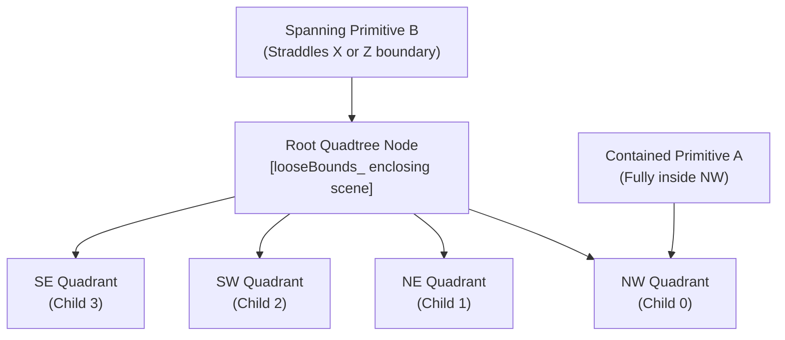

# bgl Engine (v1.2.0)

[](https://en.cppreference.com/w/cpp/23)
[](https://gpuweb.github.io/gpuweb/)
[](https://bkuolt.github.io/web-assembly-demo/docs/)
[](https://bkuolt.github.io/web-assembly-demo/)
[](CHANGELOG.md)

Modular C++23 3D graphics engine built on WebGPU (`wgpu-native` + SDL2 on Linux desktop, paired with an Emscripten WebAssembly core and native WebGPU client for browsers). It supports glTF 2.0/2.1 PBR rendering, HDR Image-Based Lighting (IBL), Forward+ clustered lighting, directional PCF shadows, desktop hybrid ray tracing and progressive path tracing, spatial Quadtree culling, and an SDF immediate-mode UI behind a backend-free public API (`#include <bgl/bgl.hpp>`).

### Online Demo & Documentation

| Resource | Purpose | Link |
| :--- | :--- | :--- |
| **Web Viewer (GitHub Pages)** | Primary hosted browser build (WebGPU + `bgl_engine.wasm`) | [bkuolt.github.io/web-assembly-demo](https://bkuolt.github.io/web-assembly-demo/) |
| **API Reference (Doxygen)** | Generated HTML reference across `bgl` modules and headers | [bkuolt.github.io/web-assembly-demo/docs](https://bkuolt.github.io/web-assembly-demo/docs/) |
| **Web Client Architecture** | Browser WebGPU renderer, WGSL pipeline, and touch/worker notes | [`web/README.md`](web/README.md) |

---


*Crytek Sponza Atrium (`assets/Sponza.glb`, 103 primitives, 69 PBR textures, 262,267 triangles) rendered with Cook-Torrance GGX PBR, 16x anisotropic mipmapping, MikkTSpace normal/bump mapping, Parallax Occlusion Mapping (POM), and multi-level LOD (`LOD0`–`LOD3`).*

---

## Public Engine API & Quickstart

### Minimal Example (`samples/01_hello_engine/main.cpp`)

```cpp
// Minimal bgl Engine app: load a glTF model, orbit the camera, and drive the SDF GUI.
// Run from the repository root: ./build/Release/sample_01_hello_engine
#include <bgl/bgl.hpp>

class HelloEngine : public bgl::App {
public:
    void OnStart() override {
        bgl::gui::SetDefaultFont("sans");
        if (auto result = GetEngine().LoadModel("assets/ToyCar.glb"); !result) {
            bgl::gui::ShowMessage("Load Failed", result.error(), bgl::gui::MessageType::Error);
        }
    }

    void OnUpdate(float deltaTime) override {
        if (bgl::Input::IsKeyPressed(bgl::Key::Escape)) {
            Quit();
        }
        if (autoOrbit_) {
            GetEngine().GetCamera().Orbit(0.3f * deltaTime, 0.0f);
        }
    }

    void OnGui() override {
        bgl::gui::Begin("Hello bgl");
        if (bgl::gui::Section("Scene Controls", true)) {
            bgl::gui::Slider("Exposure", GetEngine().Settings().exposure, 0.2f, 4.0f);
            bgl::gui::Tooltip("Adjust HDR camera exposure");
            bgl::gui::Toggle("Auto Orbit", autoOrbit_, "Continuously orbit the active camera");
            if (bgl::gui::Button("About bgl GUI")) {
                bgl::gui::ShowMessage("bgl Engine GUI",
                                      "Frosted-glass SDF widgets with hover highlights and OS font discovery.");
            }
        }
        bgl::gui::End();
    }

private:
    bool autoOrbit_{true};
};

BGL_RUN(HelloEngine)
```

```bash
task build
./build/Release/sample_01_hello_engine
```

### Core Public Types

| Concept | Role | Public Header |
| :--- | :--- | :--- |
| **`bgl::App` & `BGL_RUN`** | Lifecycle hooks (`OnStart`, `OnUpdate`, `OnGui`, `OnResize`, `OnFileDrop`, `OnShutdown`) | [`include/bgl/App.hpp`](include/bgl/App.hpp) |
| **`bgl::Engine`** | Facade owning window, GPU device, renderer, camera, and active scene | [`include/bgl/Engine.hpp`](include/bgl/Engine.hpp) |
| **`bgl::Input`** | Frame-buffered polling for keyboard and mouse (`IsKeyDown/Pressed/Released`, `MouseDelta`) | [`include/bgl/Input.hpp`](include/bgl/Input.hpp) |
| **`bgl::RenderSettings`** | Plain-data rendering, post-processing, and desktop RT configuration applied per frame | [`include/bgl/Settings.hpp`](include/bgl/Settings.hpp) |
| **`bgl::gui`** | Immediate-mode SDF UI (`Begin`, `End`, `BeginPanel`, `BeginContainer`, `BeginGroup`, `Section`, widgets, `Tooltip`, hover effects, `MessageBox`, `LoadingScreen`, font discovery) | [`include/bgl/Gui.hpp`](include/bgl/Gui.hpp) |
| **`bgl::Entity`** | Lightweight handle to a scene node (transform, parent/child hierarchy, punctual lights) | [`include/bgl/Entity.hpp`](include/bgl/Entity.hpp) |
| **`bgl::Sprite` & `Billboard`** | Batched 2D screen sprites, animated sprite sheets (`AnimatedSprite`), and 3D HDR billboards | [`include/bgl/Sprite.hpp`](include/bgl/Sprite.hpp) |

### Using `bgl::engine` as a CMake Dependency

```cmake
add_subdirectory(bgl-engine)                       # or FetchContent
target_link_libraries(my_game PRIVATE bgl::engine)
```

> [!NOTE]
> Conan 2.x dependencies (`conanfile.py` / `conan.lock`) and `third_party/wgpu-native` must be available in your build environment. See [docs/GETTING_STARTED.md](docs/GETTING_STARTED.md) for setup details.

### Reference Viewer (`apps/viewer`)

The desktop viewer (`bgl_viewer`) in [`apps/viewer/`](apps/viewer/) serves as a reference application built on top of `bgl::engine`. See the CLI flags and controls below, or [docs/ARCHITECTURE.md](docs/ARCHITECTURE.md) and [docs/CHEATSHEET.md](docs/CHEATSHEET.md) for engine internals.

---

## Overview & Capabilities

`bgl Engine` separates a modular C++23 runtime (`bgl_core`, `bgl_gpu`, `bgl_scene`, `bgl_text`, `bgl_ui`, `bgl_audio`, `bgl_engine`) from platform integration (SDL2 + `wgpu-native` on Linux x86_64; freestanding Emscripten WebAssembly + JS WebGPU client in browsers). Memory lifetimes are managed explicitly via RAII `Handle<>` GPU wrappers, `std::pmr` scratch arenas, and concurrent asset workers.

| Subsystem | Key Capabilities | Runtime Toggle / CLI |
| :--- | :--- | :--- |
| **Desktop Hybrid RT & Path Tracing** | 2-level binned-SAH BVH2 (`RayTracingScene`), G-Buffer pass, 128-slot bindless textures, compute RT soft shadows, RTAO, 1-bounce GGX reflections, temporal + À-Trous denoiser, GPU timestamps, and progressive compute path tracer | `[Ctrl+R]` / `[Ctrl+P]` / Studio UI / `RenderSettings` |
| **2D Sprites & 3D HDR Billboards** | Layer-sorted 2D swapchain sprites, grid/region `SpriteClip` animators, and depth-sorted 3D `Spherical`/`CylindricalY`/`ScreenAligned` HDR billboards feeding Bloom & Tonemapping | `bgl::Engine::DrawSprite` / `DrawBillboard` |
| **Multi-Level LOD & Debug Views** | 4-stage Mesh & Shader LOD (`LOD0`–`LOD3`), Screen-Space Error (SSE) Quadtree selection, Shadow-Pass `LOD1`, $4\times 4$ Bayer dithered cross-fade, Adaptive 60 FPS Auto-LOD, and 7 Diagnostic Views (`Lit`, `LOD Heatmap`, `Normals`, `PBR`, `UV`, `Clay + Wireframe`, `Toon / Cel`) | `[F9]`–`[F12]` / `[;]`/`[']` / `--lod-bias` / `--lod-heatmap` / `--debug-view` |
| **SDF Studio UI & Async Model Switcher** | Single-batch 2D SDF UI (`sdRoundedBox`, drop shadows, frosted HDR glass backdrop blur), containers/panels/groups/toggle boxes/option groups, 19-model glTF dropdown, non-blocking `std::jthread` loader with progress bar, FPS sparkline, and HSV `ColorEdit3` | `[F2]` / Studio UI Panel |
| **Post-Processing Pipeline** | `Depth24Plus` -> `R32Float` linear depth resolve, half-res Depth GTAO + bilateral blur, 5-mip Jimenez Bloom pyramid, GPU Auto-Exposure, Hi-Z SSR reflections, Vogel bokeh DoF, depth-gated Sun God Rays, edge chromatic aberration, 5 Color Grading presets, Film Grain, and FXAA 3.11 | Studio UI / `[X]` / `[Z]` / `[G]` / `[J]` |
| **KHR PBR & Shader Extensions** | `KHR_materials_iridescence` thin-film interference, `KHR_materials_anisotropy`, wrapped SSS backlight, roughness-aware 5-mip frosted refraction glass, 3D selection silhouette outline (`outline.wgsl`), procedural rain puddles, and Rayleigh/Mie + FBM volumetric cloud skybox | Automatic / Studio UI |
| **glTF 2.0 Animations & Skinning** | Skeletal animation (up to 128 joints with inverse bind matrices), morph target delta blending, decoupled TRS local transforms, and keyframe interpolation (`LINEAR`, `STEP`, `CUBICSPLINE` Hermite) | Automatic / glTF Animations |
| **Web Client PBR Engine** | Native browser WebGPU renderer (`BglWebGpuRenderer`, Cook-Torrance GGX PBR, 7-slot bind groups, WGSL shaders, Khronos PBR Neutral tonemapping) paired with `bgl_engine.wasm` | Automatic (Web) |
| **GPU Compute Offloading** | Parallel view-frustum culling (`GpuCuller`) and parallel compute ray-bounding picking (`GpuRayPicker`) | Automatic / GPU Compute |
| **RAM & VRAM Telemetry** | Process RSS memory (MB) from the OS kernel and atomic WebGPU VRAM buffer/texture accounting displayed on the in-engine HUD | In-Engine HUD (`[O]` / `[F3]`) |
| **Controller & Input Curves** | Native `SDL_GameController` (`0x054c` DualSense recognition, exponential aim response $mag^{2.1}$, pitch dampening `0.70`, rumble) and HTML5 Web Gamepad API with 0.12 deadzone | Auto-detected |
| **Ray Picking & Selection Outline** | Ray unprojection with Möller-Trumbore triangle picking, 3D selection outline, and bidirectional sync with hierarchy tree | Click in 3D / Scene Tree |
| **Camera Focus, Navigation & Bookmarks** | `[F]` frames selection, `[Home]` frames scene, Orbit & Fly (WASD) modes, turntable autorotation, 9 bookmarks (`Ctrl+1..9` / `1..9`), and glTF camera import | `[F]` / `[Home]` / `[C]` / `[T]` / `[1]`–`[9]` |
| **Touch Controls (Web)** | 1-finger orbit, 2-finger pinch-zoom, and 2-finger pan gestures for mobile and tablet browsers | Touch gestures on canvas |
| **Diurnal Sun / Day-Night Cycle** | Continuous 24-hour diurnal cycle updating skybox, directional PCF shadows, lens flares, and specular highlights | `[I]` / `[F8]` / Slider / `--day-night-cycle` |
| **Alpha-Tested Shadows** | Directional shadow pre-pass evaluates textures and alpha cutoff ($\alpha < \alpha_{\text{cutoff}}$) for `MASK` and `BLEND` foliage/cutouts | Automatic (`alphaMode == MASK`) |
| **Transmission & Refraction** | `KHR_materials_volume` support with view-space Snell's law screen refraction and Beer-Lambert volume attenuation | Automatic (`KHR_materials_volume`) |
| **Native Compressed Textures** | KTX1/KTX2 Basis Universal transcoding (`libktx`) to BC7, ASTC 4x4, or ETC2 based on WebGPU adapter features | Automatic GPU feature detection |
| **Parallax Occlusion Mapping (POM)** | Steep parallax raymarching (8–32 view-adaptive layers) with secant refinement and contact self-shadowing | `[P]` / Slider / HUD |
| **Atmospheric Weather** | Directional rain streaks & surface ripples (`[X]`/`[F4]`), drifting snowflakes (`[Y]`/`[F5]`), height/distance fog (`[F6]`), and turbulent FBM smoke (`[F7]`) | `[F4]`–`[F7]` / `--rain` / `--snow` / `--fog` / `--smoke` |
| **HDR Rendering & Tonemapping** | 4x MSAA `RGBA16Float` targets with Khronos PBR Neutral, AgX, and ACES Filmic tonemapping and exposure control | `[X]` / `Shift+`[`+`/`-`] / `--exposure` |
| **Image-Based Lighting (IBL)** | Compute-generated Split-Sum BRDF LUT ($128\times 128$ RGBA16F), pre-filtered GGX specular cubemap mip chains, and $L_2$ Spherical Harmonics diffuse irradiance | `[E]` / `--env <preset>` |
| **HDR Environments** | 4 built-in presets (*Mediterranean Courtyard*, *Sunset Studio*, *Overcast Atelier*, *Night Neon*), custom `.hdr`/`.exr` loading, 360° rotation, and Sharp/Blurred/Hidden skybox modes | `[E]` / `[K]` / `[` / `]` / `--env-rot` |
| **Clustered Forward+ Lighting** | glTF `KHR_lights_punctual` (Directional, Point, Spot) assigned across a $16\times 8\times 8 = 1024$ 3D frustum cluster grid | Automatic / glTF Lights |
| **Spatial Quadtree & Occlusion Culling** | 4-way XZ-plane partitioning, front-to-back traversal, $32\times 16$ Hi-Z `OcclusionBuffer`, and single-draw batched AABB wireframes | `[B]` / `[H]` / `[Q]` / `--no-occlusion` |
| **Remote Asset Streaming** | `http://`, `https://`, `file://`, and `data:` loading via `libcurl` (desktop) and Fetch API (Wasm), including URL drag-and-drop and external `.gltf` buffer resolution | `--asset <url>` / Drag & Drop |
| **HarfBuzz & FreeType 2 HUD** | Dynamic $1024\times 1024$ RGBA8 shelf-packed font atlas, Unicode shaping, embedded Liberation Mono fallback font, and telemetry overlay | `[O]` / `[F3]` / `--no-hud` |
| **Browser Pre-Flight Checks (Web)** | Checks WebAssembly, WebGPU API, GPU adapter availability, and Secure Context (`HTTPS`/`localhost`) with clear diagnostics | Automatic (Web) |

---

## Architecture Highlights

### Modules & Namespaces (`bgl`)

- `bgl::core`: Math, types (`AABB`, `Ray`, `Frustum`, `Vertex`, `Result<T>`), camera, block memory pool, PMR arenas, concurrent `ThreadPool`, POSIX signal crash handler, C++23 `std::stacktrace` diagnosis, `libcurl` fetcher, and `spdlog` logging.
- `bgl::gpu`: WebGPU device context, swapchain surface, 4x MSAA, modular WGSL shader pipeline (`#include`, `#pragma once`, hot-reload), Forward+ rendering, directional shadows, IBL, post-processing, 2-level SAH BVH & RT passes, skybox, and batched AABB/sprite renderers.
- `bgl::scene`: Multithreaded glTF ingestion (`fastgltf`), toggleable KTX / PNG / JPEG / WebP / HDR / EXR decoders, Basis Universal transcoding, CPU mip generation, MikkTSpace tangents, loose-bounds XZ Quadtree with `Refit()` and Hi-Z occlusion, and Möller-Trumbore ray picking.
- `bgl::text`: Cross-platform font discovery (`FontLibrary`), FreeType 2 glyph/SDF rasterization into RGBA8 atlases with fallback faces, HarfBuzz Unicode shaping, and batched 2D text rendering.
- `bgl::ui`: Immediate-mode SDF renderer (`ImmediateUI`) with containers, panels, visual groups, widgets, tooltips, hover animations, modals/loading banners, and telemetry overlay (`DebugOverlay`).
- `bgl::audio`: 3D spatial sound engine via `miniaudio`.
- `bgl::engine` & `bgl` (`include/bgl/`, `src/engine/`): Backend-free public SDK (`Engine`, `App`, `Input`, `RenderSettings`, `gui`, `Entity`) and `EngineCore` runtime.
- `bgl::app` (`apps/viewer/`): Reference desktop viewer built on `EngineCore` with CLI parser, 19-model preset switcher, studio UI, and Emscripten exports.

### Subsystem Details

- **Quadtree Frustum & Occlusion Culling**:
  - Hierarchical 4-way XZ partitioning with loose bounding boxes (`looseBounds_`) and `ContainsXZ` containment. Primitives spanning quadrant dividers remain at the parent node to prevent clipping or popping.
  - On `Sponza.glb` (`103` primitives partitioned into `53` Quadtree nodes), interior frustum queries cull out-of-view quadrants across all primary courtyard viewing axes (`+X`, `-X`, `+Z`, `-Z`).
  - Scene, primitive, and quadtree wireframe AABBs are submitted in one batched GPU draw call.
- **POSIX Crash Handler & Callstack Diagnostics**:
  - Intercepts `SIGSEGV`, `SIGABRT`, `SIGFPE`, `SIGILL`, and `SIGBUS` via `sigaction` on an alternate signal stack (`sigaltstack`).
  - Logs signal name, fault address, PID/TID, raw `execinfo` trace, and demangled C++23 `std::stacktrace`. Intentional test triggers are available via `--test-crash [segv|abrt|fpe]`.
- **Configurable Texture Format Decoders (All `ON` by Default)**:
  - `-DBGL_ENABLE_PNG=ON/OFF` (`libpng`)
  - `-DBGL_ENABLE_JPEG=ON/OFF` (`libjpeg-turbo` with `setjmp` error handling)
  - `-DBGL_ENABLE_WEBP=ON/OFF` (`libwebp`)
  - `-DBGL_ENABLE_KTX=ON/OFF` (`libktx 4.4.2`, KTX1/KTX2 + Basis Universal UASTC/ETC1S transcoding + magic-byte sniffing)
  - Query compiled capabilities via `./build/Release/bgl_viewer --formats` or `TextureDecoder::GetSupportedFormats()`.
- **Concurrent Asset Loading & Text Shaping**:
  - Parallel image decoding and scene primitive/LOD extraction via `ThreadPool` (`std::jthread`).
  - `FontLibrary::Discover` / `Find` resolves system and workspace `.ttf`/`.otf`/`.ttc` fonts alongside `"sans"`, `"mono"`, `"serif"`, and `"embedded"` (Liberation Mono Regular).
- **Zero-GLFW Windowing & Deterministic Dependencies**:
  - Desktop uses native SDL2; browser builds target freestanding Emscripten C-ABI (`src/wasm/wasm_bridge.cpp`, `web/dist/bgl_engine.wasm`) paired with the JS WebGPU frontend (with `BGL_PLATFORM_WASM` guards in place for direct `emdawnwebgpu` binding).
  - Third-party libraries are pinned via Conan 2.x and `conan.lock` (`freetype/2.13.2`, `harfbuzz/11.4.1`, `ktx/4.4.2`, `miniaudio/0.11.25`).

---

## Repository Structure

```text
.
├── CMakeLists.txt                     # C++23 target-based CMake configuration (+ optional Doxygen target)
├── CMakePresets.json                  # Release, Clang, ASan, UBSan & TSan presets
├── CHANGELOG.md                       # Release history (v0.6.0 -> v1.2.0)
├── Doxyfile                           # Doxygen + Graphviz SVG configuration
├── Taskfile.yml                       # Format, lint, build, test, docs & web helper tasks
├── conanfile.py                       # Conan 2.x package recipe
├── conan.lock                         # Deterministic dependency lockfile
├── docs/
│   ├── ARCHITECTURE.md                # Layering rules, module boundaries & data flow
│   ├── GETTING_STARTED.md             # Setup, Conan 2.x, presets & first app walkthrough
│   ├── CHEATSHEET.md                  # Quick-reference snippets for bgl Engine & GUI
│   ├── modules.dox                    # Doxygen @defgroup & namespace documentation
│   └── FEATURE_AND_PHYSICS_REPORT.md  # Architecture roadmap & Jolt physics integration blueprint
├── assets/
│   ├── Sponza.glb                     # Architectural benchmark scene
│   ├── ToyCar.glb                     # glTF benchmark model (Clearcoat, Sheen, Transmission, AO)
│   ├── env/                           # Optional local HDR environment presets
│   └── fonts/
│       └── LiberationMono-Regular.ttf # Embedded fallback monospace font
├── src/
│   ├── core/                          # -> libbgl_core.so
│   │   ├── Camera.hpp/.cpp            # Orbit, Pan, Zoom, Fly camera with [0,1] WebGPU projection
│   │   ├── CrashHandler.hpp/.cpp      # POSIX signal handler & C++23 stacktrace
│   │   ├── Gamepad.hpp/.cpp           # Controller deadzone & response curve calibration
│   │   ├── Log.hpp/.cpp               # spdlog wrapper and RAII ScopedTimer
│   │   ├── MemoryPool.hpp/.cpp        # Fixed block pool & PMR scratch arena
│   │   ├── MemoryTracker.hpp/.cpp     # OS RSS RAM & atomic WebGPU VRAM counters
│   │   ├── NetworkFetcher.hpp/.cpp    # libcurl / local streaming with timeout & cancellation
│   │   ├── Sprite.hpp/.cpp            # 2D Sprites, AnimatedSprites, SpriteClip & 3D Billboards
│   │   ├── ThreadPool.hpp/.cpp        # Concurrent worker pool and ParallelFor scheduler
│   │   ├── Types.hpp                  # AABB, Ray, Frustum, 96-byte Vertex, Result<T>
│   │   └── Version.hpp(.in)           # Generated version header
│   ├── gpu/                           # -> libbgl_gpu.so
│   │   ├── AabbRenderer.hpp/.cpp      # Batched 3D wireframe bounding box renderer
│   │   ├── Context.hpp/.cpp           # WebGPU device, MSAA, depth & swapchain surface
│   │   ├── DrawHelpers.hpp            # Shared per-draw UBO/skin/morph helpers & DynamicInstanceBuffer
│   │   ├── GpuCuller.hpp/.cpp         # Compute frustum culling
│   │   ├── GpuRayPicker.hpp/.cpp      # Two-pass compute ray-AABB picker
│   │   ├── Handle.hpp                 # RAII WebGPU Handle<> wrappers
│   │   ├── Pipeline.hpp/.cpp          # PBR pipelines, state caching & shader hot-reload
│   │   ├── PipelineRender.cpp         # Frame staging, clustered Forward+, shadows & pass dispatch
│   │   ├── PipelineEffects.cpp        # GPU mip chains, opaque copy mips & selection outlines
│   │   ├── PipelineIBL.cpp            # BRDF LUT, GGX cubemap prefiltering & L2 SH irradiance
│   │   ├── PipelineScene.cpp          # Scene buffer upload, morph SSBO, skinning & draw emission
│   │   ├── PipelineHelpers.hpp        # Internal FP16/cubemap/material uniform helpers
│   │   ├── PostProcessPass.hpp/.cpp   # Post-processing pipeline setup & lifecycle
│   │   ├── PostProcessPassRender.cpp  # Depth linearize, GTAO, Bloom, Auto-Exposure, SSR, DoF & FXAA
│   │   ├── PostProcessPassTargets.cpp # Fullscreen post-processing target allocation & bind groups
│   │   ├── PostProcessHelpers.hpp     # Shared post-processing uniforms & fullscreen draw helpers
│   │   ├── RayTracingScene.hpp/.cpp   # RT geometry/material pools, GPU buffer upload & bindless groups
│   │   ├── RayTracingSceneBvh.cpp     # Shared binned-SAH BVH2 (BLAS + TLAS) & CPU ray traversal
│   │   ├── RayTracingPass.hpp/.cpp    # G-Buffer, RT shadows, RTAO, reflections & path trace execution
│   │   ├── RayTracingPassPipelines.cpp# RT compute/render pipeline compilation & hot-reload
│   │   ├── RayTracingPassTargets.cpp  # RT resolution target allocation, tracking & denoiser bind groups
│   │   ├── ShaderManager.hpp/.cpp     # Modular .wgsl loader, #include/#pragma once & hot-reload
│   │   ├── Shaders.hpp                # WGSL shader accessors
│   │   ├── ShadowPass.hpp/.cpp        # Directional depth pre-pass with Quadtree light culling
│   │   ├── Skybox.hpp/.cpp            # Rayleigh/Mie + FBM volumetric cloud skybox
│   │   ├── SpriteRenderer.hpp/.cpp    # Batched WebGPU 2D sprites & 3D HDR billboards
│   │   ├── Uniforms.hpp               # Uniform structs and DynamicUniformRing
│   │   └── shaders/                   # Modular .wgsl PBR, compute, RT, outline, weather & post shaders
│   ├── scene/                         # -> libbgl_scene.so
│   │   ├── Animation.hpp/.cpp         # Keyframe sampler, skinning & morph targets
│   │   ├── AssetManager.hpp/.cpp      # FNV-1a cache and PMR geometry allocation
│   │   ├── FastGltfLoader.hpp/.cpp    # Async glTF/GLB orchestrator & external buffer resolver
│   │   ├── FastGltfInternal.hpp       # Monotonic ProgressReporter and internal stage declarations
│   │   ├── FastGltfParser.cpp         # Parallel primitive parsing, LOD generation & image decode
│   │   ├── FastGltfSceneBuilder.cpp   # Material, light, instancing, hierarchy, camera & skin builders
│   │   ├── Quadtree.hpp/.cpp          # 4-way XZ partition, Refit(), Hi-Z occlusion & SSE LOD
│   │   ├── RayPicker.hpp/.cpp         # Hierarchical Möller-Trumbore ray-triangle picking
│   │   ├── Scene.hpp/.cpp             # Scene graph, hierarchy transforms & GPU cleanup
│   │   ├── SceneMeshOps.cpp           # Tangent-space basis, adaptive grid/area LODs & morph targets
│   │   └── TextureDecoder.hpp/.cpp    # PNG, JPEG, WebP, KTX2, HDR & EXR decoding
│   ├── text/                          # -> libbgl_text.so
│   │   ├── EmbeddedFont.hpp/.cpp      # Embedded TrueType fallback font bytes
│   │   ├── FontAtlas.hpp/.cpp         # FreeType 2 alpha/SDF rasterizer & fallback atlas
│   │   ├── FontLibrary.hpp/.cpp       # OS/workspace font discovery & alias resolver
│   │   ├── TextShaper.hpp/.cpp        # HarfBuzz shaping, measurement & word wrapping
│   │   └── TextRenderer.hpp/.cpp      # WebGPU batched text renderer
│   ├── ui/                            # -> libbgl_ui.so
│   │   ├── DebugOverlay.hpp/.cpp      # In-engine telemetry HUD overlay
│   │   ├── ImmediateUI.hpp/.cpp       # Core SDF/text batching, PMR arena, fonts & hover animation
│   │   ├── ImmediateUIGpu.cpp         # WebGPU shader/pipeline switching & submission
│   │   ├── ImmediateUILayout.cpp      # Containers, panels, visual groups, ToggleBox & Option/OptionGroup
│   │   ├── ImmediateUIModals.cpp      # MessageBox, LoadingScreen, LoadingBanner & FloatingBadge
│   │   ├── ImmediateUIOverlays.cpp    # Dropdowns, scroll areas, progress bars, popups & UI facade
│   │   ├── ImmediateUIWidgets.cpp     # Immediate-mode studio widgets with optional hover effects
│   │   └── shaders/ui.wgsl            # 2D SDF, Gaussian drop shadow & frosted backdrop shader
│   ├── audio/                         # -> libbgl_audio.so
│   │   └── SoundEngine.hpp/.cpp       # Spatial 3D audio engine via miniaudio
│   ├── engine/                        # -> libbgl_engine.so
│   │   ├── EngineCore.hpp/.cpp        # Reusable runtime (window, GPU, scene, render loop)
│   │   ├── EngineCoreScene.cpp        # Scene activation, ray picking, camera cycling & sun controls
│   │   ├── Engine.cpp / EngineImpl.*  # Public bgl::Engine Pimpl facade & RenderSettings diffing
│   │   ├── App.cpp / Gui.cpp          # bgl::App runner & bgl::gui helpers
│   │   ├── Input*.hpp/.cpp            # bgl::Input polling state & SDL2 backend
│   │   └── Entity*.hpp/.cpp           # bgl::Entity handle & scene-graph operations
│   └── wasm/
│       └── wasm_bridge.cpp            # Freestanding C++23 Emscripten C-ABI bridge (`bgl_engine.wasm`)
├── include/bgl/                       # Public SDK headers (#include <bgl/bgl.hpp>)
│   ├── bgl.hpp                        # Umbrella header
│   ├── App.hpp / Engine.hpp           # Application lifecycle & engine facade
│   ├── Entity.hpp / Gui.hpp           # Entity handle & immediate-mode UI
│   ├── Input.hpp / Settings.hpp       # Input polling & RenderSettings
│   ├── Sprite.hpp                     # 2D Sprite, AnimatedSprite, SpriteClip & Billboard
│   └── Types.hpp                      # Public Result<T>, Camera, CameraMode & GLM aliases
├── apps/viewer/                       # -> libbgl_viewer_lib.so + bgl_viewer (Reference App)
│   ├── Application.hpp/.cpp           # Viewer shortcuts, HUD, turntable & studio UI
│   ├── ApplicationInput.cpp           # Desktop SDL2 shortcuts & bookmark hotkeys
│   ├── ApplicationModelLoader.cpp     # 19-model preset catalog, async loader & picking
│   ├── ApplicationUI.cpp              # Per-section SDF UI studio builders
│   ├── ApplicationConfig.hpp          # Shared viewer startup configuration
│   ├── CommandLine.hpp/.cpp           # Table-driven CLI parser, help & format report
│   ├── main.cpp                       # Native desktop viewer entry point
│   └── WebExports.cpp                 # Emscripten C-ABI exports for browser builds
├── samples/                           # Standalone engine samples (only #include <bgl/bgl.hpp>)
│   ├── 01_hello_engine/main.cpp       # Minimal model load, orbit camera, and exposure slider
│   ├── 02_entities_and_lights/main.cpp# Scene entities and orbiting point light
│   └── 03_sprites_and_billboards/main.cpp # 2D animated sprites & 3D HDR billboards
├── tests/                             # C++ GTest (334 tests across 51 suites) + Web Unit/E2E suites
│   ├── test_main.cpp
│   ├── test_types_math.cpp            # AABB, Ray, Plane, Frustum math, 96-byte Vertex layout
│   ├── test_camera.cpp                # Orbit, Pan, Zoom, ScreenPointToRay, bookmarks
│   ├── test_memory_pool.cpp           # MemoryPool, free-list reuse, ScratchArena
│   ├── test_asset_manager.cpp         # FNV-1a hashing, cache deduplication, arena clear
│   ├── test_network_fetcher.cpp       # URI sanitization, relative resolution, FetchSync/Async & MemoryTracker
│   ├── test_scene_mesh.cpp            # Dense LOD reduction, ComputeTangents, morph targets & Scene hierarchies
│   ├── test_quadtree_lod.cpp          # Quadtree subdivision, Refit(), Hi-Z occlusion, SSE LOD
│   ├── test_ray_picker.cpp            # Möller-Trumbore ray-triangle hit/miss & hierarchy picking
│   ├── test_gltf_loader.cpp           # ToyCar glTF, KHR extensions, async progress, cancel & presets
│   ├── test_texture_decoders.cpp      # PNG, JPEG, WebP, KTX2, HDR, EXR, magic-byte sniffing
│   ├── test_text_rendering.cpp        # FreeType rasterization, HarfBuzz shaping, SDF & widgets
│   ├── test_crash_handler.cpp         # POSIX signal handler install/uninstall & stacktrace
│   ├── test_command_line.cpp          # CLI argument parsing and feature toggles
│   ├── test_rendering_features.cpp    # ShaderManager, DynamicUniformRing, PBR, Shadows, IBL & WebGPU
│   ├── test_ray_tracing.cpp           # SAH BVH2 BLAS/TLAS, CPU traversal, RT config & headless passes
│   ├── test_golden_image.cpp          # Headless GLB golden checks, checksum & instancing
│   ├── test_animation.cpp             # Skeletal skinning, morph targets & TRS keyframe interpolation
│   ├── test_thread_pool.cpp           # ParallelFor, nested tasks & exception propagation
│   ├── test_audio_engine.cpp          # Spatial 3D audio lifecycle & error handling
│   ├── test_render_settings.cpp       # RenderSettings defaults parity & equality diff checks
│   ├── test_input_state.cpp           # Frame-buffered InputState & bgl::Input forwarding
│   ├── test_entity.cpp                # Scene graph reparenting, cycle guard & Entity handle safety
│   ├── test_engine_api.cpp            # Live Engine API, gui safety & scene reload invalidation
│   ├── test_sprites.cpp               # Sprites, AnimatedSprites, SpriteClips & SpriteRenderer
│   ├── test_web_unit.js               # 80 Node.js web math, shader, security, glTF, frustum & LOD tests
│   ├── test_webgpu_path.js            # Headless WebGPU pipeline + bgl_engine.wasm verification
│   └── test_browsers_e2e.py           # Playwright/Selenium Firefox & Chrome native WebGPU E2E checks
├── scripts/
│   ├── check_layering.py              # Module dependency & public-SDK boundary checker
│   ├── doxygen_md_filter.py           # Doxygen GFM math & alert preprocessor
│   ├── package_web.py                 # Minimal web app zip packager
│   ├── run_ci_locally.sh              # Local CI mirror (format, build, test, smoke)
│   └── stage_pages.sh                 # GitHub Pages static web + Doxygen staging script
└── web/                               # Browser WebGPU client & sample models
    ├── README.md                      # WebGPU client & shader pipeline guide
    ├── index.html                     # Viewer UI (Scene Graph Tree, JSON Inspector, Telemetry Card)
    ├── style.css                      # Viewer styles
    ├── app.js                         # UI coordinator, frame scheduler & bootstrap
    ├── gltf_worker.js                 # Web Worker for glTF/GLB parsing & base64 decoding
    ├── assets/                        # Web-served GLB models (ToyCar, Sponza, RobotExpressive, Soldier)
    ├── js/
    │   ├── core.js                    # Logging, notifications, state, UI cache & WASM bridge
    │   ├── gltf.js                    # glTF/GLB parser, scene graph & telemetry
    │   ├── math.js                    # Column-major mat4, projection, TRS & frustum culling math
    │   ├── shaders.js                 # WGSL Cook-Torrance PBR, POM, weather & LOD shaders
    │   └── renderer.js                # WebGPU device/pipeline manager & frame render loop
    └── dist/                          # Compiled WebAssembly module (`bgl_engine.wasm`)
```

---

## Real-Time Rendering Pipeline

Every frame records a multi-pass WebGPU command stream into the active `WGPUCommandEncoder`: a **Directional Shadow Depth Pre-Pass** (`2048×2048 Depth32Float`), an optional **Desktop Hybrid RT Pre-Pass** (1x G-Buffer + half-res/full-res RT Shadows and RTAO with temporal + À-Trous denoising), a **4x MSAA Split HDR Forward+ PBR Pass** (`Opaque` -> `Opaque Copy 5-Mip Chain` -> `Atmospheric Skybox` -> `RT Reflections` -> `Transparent & Transmission` + `Selection Outline`), the **`PostProcessPass` Suite** (`Depth Linearize` -> `Half-Res GTAO + Bilateral Blur` -> `5-Mip Bloom` -> `GPU Auto-Exposure` -> `Hi-Z SSR / Bokeh DoF / God Rays / Color Grading / Tonemapping` -> `FXAA 3.11`), and the final **2D SDF Studio UI & HarfBuzz Overlay**. Desktop builds can also switch into a **Progressive Compute Path Tracer**.

```mermaid
flowchart LR
    subgraph Pass1["1. Shadow Depth Pre-Pass (2048×2048 Depth32Float)"]
        LightMat["ComputeDirectionalLightMatrix()\nOrthoRH_ZO fitted to Scene AABB"]
        QuadShadow["Quadtree Frustum Culling\n(Light Space)"]
        ShadowVS["shadow.wgsl (LOD1 / Mask Discard)"]
        ShadowTex["shadowDepthTexture_\n(Hardware Depth Bias)"]
        LightMat --> QuadShadow --> ShadowVS --> ShadowTex
    end

    subgraph Pass2["2. 4× MSAA Split HDR PBR Pass (RGBA16Float)"]
        Opaque["Opaque PBR Pass\n1024-Cluster Forward+ & IBL"]
        OpaqueMip["5-Mip Opaque Copy\n(Rough Frosted Transmission)"]
        Skybox["Rayleigh/Mie + FBM Skybox"]
        Trans["Transparent & Volume Refraction\n+ 3D Selection Outline"]
        Opaque --> OpaqueMip --> Skybox --> Trans
    end

    subgraph Pass3["3. Post-Processing & SDF UI"]
        Post["Depth Linearize + Half-Res GTAO\n5-Mip Bloom + Auto-Exposure\nHi-Z SSR + DoF + God Rays + FXAA"]
        UI["ImmediateUI SDF Studio\n(Frosted Glass Backdrop)\n+ HarfBuzz Debug Overlay"]
        Post --> UI
    end

    ShadowTex -->|"Group 0 Depth + Comparison Sampler"| Opaque
    Trans --> Post
```



### 1. Bump Mapping & Tangent-Space Normal Mapping (`[V]` / `--no-bump`)
- **MikkTSpace / Lengyel Tangent Generation (`MeshPrimitive::ComputeTangents()`):**
  When a glTF primitive omits explicit `TANGENT` attributes, the loader computes per-vertex tangents $\mathbf{T}$ and bitangents $\mathbf{B}$ from triangle edges $(\Delta \mathbf{p}_1, \Delta \mathbf{p}_2)$ and UV deltas $(\Delta u_1, \Delta v_1, \Delta u_2, \Delta v_2)$, orthogonalized via Gram-Schmidt against the vertex normal $\mathbf{N}$:
  $$\mathbf{T}' = \text{normalize}\!\left(\mathbf{T} - \mathbf{N}(\mathbf{N} \cdot \mathbf{T})\right), \quad w = \text{sign}\!\left((\mathbf{N} \times \mathbf{T}) \cdot \mathbf{B}\right) \in \{-1, +1\}$$
- **Normal & Screen-Space Height Bump Perturbation:**
  In `pbr.wgsl`, when `MaterialFlags::EnableBumpMapping` is active, tangent-space normal maps (`normalTexture`) are combined with screen-space height derivatives (`dpdx(height)`, `dpdy(height)`) to perturb the shading normal $\mathbf{N}$ along $\mathbf{T}$ and $\mathbf{B}$ controlled by `ubo.bumpScale`. All derivatives and texture samples execute in uniform control flow prior to alpha-mask `discard`.

### 2. Mip-Mapping with Normal-Map Vector Renormalization (`[L]` / `--no-mipmaps`)
- **Full Mip Pyramid Generation (`CalculateMipLevels` & `GenerateNextMipLevel`):**
  Every 2D texture generates $\lfloor \log_2(\max(W, H)) \rfloor + 1$ mip levels down to $1 \times 1$.
  - **Color & Material Maps (`isNormalMap = false`):** 2x2 box-filter downsampling preserving average luminance and alpha coverage.
  - **Normal Maps (`isNormalMap = true`):** Decodes 4 parent texels into 3D vectors $\mathbf{n}_i \in [-1, 1]^3$, averages, and renormalizes $\bar{\mathbf{n}} = \text{normalize}(\sum \mathbf{n}_i)$ before re-packing to `RGBA8Unorm`, avoiding normal-length decay at oblique angles.
- **Live Sampler Switching:**
  Pressing **`L`** toggles `PipelineManager::SetMipmappingEnabled()`, rebuilding material bind groups between `defaultSampler_` (**16x Anisotropic Trilinear**, `lodMaxClamp = 32.0`) and `noMipSampler_` (**Base Mip 0 Only**, `lodMaxClamp = 0.0`).

### 3. Directional Shadow Mapping with 12-Tap Rotated Poisson PCF (`[M]` / `--no-shadows`)
- **Scene-Fitted Orthographic Light Projection (`ComputeDirectionalLightMatrix`):**
  Constructs a right-handed zero-to-one orthographic projection (`glm::orthoRH_ZO`) centered on `sceneAABB.Center()` with radius $R = \max(\|\text{Extents}\|, 5.0)$ enclosing all 8 transformed scene AABB corners plus a $15\%$ light-space safety margin inside WebGPU clip space $[-1, 1]^2 \times [0, 1]$.
- **Dedicated Shadow Pass & Adaptive Poisson PCF (`ShadowPass`, `pbr.wgsl`):**
  Executes a `2048×2048` `Depth32Float` pre-pass over `LOD1` proxy slices (binding dynamic per-draw UBOs, material alpha-mask textures, and skeletal skinning SSBOs without binding `shadowDepthTexture_` for read/write hazard safety). In `pbr.wgsl`, `sampleShadowPCF()` evaluates a **12-tap rotated Poisson disk PCF** kernel (jittered per pixel via interleaved gradient noise) on `LOD0`/`LOD1` and a 1-tap `textureSampleCompareLevel` on `LOD2`/`LOD3`.

### 4. Environment Cubemap Reflections & Specular IBL (`[R]` / `--no-reflections`)
- **GPU-Prefiltered 6-Face Roughness Cubemap (`PipelineIBL`):**
  Generates a **$128 \times 128 \times 6$ `WGPUTextureViewDimension_Cube` (`RGBA16Float`) texture with 8 GGX mip levels** via compute shaders (`ggx_prefilter.wgsl`, `roughness` $\in [0, 1]$), alongside $L_2$ Spherical Harmonics diffuse irradiance and $128\times 128$ Split-Sum BRDF LUT (`brdf_lut.wgsl`). Custom `.hdr`/`.exr` equirectangular maps scale face size cleanly between $64\times 64$ and $256\times 256$.
- **Karis Split-Sum Specular & Clearcoat IBL:**
  Samples `textureSampleLevel(envCubemap, defaultSampler, R, roughness * maxMip)` along $\mathbf{R} = \text{reflect}(-\mathbf{V}, \mathbf{N})$ and applies the $128\times 128$ Split-Sum BRDF LUT plus clearcoat reflection weighting.

### 5. Desktop Compute-Shader Ray Tracing & Progressive Path Tracer (`[Ctrl+R]` / `[Ctrl+P]`)
- **2-Level Binned-SAH BVH2 (`RayTracingScene`, `RayTracingSceneBvh.cpp`):**
  Builds compact 32-byte `RtBvhNode` bottom-level trees (`BLAS`) per unique `MeshPrimitive` in parallel across `ThreadPool` alongside a dirty-tracked scene-level `TLAS` (`RtInstance`, 176 bytes) supporting `EXT_mesh_gpu_instancing` and small-scale glTF transforms (`abs(det) >= 1e-24`).
- **128-Slot Bindless Texture Arrays (`Context.cpp`, `rt_traversal.wgsl`):**
  Queries `wgpu-native` bindless capabilities (`WGPUNativeFeature_TextureBindingArray`, non-uniform indexing, partially bound arrays) so secondary ray hits sample base-color textures from `@group(2)` `binding_array<texture_2d<f32>, 128>`, falling back seamlessly to material factor shading when bindless slots are unavailable.
- **Hybrid RT Passes & Temporal / À-Trous Denoiser (`RayTracingPass`, `rt_denoise.wgsl`, `rt_denoise_hdr.wgsl`):**
  Renders a 1x `G-Buffer` (`rt_gbuffer.wgsl`), traces jittered soft sun + up to 3 punctual light shadows (`rt_shadows.wgsl` -> `@group(0) @binding(6)` in `pbr.wgsl`), 2-sample cosine RTAO (`rt_ao.wgsl` overriding GTAO in `PostProcessPass`), and 1-bounce GGX specular reflections (`rt_reflections_core.wgsl`, suppressing SSR and blending smoothly across `roughness` $\in [0.40, 0.65]$), stabilized via temporal reprojection, 3-step À-Trous spatial filtering, and bilateral half-res upsampling.
- **Progressive Compute Path Tracer (`rt_pathtrace_core.wgsl`, `[Ctrl+P]`):**
  Accumulates multi-bounce diffuse, GGX specular, and dielectric transmission paths in a linear fp32 `pathAccum` storage buffer (`1`–`6` bounces) using Next-Event Estimation (NEE) and Russian Roulette, automatically resetting accumulation on camera, light, or scene changes and reporting non-blocking `WGPUQuerySet` GPU timings in `DebugOverlay` and `"Desktop Ray Tracing"` Studio UI (`BGL_PLATFORM_WASM` safely retains raster/IBL/GTAO/SSR rendering).

---

## Spatial Quadtree Partitioning & Frustum Culling

To maintain stable frame times on multi-mesh scenes such as Sponza (103 primitives, 69 textures), the engine uses a hierarchical 4-way **Quadtree spatial partition** on the XZ ground plane.



### Key Mechanisms

1. **Strict `ContainsXZ` Containment:**
   Primitives are pushed into child quadrants only if their world-space AABB fits within that quadrant on the XZ plane:
   $$\text{inner.min} \ge \text{outer.min} - \epsilon \quad \text{and} \quad \text{inner.max} \le \text{outer.max} + \epsilon$$
   Primitives straddling dividing boundaries stay at the parent node level.

2. **Loose Bounding Boxes (`looseBounds_`):**
   Each Quadtree node maintains a bounding box enclosing all contained primitives and descendant subtrees:
   - If `!frustum.IntersectsAABB(looseBounds_)`, the entire quadrant subtree is culled in one check.
   - Geometry extending outside geometric quadrant lines is not clipped or culled prematurely.

3. **WebGPU $[0, 1]$ Depth Frustum Extraction:**
   Frustum planes use Gribb-Hartmann extraction adapted for WebGPU's right-handed zero-to-one clip space (`perspectiveRH_ZO`):
   - Near plane: $Z_{\text{clip}} \ge 0 \implies \text{row}_2 \cdot P \ge 0$
   - Far plane: $Z_{\text{clip}} \le W_{\text{clip}} \implies (\text{row}_3 - \text{row}_2) \cdot P \ge 0$

4. **Sponza Courtyard Frustum Culling (`QuadtreeTest.SponzaFrustumCullingDiagnostic`):**
   `assets/Sponza.glb` (`103` primitives partitioned across `53` loose-bounds Quadtree nodes) is verified against an interior courtyard perspective camera at `(-0.5, 2.0, -0.3)` (`45°` FOV, `16:9` aspect), asserting strict subset visibility along all four horizontal cardinal views (`+X`, `-X`, `+Z`, `-Z`).

---

## Building and Running

### Prerequisites

- C++23 compiler (GCC 13+ or Clang 17+)
- CMake 3.28+
- Ninja
- Conan 2.x
- Vulkan SDK and GPU drivers with WebGPU support

### 1. Install Dependencies with Conan

```bash
conan install . -s build_type=Release --build=missing --lockfile=conan.lock
```

### 2. Configure and Build

```bash
cmake -B build/Release -G Ninja \
  -DCMAKE_BUILD_TYPE=Release \
  -DCMAKE_TOOLCHAIN_FILE=build/Release/generators/conan_toolchain.cmake \
  -DBGL_ENABLE_PNG=ON \
  -DBGL_ENABLE_JPEG=ON \
  -DBGL_ENABLE_WEBP=ON \
  -DBGL_ENABLE_KTX=ON

cmake --build build/Release -j$(nproc)
```

> [!NOTE]
> Texture decoders can be toggled individually at configure time (e.g., `-DBGL_ENABLE_KTX=OFF` or `-DBGL_ENABLE_WEBP=OFF`).

### 3. Run the Test Suite

```bash
# Run C++ unit tests, layering check, smoke test, and Web/WebGPU Node suites via CTest
ctest --test-dir build/Release --output-on-failure -E BrowserE2ETest

# Filter C++ GoogleTest suites directly
./build/Release/bgl_unit_tests --gtest_filter=QuadtreeTest*
./build/Release/bgl_unit_tests --gtest_filter="*RayTracing*"
```

### 4. Launch Native Desktop Viewer

The executable resolves relative RPATHs to its shared libraries and WebGPU backend:

```bash
# Default scene (Sponza.glb)
./build/Release/bgl_viewer

# CLI help and hotkeys
./build/Release/bgl_viewer --help

# Query compiled image/asset format support
./build/Release/bgl_viewer --formats

# Load a glTF/GLB from local disk or HTTP/HTTPS URL
./build/Release/bgl_viewer --asset assets/ToyCar.glb -w 1600 -H 900 --log-level debug
./build/Release/bgl_viewer https://raw.githubusercontent.com/KhronosGroup/glTF-Sample-Assets/main/Models/BoxTextured/glTF/BoxTextured.gltf

# Visualize 3D Quadtree partitions
./build/Release/bgl_viewer --quadtree

# Test crash signal handler
./build/Release/bgl_viewer --test-crash segv
```

#### Command-Line Arguments

| Option | Argument | Description | Default |
| :--- | :--- | :--- | :--- |
| `-h`, `--help` | — | Display formatted help screen with arguments and controls | — |
| `-v`, `--version` | — | Print engine version string | `1.2.0` |
| `--formats` | — | Query compiled texture decoders and `libcurl` availability | — |
| `-a`, `--asset` | `<path\|url>` | Load `.glb` or `.gltf` model from path or HTTP/HTTPS URL | Auto-detect |
| `-w`, `--width` | `<pixels>` | Initial window width | `1280` |
| `-H`, `--height` | `<pixels>` | Initial window height | `720` |
| `-l`, `--log-level` | `<level>` | Log level (`trace`, `debug`, `info`, `warn`, `error`) | `info` |
| `--no-skybox` | — | Start with procedural atmospheric skybox disabled | `Enabled` |
| `--no-hud` | — | Start with Debug Overlay HUD hidden | `Visible` |
| `--no-bounds` / `--bounds` | — | Hide / show 3D wireframe bounding boxes | `Visible` |
| `--quadtree` | — | Start with 3D Quadtree partitions visible | `Disabled` |
| `--no-bump` / `--bump` | — | Toggle tangent-space normal & bump mapping | `Enabled` |
| `--no-mipmaps` / `--mipmaps` | — | Toggle 16x anisotropic mipmapping vs Mip-0 | `Enabled` |
| `--no-shadows` / `--shadows` | — | Toggle directional shadow mapping (2048x2048 12-tap Poisson PCF) | `Enabled` |
| `--no-reflections` / `--reflections` | — | Toggle environment cubemap reflections (IBL) | `Enabled` |
| `--no-ao` / `--ao` | — | Toggle glTF ambient occlusion & micro-cavities | `Enabled` |
| `--no-occlusion` / `--occlusion` | — | Toggle Quadtree hierarchical occlusion culling | `Enabled` |
| `--no-lod` / `--lod` | — | Toggle multi-level mesh & shader LOD (`LOD0`–`LOD3`) | `Enabled` |
| `--auto-lod` / `--no-auto-lod` | — | Enable / disable adaptive 60 FPS Auto-LOD | `Disabled` |
| `--lod-bias` | `<0.25-4.0>` | Screen-space error LOD distance bias multiplier | `1.0` |
| `--lod-heatmap` | — | Start in LOD heatmap diagnostic mode | `Disabled` |
| `--debug-view` | `<lit\|lod\|normals\|pbr\|uv>` | Select initial diagnostic shading mode | `lit` |
| `--rain` / `--snow` / `--fog` / `--smoke` | — | Start with Rain, Snow, Fog, or Smoke shader active | `Clear` |
| `--weather` | `<clear\|rain\|snow\|fog\|smoke>` | Select initial weather mode | `clear` |
| `--weather-intensity` | `<0.0-2.0>` | Weather density/particle multiplier | `1.0` |
| `--wind` | `<-1.0-1.0>` | Lateral wind direction and speed | `0.3` |
| `--time` | `<0.0-24.0>` | Initial time of day in hours | `14.0` |
| `--day-night-cycle` | — | Enable continuous day/night progression | `Disabled` |
| `--day-night-speed` | `<hrs/sec>` | Day/night cycle speed multiplier | `1.0` |
| `--test-crash` | `[segv\|abrt\|fpe]` | Trigger test crash for signal/stacktrace verification | `segv` |
| `--headless` | — | Headless CI smoke mode (renders 10 frames and exits) | `Disabled` |

#### Desktop Controls

- **Mouse / Picking**: `LMB + Drag` Orbit, `RMB / Shift + Drag` Pan, `Scroll Wheel` Zoom, `Double-Click / MMB` Pick node (`RayPicker`) & show 3D Selection Outline.
- **Studio UI & Overlays**: `F1` Wireframe Overlay, `F2` SDF Studio Settings UI (19-model selector, async loading progress bar, scene tree, theme customizer, desktop RT controls), `O` / `F3` Debug Overlay HUD.
- **PBR & Lighting**: `V` Bump/Normal Mapping, `L` 16x Aniso Mipmapping, `M` PCF Shadows, `R` Specular IBL Reflections, `U` Ambient Occlusion, `P` Parallax Occlusion Mapping, `E` Environment Preset, `[` / `]` Rotate Environment (-5° / +5°), `K` Skybox Mode (`Sharp` / `Blurred` / `Hidden`).
- **Desktop Ray Tracing**: `Ctrl+R` Toggle Desktop Hybrid Ray Tracing (Shadows, RTAO, 1-Bounce GGX Reflections), `Ctrl+P` Toggle Progressive Compute Path Tracer.
- **Post-Processing & Exposure**: `X` Cycle Tonemapper (`Khronos PBR Neutral` / `AgX` / `ACES`), `Z` Emissive HDR Bloom, `G` GTAO/SSAO, `J` Sun Lens Flare, `Shift + (+ / -)` Exposure.
- **Weather & Diurnal Sun**: `Y` Cycle Weather (`Clear` / `Rain` / `Snow` / `Fog` / `Smoke`), `F4`–`F7` Direct Weather Toggles, `I` / `F8` Auto Day/Night Cycle, `,` / `.` Step Time (-30m / +30m).
- **Culling, LOD & Views**: `B` AABB Wireframes, `Q` Quadtree Boundaries, `H` Hi-Z Occlusion Culling, `N` / `F9` Cycle Diagnostic View, `F10` LOD Heatmap, `F11` Multi-Level LOD, `F12` Auto-LOD, `;` / `'` LOD Bias (-0.15 / +0.15).
- **Camera & Streaming**: `W`/`A`/`S`/`D` + Arrows Move, `+` / `-` Zoom, `F` Focus Selection/Bounds, `C` Orbit / Fly Mode, `T` Turntable, `Ctrl+1..9` / `1..9` Camera Bookmarks, Drag & Drop `.glb`/`.gltf` or HTTP/HTTPS URL, `ESC` Exit.

---

## Generating & Browsing Doxygen API Documentation

HTML API documentation (with module groups, Graphviz collaboration/dependency SVGs, treeview, and MathJax equations) is generated from [`Doxyfile`](https://github.com/bkuolt/web-assembly-demo/blob/main/Doxyfile) and published automatically to GitHub Pages via [`.github/workflows/pages.yml`](https://github.com/bkuolt/web-assembly-demo/blob/main/.github/workflows/pages.yml):

- **Online:** [bkuolt.github.io/web-assembly-demo/docs](https://bkuolt.github.io/web-assembly-demo/docs/)
- **Generate Locally:**
  ```bash
  doxygen Doxyfile
  # Or via Taskfile / CMake:
  task docs
  cmake --build build/Release --target docs
  ```
  Open `build/docs/html/index.html` locally to view the generated HTML site.

---

## WebAssembly Browser Viewer & Minimal Packaging

### Hosted Browser Viewer

You can run the WebAssembly and WebGPU viewer directly in a supported desktop browser (Chrome / Edge / Firefox Nightly with WebGPU enabled) without installing local build tools:

- **GitHub Pages (Primary):** [https://bkuolt.github.io/web-assembly-demo/](https://bkuolt.github.io/web-assembly-demo/)

### Serving the Web Viewer Locally

```bash
python3 -m http.server 8080 --directory web
```

Open `http://localhost:8080` for:
- Streaming WebAssembly startup via `WebAssembly.instantiateStreaming`
- Real-time download progress tracking (received MB, total size, percentage, `MB/s`)
- Toast notifications for network errors, parse failures, and WebGPU initialization diagnostics
- Structured console logs (`[Engine]`, `[Wasm]`, `[WebGPU]`, `[Network]`, `[glTF]`, `[Perf]`)
- Interactive scene graph tree, collapsible glTF 2.0 JSON inspector, and AABB geometry telemetry
- Quick toggles (`[B]` Bounds, `[Q]` Quadtree, `[K]` Skybox, `[O]` HUD) and 19 built-in sample models (`ToyCar`, `Sponza`, `RobotExpressive`, `Soldier`, Khronos samples)

### Minimal Web Distribution Archive

```bash
cmake --build build/Release --target package_web
# or directly:
python3 scripts/package_web.py
```

Produces `dist/bgl_web_app_minimal.zip` (~5.8 MB) with the web runtime and core assets while excluding large benchmark `.glb` files.

---

## Test Suite Overview

The repository includes **334 C++ GoogleTests across 51 suites**, a static module dependency check (`LayeringCheck`), a headless GPU smoke check (`NativeHeadlessSmokeTest`), **80 Node.js web unit tests**, a headless WebGPU/WASM pipeline check (`WebGPUPipelineTest`), ASan/UBSan sanitizer verification (both locally via CMake presets and in CI), and cross-browser Chrome/Firefox tests (`BrowserE2ETest`).

| Test Suite | Tests | Scope |
| :--- | :---: | :--- |
| `RenderingFeaturesTest` | 58 | Tangents & handedness, mipmaps & normal renormalization, shadow matrices, cubemap IBL, uniform packing, Forward+ clusters, POM, GTAO, lens flare, tonemappers, KTX2 targets, transmission attenuation, bloom, weather (`rain`/`snow`/`fog`/`smoke`), diurnal sun, gamepad response curves, `GpuCuller`/`GpuRayPicker`, `DebugOverlay`, `KHR_texture_transform`, split passes & headless WebGPU validation. |
| `TypesMathTest` | 24 | AABB/ray intersections, Hesse planes, WebGPU frustum extraction, 96-byte Vertex alignment, tangents, mipmap helpers, shadow matrices, cubemap mips, Arvo box transform, slerp/affine inversion, and degenerate geometry guards. |
| `CommandLineTest` | 22 | Default config, `--help`, `--version`, `--formats`, resolution & non-positive dimension guards, symmetric toggles, `--flag=value` & `--`, flag-swallow protection, weather/time-of-day flags, LOD bias/heatmap, debug views, crash options, `--headless`, and `ApplicationConfig` slicing. |
| `CameraTest` | 18 | Orbit, pan, zoom clamping, view/projection composition, `ScreenPointToRay` unprojection, pitch limits, aspect ratios, WASD/fly navigation, bounds framing, bookmarks, and glTF camera import. |
| `GltfLoaderTest` | 19 | `ToyCar.glb` parsing, KHR extensions, corrupted GLB rejection, oversized-accessor bounds, cycle/diamond-DAG guards, morph-target cap, hierarchy transforms, monotonic async progress & cancellation, 19-model presets, worker teardown safety, and optional 1 GB megacity stress test. |
| `MemoryPoolTest` | 15 | Fixed-size block allocation, multi-block chaining, free-list reuse, destructor tracking, move semantics, LIFO safety, 64-byte alignment, and PMR `ScratchArena`. |
| `RayPickerTest` | 14 | Möller-Trumbore ray-triangle hit/miss, backface/negative-t rejection, normal orthogonality, hierarchical transforms, and empty/multi-root scenes. |
| `AnimationTest` | 14 | Step/Linear/Slerp/CubicSpline samplers, edge-case keyframes, TRS decoupling, hierarchy propagation, morph blending, time wrapping, and skeletal skin matrices. |
| `QuadtreeTest` | 13 | 4-way XZ subdivision, loose bounds, `Refit()` relocation, `ContainsXZ`, Sponza culling ratios, Hi-Z `OcclusionBuffer` tile queries, and `LOD0`–`LOD3` bias scaling. |
| `TextRenderingTest` | 11 | Embedded Liberation Mono integrity, FreeType alpha/SDF atlases, glyph rasterization, HarfBuzz shaping, UTF-8/CRLF/empty strings, multi-line layout, and tinting. |
| `TextureDecoderTest` | 10 | Format capability queries, empty/corrupt payload rejection, magic-byte sniffing (`PNG`, `JPEG`, `WebP`, `KTX2`), `HDR`/`EXR` headers, PMR decoding, NPOT mip levels, and crafted PNG/HDR/WebP/KTX2/EXR overflow guards. |
| `ThreadPoolTest` | 9 | Worker lifecycle, singleton identity, async futures, `ParallelFor` partitioning, empty/inverted bounds, nested deadlock guard, and exception propagation. |
| `NetworkFetcherTest` & `MemoryTrackerTest` | 10 | URI scheme/sanitization/percent-decoding, SSRF & HTTPS-only filtering (including live loopback test server), `file://` host validation, relative & cross-scheme subresource containment, `FetchSync`/`FetchAsync`, and saturated GPU VRAM alloc/free counters. |
| `AssetManagerTest` | 8 | 64-bit FNV-1a hashing, texture cache insertion/deduplication/replacement, KTX2 handling, scratch arena reset, bit-avalanche, and missing path errors. |
| `SoundEngineTest` | 7 | Audio lifecycle & initialization, missing-file error handling, `NaN`/non-finite spatial safety, repeated stop safety, and idempotent shutdown. |
| `CrashHandlerTest` | 6 | POSIX signal handler install/uninstall, async-signal-safe formatting, boundary safety, and idempotent re-installation. |
| `RayTracingSceneTest` & `RayTracingPassTest` | 10 | WGSL ABI struct sizes (`RtVertex`/`RtBvhNode`/`RtInstance`/`RtMaterial`/`RtPassUniforms`), binned-SAH BLAS builder, scene BVH + unindexed geometry + non-uniform scale normals + CPU ray tracing, `UpdateTlas`, `EXT_mesh_gpu_instancing` multi-instance tracing, singular transform rejection, RT parameter clamping, shader reload filtering, and headless WebGPU hybrid & path-trace execution. |
| `SceneMeshTest` | 7 | `MeshPrimitive::GenerateLODs` dense/small/collapsed-area reduction, `ComputeTangents` (indexed, unindexed, degenerate UVs), `ApplyMorphTargets`, copy/move buffer ownership guards, and instanced `Scene::Update` bounds. |
| `ImmediateUIAdvancedWidgetsTest` | 5 | SDF & backdrop blur flags, HSV conversion, sliders/collapsing headers/sparklines/scroll areas, `ColorEdit3` popup, and scrollable `Dropdown`/`ProgressBar`/`DrawLoadingBanner`. |
| `GoldenImageTest` | 4 | Headless GLB golden geometry validation, fixed-checksum buffer determinism, FNV-1a content hashing, and instancing checks. |
| `ShaderManagerTest` | 4 | WGSL `#include` & `#pragma once`, circular/missing include detection, entry-point checks, and hot-reload detection. |
| Public SDK & Engine Suites | 20 | `InputState` (7), `EntityOps` (7), `RenderSettings` (2), `GuiPublicApi` (2), `EnginePublicApi` (1), and `EntityHandle` (1). |
| UI Scoping, Modal, Hover & Font Suites | 13 | `ImmediateUIModalAndLoadingTest` (2), `ImmediateUIScopingAndDisabledTest` (3), `ImmediateUiSafetyTest` (2), `FontLibraryTest`, `TextShaperTest`, `TextRendererTest`, `ImmediateUIHoverAndTooltipTest`, `ImmediateUIMultiFontTest`, and `ImmediateUILayoutAndControlsTest`. |
| Sprites & Billboards Suites | 6 | `SpriteTextureTest`, `SpriteClipAndAnimatorTest`, `AnimatedSpriteAndBillboardTest`, `BillboardBasisTest`, `SpriteRendererCpuTest`, and `EnginePublicSpriteApiTest`. |
| Single-Test Targeted Suites | 7 | `GamepadTest`, `ImmediateUITest`, `PipelineDelegationTest`, `PostProcessPassTest`, `QuadtreeLodTest`, `ShaderManagerSecurityTest`, and `TextureDecoderHdrTest`. |

---

## Changelog & Release History

See [**CHANGELOG.md**](CHANGELOG.md) for version notes from `v0.6.0` through **`v1.2.0`**:

- **[1.2.0](CHANGELOG.md#120---2026-11-22)**: End-to-end security, safety & compliance hardening across glTF/mesh/animation ingestion, texture decoders, async-signal-safe crash diagnostics, SSRF-filtered `NetworkFetcher`, WebGPU/BVH/WGSL bounds & context-loss guards, strict CSP without inline script attributes (`script-src-attr 'none'`), ELF/WASM stack-first hardening with `libwgpu_native.so` SHA256 verification, ASan+UBSan CI job, and **334 C++ GoogleTests + 80 Web unit tests**.
- **[1.1.0](CHANGELOG.md#110---2026-11-22)**: Public backend-free C++23 SDK (`include/bgl/`, `EngineCore`, `samples/01..03`), desktop compute-shader hybrid ray tracing & progressive path tracer (`RayTracingScene` + `RayTracingPass`), 2D sprites & 3D HDR billboards, cross-platform font discovery (`FontLibrary`) & frosted-glass modals, SDF studio UI & full post-processing suite (GTAO, Bloom, Auto-Exposure, SSR, DoF, God Rays, FXAA), security & overflow hardening, modular source/JS splits, 324 C++ GoogleTests + 74 Web unit tests, and Doxygen/GitHub Pages deployment.
- **[1.0.0](CHANGELOG.md#100---2026-11-16)**: Production 1.0 release with RAII `Handle<>` WebGPU lifecycle, modularized `FastGltfLoader` / `PipelineManager` / `Application`, consolidated swapchain/attachment helpers, zero `clang-tidy`/compiler warnings, and cross-compiler/sanitizer/browser E2E parity.
- **[0.9.18](CHANGELOG.md#0918---2026-11-16)**: Modular `.wgsl` shader pipeline with `#include`/`#pragma once` and hot-reload, split Opaque/Skybox/Transparent+Transmission HDR pass, `EXT_mesh_gpu_instancing`, `Quadtree::Refit()`, modular web client (`web/js/`), and Conan 2 dependency upgrades.
- **[0.7.0](CHANGELOG.md#070---2026-10-22)**: Bump & Normal Mapping (`[V]`), normal-renormalized mipmapping (`[L]`), 2048x2048 3x3 PCF shadows (`[M]`), 6-face environment cubemap reflections (`[R]`), C++23 `{}` uniform init, `std::span` APIs, and multithreaded CPU asset generation.
- **[0.6.8](CHANGELOG.md#068---2026-10-22)**: Per-format CMake toggles, POSIX crash handler with `std::stacktrace`, desktop CLI parser, batched AABB wireframes, Quadtree loose-bounds culling fix, minimal web zip packager, and 1 GB megacity stress test.
- **[0.6.7](CHANGELOG.md#067---2026-10-22)**: KTX1/KTX2 texture support with Basis Universal transcoding (`libktx`) and multithreaded glTF ingestion.
- **[0.6.6](CHANGELOG.md#066---2026-10-22)**: FreeType 2 & HarfBuzz Unicode text rendering and Debug Overlay HUD.
- **[0.6.5](CHANGELOG.md#065---2026-10-22)**: Procedural atmospheric skybox and 3D wireframe AABB bounding boxes.
- **[0.6.4](CHANGELOG.md#064---2026-10-22)**: Sponza atrium benchmark scene, 4x MSAA, 16x Anisotropic filtering, and initial XZ-Quadtree frustum culling.
- **[0.6.0 – 0.6.3](CHANGELOG.md#060---2026-10-19)**: Core C++23 WebGPU architecture, KHR PBR extensions, Web Scene Graph & JSON Inspector, and CI/CD automation.

---

## License

MIT License. See [LICENSE](LICENSE) for details.
