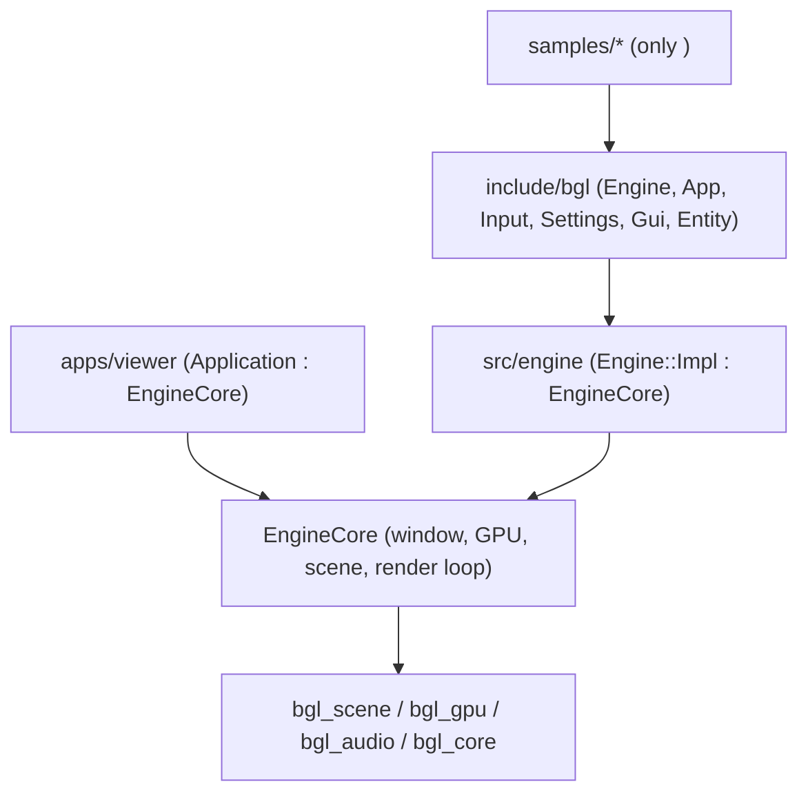

# bgl Engine Architecture

## Module Layers

## Layering Rules

Enforced automatically by [`scripts/check_layering.py`](../scripts/check_layering.py) (and CTest `LayeringCheck`):

1. **Public headers (`include/bgl/`)** may only include `core/*` and `bgl/*`. They must **never** include `webgpu.h`, `WGPU*`, or `SDL*` headers.
2. **Samples (`samples/`)** may only include `bgl/*` (`<bgl/bgl.hpp>`).
3. **Engine core (`src/engine/`)** must never reference viewer code (`Application` or `apps/viewer/`).
4. **Core (`src/core/`)** depends on no other `src/*` module.
5. **Scene (`src/scene/`)** and **Audio (`src/audio/`)** depend only on `core/`.
6. **Text (`src/text/`)** depends only on `core/` and `gpu/`; **UI (`src/ui/`)** depends on `core/`, `gpu/`, and `text/`.

## File Responsibilities

| Component | Location | Responsibility |
| :--- | :--- | :--- |
| Public SDK | `include/bgl/*.hpp` | Backend-free API: `App`, `Engine`, `Entity`, `Gui`, `Input`, `RenderSettings`, `Types` |
| `EngineCore` | `src/engine/EngineCore.*` | Reusable runtime: SDL2 window, WebGPU context, scene loading, picking, sun/sky, full HDR render sequence |
| `Engine::Impl` | `src/engine/EngineImpl.*`, `Engine.cpp` | Pimpl implementation of `bgl::Engine`: settings diffing, event pumping, default camera controls, GUI bracket |
| `Application` | `apps/viewer/Application*` | Reference viewer app inheriting from `EngineCore`: hotkeys, studio UI, debug overlay, async preset loader, turntable |
