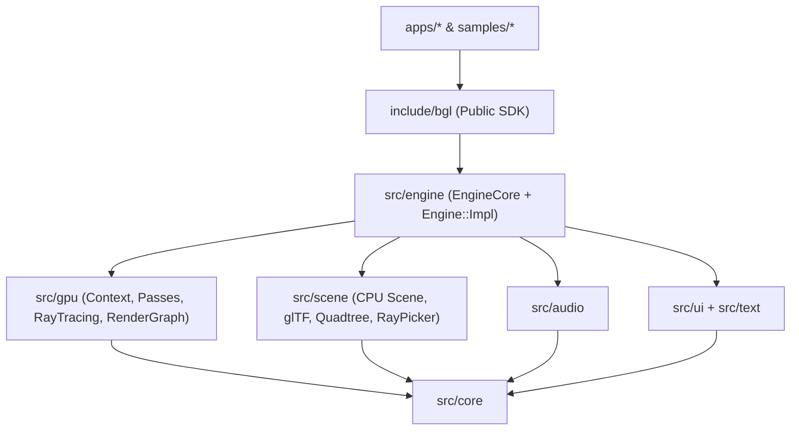

# bgl Engine — Architecture Plan & Remaining Layering Debt

> **Status:** Tiers 1 and 2 (public backend-free SDK under `include/bgl/`, `EngineCore` extraction in `src/engine/`, reference viewer separation under `apps/viewer/`, standalone samples under `samples/`, and automated boundary enforcement via `scripts/check_layering.py`) are complete as of `v1.1.0`. See [ARCHITECTURE.md](ARCHITECTURE.md) for the live module diagram and layering rules.

---

## 1. Design Principles

1. **Single Public Entry Header (`#include <bgl/bgl.hpp>`):** External applications and samples depend exclusively on `include/bgl/*.hpp` (`bgl::App`, `bgl::Engine`, `bgl::Entity`, `bgl::Input`, `bgl::RenderSettings`, `bgl::gui`, `bgl::Sprite`). No `WGPU*`, `webgpu.h`, or `SDL*` headers leak into the public SDK.
2. **Error-as-Value Boundary:** All fallible public and internal APIs return `bgl::core::Result<T>` (`std::expected<T, std::string>`) rather than throwing C++ exceptions across shared-library or C-ABI boundaries.
3. **Reference Viewer Separation:** `apps/viewer/` (`bgl_viewer`) inherits from `bgl::engine::EngineCore` and must remain optional; `src/engine/` never includes or references viewer types (`Application`, `CommandLine`).
4. **Automated Layering Enforcement:** `scripts/check_layering.py` (executed as CTest `LayeringCheck`) enforces allowed `#include` edges between `core`, `audio`, `scene`, `gpu`, `text`, `ui`, `engine`, `include/bgl`, `apps/viewer`, and `samples`.

---

## 2. Known Remaining Debt (Tier 3 Roadmap)

While the public SDK surface is fully decoupled from backend headers, the internal implementation still carries two intentional Tier-3 architectural items frozen by `scripts/check_layering.py`:

| # | Current Coupling | Rationale for Deferral | Target Tier-3 Refactor |
|---|---|---|---|
| 1 | **`src/gpu` includes `scene/*`** (`Scene.hpp`, `Quadtree.hpp`, `TextureDecoder.hpp`) | Avoids breaking changes to `PipelineManager`, `ShadowPass`, `PipelineIBL`, and `RayTracingScene` while stabilizing desktop RT and the public SDK. | Move GPU resource handles out of `scene::Scene` / `MeshPrimitive` into a `GpuScene` cache inside `src/gpu`, leaving `src/scene` strictly CPU-only (`bgl_scene` independent of WebGPU). |
| 2 | **Dual Native / Browser Runtime** (`src/` vs. `web/js/renderer.js` + `src/wasm/wasm_bridge.cpp`) | Preserves the fast, zero-dependency browser WebGPU viewer alongside the freestanding Emscripten WASM bridge (`bgl_engine.wasm`). | Unify native (`wgpu-native`) and WASM (`emdawnwebgpu`) rendering backends inside `bgl::gpu::Context` and `src/engine` behind a shared C++23 core. |
| 3 | **Single-Instance Engine Globals** (`ShaderManager::Instance()`, `ThreadPool::Instance()`, `MemoryTracker::Instance()`) | Simplifies current single-window applications without invasive constructor plumbing. | Inject service instances cleanly via `Engine::Impl` to support multiple independent headless/viewport engine instances in one process. |

---

## 3. Target Layering Diagram (Post Tier-3)

