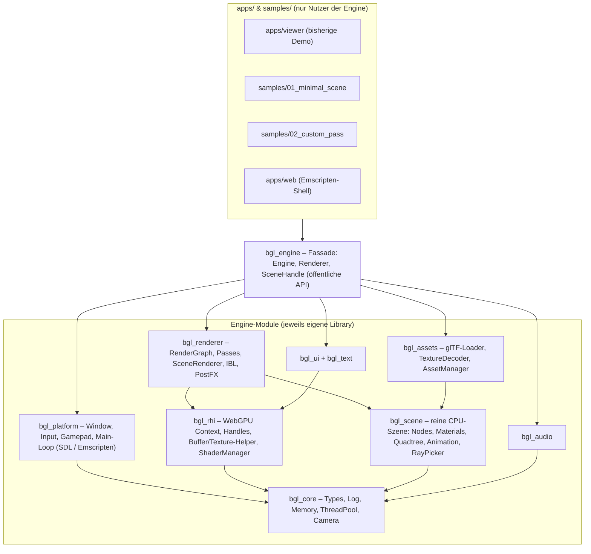

# Umbau zur klar erkennbaren Grafik-Engine

> **Umsetzung:** Die ausführbare, schrittweise Anleitung (für die Umsetzung mit niedrigem Thinking-Effort) steht in [ENGINE_IMPLEMENTATION_GUIDE.md](ENGINE_IMPLEMENTATION_GUIDE.md).
> Dieses Dokument bleibt die **Begründung und das Zielbild**. Abweichungen der Anleitung davon (bewusst, um das Risiko zu senken):
> 1. **Fassade zuerst:** `bgl::App`/`bgl::Engine` entstehen vor der tiefen Entflechtung (Phase A/B dieses Plans = Tier 3 der Anleitung).
> 2. **`Entity` ohne Komponenten-Templates und ohne EnTT** (dünner Wrapper um `SceneNode`); die Komponenten-API (`Add<T>/Get<T>`) ist zurückgestellt.
> 3. **Kein `install(EXPORT)`/`find_package`**, Nutzung per `add_subdirectory` + `bgl::engine`.
> 4. **Web/WASM bleibt unverändert** (CI baut dort nur `wasm_bridge.cpp`; eine einheitliche C++-Web-Engine ist ein eigenes Projekt).
> 5. Das Zielbild „Hello Engine“ in Abschnitt 2a ist in der Anleitung als `samples/01_hello_engine` (ohne Komponenten-Syntax) umgesetzt.

Ziel: Das Repo soll nicht mehr wie eine glTF-Viewer-Demo wirken, sondern wie eine **wiederverwendbare Grafik-Engine** (Library + SDK), mit dem Viewer nur als eine von mehreren Beispiel-Apps.

---

## 1. Ist-Analyse (Befunde im Code)

| # | Befund | Beleg | Problem für „Engine“ |
|---|--------|-------|----------------------|
| 1 | **Zyklische Schichtung** `gpu` ↔ `scene` | `bgl_scene` linkt `bgl_gpu` + `bgl_audio` (`CMakeLists.txt` L269-L274); `gpu/*.hpp` inkludieren `scene/Scene.hpp`, `scene/Quadtree.hpp`; `gpu/Context.cpp` inkludiert `scene/TextureDecoder.hpp` | RHI (GPU-Abstraktion) ist nicht ohne Scene/glTF nutzbar |
| 2 | **Szenendaten enthalten WebGPU-Handles** | `scene/Scene.hpp`: `TextureGpuResource` mit `WGPUTexture/WGPUTextureView/WGPUSampler` | CPU-Daten und GPU-Ressourcen sind vermischt |
| 3 | **`PipelineManager` ist ein God-Object** | `gpu/Pipeline.hpp` (719 Z.) + `Pipeline.cpp` (2074) + `PipelineIBL.cpp` + `PipelineScene.cpp`; ~100 Setter/Getter (Bloom, SSAO, Wetter, LOD, Tonemap …) | Kein klarer Renderer-Einstieg, nicht erweiterbar um eigene Passes |
| 4 | **Frame-Ablauf ist in der Demo hartcodiert** | `Application::Render()` (`app/Application.cpp` L639-L738): Shadow → HDR → Skybox → Snapshot → Transparent → AABB → Outline → PostProcess → Tonemap → UI | Ein Nutzer der Engine kann den Frame nicht selbst zusammenstellen |
| 5 | **`Application` mischt Engine + Demo** | `app/Application.hpp` (427 Z.): SDL-Fenster, Input, Tastatur-Shortcuts, Sun/Tageszeit, Auswahl, Settings-UI, ~60 reine Weiterleitungen an `pipelineManager_`, Sponza/ToyCar-Suchpfade fest verdrahtet | Es gibt keine Engine-API ohne Viewer-Verhalten |
| 6 | **Globale Singletons** | `ShaderManager::Instance()`, `ThreadPool::Instance()`, `MemoryTracker::Instance()` | Mehrere Engine-Instanzen / saubere Tests nicht möglich |
| 7 | **Drei parallele Einstiege** | `src/main.cpp` (C-ABI mit globalem `g_pApp`), `src/wasm/wasm_bridge.cpp` (separater `EngineState`-Stub ohne Engine-Libs), `web/js/renderer.js` (3216 Z. JS-Renderer) | Dreifache Pflege, Web ≠ C++-Engine (siehe `docs/FEATURE_AND_PHYSICS_REPORT.md` A1) |
| 8 | **Kein SDK-Packaging** | Nur Install-Regeln, keine `bgl::`-Alias-Targets, kein Export/`find_package`, `Version.hpp` wird in den Source-Tree geschrieben (`configure_file`), alle Libs im selben Include-Root `src/` | Externe Projekte können die Engine nicht konsumieren |
| 9 | **Name/Positionierung** | README, Binary `bgl_viewer`, Repo-Name `bgl-wasm` | Wirkt wie Demo, nicht wie Engine |

---

## 2. Ziel-Architektur



**Regeln (müssen per CMake erzwungen werden):**

1. Abhängigkeiten zeigen nur **nach unten**. Kein Zyklus (`scene` kennt `rhi` nicht, `rhi` kennt `scene` nicht).
2. `bgl_scene` enthält **keine** `webgpu.h`-Includes. GPU-Ressourcen leben im Renderer (`GpuScene`-Cache).
3. Es gibt **eine** öffentliche Einstiegsklasse (`bgl::Engine`); Apps greifen nicht auf `PipelineManager`/`Context` direkt zu.
4. Keine Singletons im Engine-Kern; Abhängigkeiten werden injiziert (`Engine` besitzt `ShaderManager`, `ThreadPool`, `MemoryTracker`).
5. Die Demo (Viewer) darf nur öffentliche Engine-API benutzen. Das ist der Beweis, dass die Engine nutzbar ist.

---

## 2a. Entwickler-Erfahrung: einfache API mit gängigen Konzepten

Leitidee: Wer schon einmal Unity, Godot, Raylib, Three.js oder Bevy benutzt hat, soll die Engine **ohne Einarbeitung** verstehen. Dafür werden bekannte Muster statt eigener Begriffe verwendet.

| Gängiges Konzept | Bekannt aus | Umsetzung in bgl |
|------------------|-------------|------------------|
| **Application mit Lifecycle-Hooks** (`OnStart/OnUpdate/OnGui/OnShutdown`) | Unity, Godot, Hazel | Basisklasse `bgl::App`; `main()` ist eine Zeile (`BGL_RUN(MyApp)`) |
| **Entity + Components** (`Transform`, `MeshRenderer`, `Light`, `Camera`) | Unity, Godot, Bevy | `Scene` verwaltet `Entity`; Komponenten als einfache Structs (Backend: [EnTT](https://github.com/skypjack/entt), Standard in C++) |
| **Szenen-Hierarchie (Parent/Child)** | alle Engines | `entity.SetParent(other)`; glTF-Knoten werden zu Entities |
| **Asset-Laden mit Handles** | Unity `Resources.Load`, Godot `load()` | `assets.Load<Mesh>("car.glb")`, `Handle<Texture>`, Caching & Referenzzählung intern |
| **Input-Abfrage per Polling** | Raylib, Unity | `Input::IsKeyDown(Key::W)`, `Input::MouseDelta()`, `Input::Gamepad(0).Axis(...)` |
| **Events/Callbacks** (Resize, Drop, Close) | SDL, GLFW | `app.OnResize(...)`, `app.OnFileDrop(...)` |
| **Material/Mesh/Light als Daten-Structs** | Three.js, Unity | `Material{ .baseColor = ..., .metallic = ..., .roughness = ... }` (C++20 designated initializers) |
| **Render-Graph / Pass-Liste** | Unreal, Frostbite, Bevy | `engine.Renderer().Graph().AddPass<MyPass>()` – nur für Fortgeschrittene |
| **Post-Processing als Volume/Stack** | Unity URP | `Camera`-Komponente trägt `PostFx{ bloom, ssao, tonemap }` |
| **Debug-UI im Immediate-Mode** | Dear ImGui | `OnGui()`-Hook; bestehendes `ImmediateUI` bleibt, API an ImGui angelehnt (`ui.Slider("Exposure", &v, 0, 4)`) |
| **Fehler als Wert** | `std::expected` (C++23) | bleibt `core::Result<T>`, keine Exceptions in der API |
| **Dependency-Management & Build** | Standard-C++ | Conan + CMake, `find_package(bgl)` und `FetchContent` |

### Designprinzipien

1. **Sinnvolle Defaults:** Alles startet ohne Konfiguration (PBR, IBL, Schatten, Tonemapping, Skybox an). Konfiguration nur bei Bedarf über `Settings`-Structs.
2. **Nur eine Header-Einstiegsdatei:** `#include <bgl/bgl.hpp>` genügt. Interne Header (`PipelineManager`, `Context`, wgpu) sind **nicht** öffentlich.
3. **Kein WebGPU in der öffentlichen API:** Keine `WGPU*`-Typen in `include/bgl/`. Dadurch einfachere API, stabile ABI (Pimpl) und gleicher Code für Native/Web.
4. **Gleiche Namen überall:** Eine Konvention (`PascalCase` Typen/Methoden, `camelCase` Felder), alles in `namespace bgl`, Doxygen-Kommentare an jeder öffentlichen Funktion.
5. **Progressive Offenlegung:** Stufe 1 `App` + Entities (Einsteiger) → Stufe 2 `RenderSettings`/`Material` (Fortgeschrittene) → Stufe 3 `RenderGraph`/eigene Passes/RHI (Experten).
6. **Lesbare Fehlermeldungen:** Jedes `Result` enthält Kontext (z. B. „Datei ‚car.glb‘ nicht gefunden – gesucht in: …“).
7. **Kurze Beispiele statt langer Doku:** Jedes Feature hat ein Sample < 50 Zeilen.

### So soll ein „Hello Engine“ aussehen (Zielbild)

```cpp
#include <bgl/bgl.hpp>

class MyApp : public bgl::App {
public:
    void OnStart() override {
        auto model = Assets().Load<bgl::Model>("assets/ToyCar.glb");
        car_ = Scene().Instantiate(model);             // Entity mit Kindern

        auto sun = Scene().CreateEntity("Sun");
        sun.Add<bgl::Light>({ .type = bgl::LightType::Directional, .intensity = 3.0f });

        camera_ = Scene().CreateEntity("Camera");
        camera_.Add<bgl::Camera>({ .fovDegrees = 60.0f });
        camera_.Get<bgl::Transform>().position = {0, 1.5f, 5};
    }

    void OnUpdate(float dt) override {
        car_.Get<bgl::Transform>().Rotate(Y_AXIS, 0.5f * dt);
        if (bgl::Input::IsKeyPressed(bgl::Key::Escape)) Quit();
    }

    void OnGui() override {
        bgl::ui::Slider("Exposure", &Renderer().Settings().tonemap.exposure, 0.0f, 4.0f);
    }

private:
    bgl::Entity car_, camera_;
};

BGL_RUN(MyApp)    // erzeugt main(), Fenster, Engine, Loop – nativ und im Browser
```

Eigener Render-Pass (Stufe 3):

```cpp
struct VignettePass : bgl::RenderPass {
    void Execute(bgl::FrameContext& f) override { /* Fullscreen-Draw */ }
};
Renderer().Graph().InsertAfter("Tonemap", std::make_unique<VignettePass>());
```

---

## 3. Ziel-Verzeichnisstruktur

```text
bgl-engine/
├── CMakeLists.txt                  # dünn: add_subdirectory(engine), apps, samples, tests
├── cmake/                          # BglOptions.cmake, BglInstall.cmake, bglConfig.cmake.in
├── engine/
│   ├── include/bgl/                # ÖFFENTLICHE Header (SDK)
│   │   ├── Engine.hpp
│   │   ├── Renderer.hpp
│   │   ├── RenderSettings.hpp
│   │   ├── Scene.hpp
│   │   ├── Camera.hpp
│   │   ├── RenderGraph.hpp
│   │   └── Version.hpp             # generiert ins Build-Dir
│   └── src/
│       ├── core/      ├── platform/   ├── rhi/      ├── scene/
│       ├── assets/    ├── renderer/   ├── ui/       ├── text/     └── audio/
├── apps/
│   ├── viewer/                     # bisheriges Application/main/CommandLine/DebugOverlay-Verhalten
│   └── web/                        # Emscripten-Shell + index.html
├── samples/                        # kleine, kommentierte Beispiele (je eigene main.cpp)
├── assets/  shaders/ (optional)    # Beispieldaten
├── tests/
└── docs/                           # ARCHITECTURE.md, GETTING_STARTED.md, API.md
```

Die Umbenennung von `src/` nach `engine/src` kann ganz am Schluss erfolgen (Schritt 11). Bis dahin reicht es, die Libraries logisch zu trennen.

---

## 4. Anweisungen (Schritt für Schritt)

> Nach **jedem Schritt** muss `task build` / `ctest` grün sein. Kleine, einzeln committbare PRs.

### Phase A – Abhängigkeiten entwirren (Fundament)

**Schritt 1 – Szenendaten von WebGPU trennen**
- In `scene/Scene.hpp` `TextureGpuResource` und alle `WGPU*`-Felder aus `Scene`, `Material`, `MeshPrimitive` entfernen.
- Stattdessen opake IDs einführen: `struct TextureId { uint32_t value; }`, `MeshId`, `MaterialId`.
- Neues Modul `renderer/GpuScene.{hpp,cpp}`: `class GpuScene` hält `unordered_map<MeshId, GpuMesh>`, `unordered_map<TextureId, GpuTexture>`, Bind-Groups. Besitzt die Logik aus `PipelineManager::PrepareScene` / `RebuildMaterialBindGroups` / `RetranscodeKtxTextures` (`PipelineScene.cpp`).
- Akzeptanz: `grep -r "webgpu" src/scene` liefert nichts.

**Schritt 2 – `TextureDecoder`/Loader aus `scene` in `assets` auslagern**
- `FastGltfLoader`, `TextureDecoder`, `AssetManager` → neue Library `bgl_assets` (linkt `bgl_scene`, `fastgltf`, PNG/JPEG/WebP/KTX).
- `gpu/Context.cpp` darf `scene/TextureDecoder.hpp` nicht mehr inkludieren (Typen wie `KtxTranscodeTarget` nach `core/` oder `rhi/TextureFormat.hpp` verschieben).
- `bgl_scene` linkt nur noch `bgl_core` (kein `bgl_gpu`, kein `bgl_audio`).

**Schritt 3 – `gpu` aufteilen in `rhi` und `renderer`**
- `bgl_rhi`: `Context`, `Handle`, `ShaderManager`, `DrawHelpers` (`DynamicUniformRing`, `DynamicInstanceBuffer`), `PipelineHelpers`, `Uniforms` (nur generische), alle `*.wgsl`-Infrastruktur.
- `bgl_renderer`: `Pipeline*`, `ShadowPass`, `PostProcessPass`, `Skybox`, `AabbRenderer`, `GpuCuller`, `GpuRayPicker`, `GpuScene`, `shaders/*.wgsl`.
- Header, die `scene/*` brauchen (`AabbRenderer`, `ShadowPass`, `GpuCuller`, `GpuRayPicker`), wandern nach `renderer/`.
- Akzeptanz: `bgl_rhi` linkt nur `bgl_core`; `bgl_renderer` linkt `bgl_rhi` + `bgl_scene`.

**Schritt 4 – Singletons entfernen**
- `ShaderManager::Instance()` → Member von `Engine`/`Renderer`, per Referenz an `PipelineManager`/Passes übergeben. Die statische Embedded-Lookup-Funktionen (`GetEmbeddedRaw/Preprocessed`) bleiben (sind zustandslos).
- `ThreadPool::Instance()` und `MemoryTracker::Instance()` → `Engine` besitzt sie; Zugriff über `EngineContext&`.
- Akzeptanz: Zwei `Engine`-Instanzen im Test erzeugbar.

### Phase B – Renderer modularisieren

**Schritt 5 – Render-Passes als Interface + Render-Graph**
- Interface einführen:
  ```cpp
  // renderer/RenderPass.hpp
  struct FrameContext {            // alles, was ein Pass pro Frame braucht
      const scene::Scene* scene; const Camera* camera;
      WGPUCommandEncoder encoder; RenderTargets& targets;
      float dt, time; RenderSettings const& settings;
  };
  class RenderPass {
  public:
      virtual ~RenderPass() = default;
      virtual std::string_view Name() const = 0;
      virtual core::Result<void> Setup(RhiDevice&, ShaderManager&) = 0;
      virtual void Execute(FrameContext&) = 0;
  };
  ```
- `RenderGraph` hält eine geordnete Liste von Passes (`AddPass`, `InsertBefore`, `Remove`, `Enable(name,bool)`).
- Bestehenden Code als Passes kapseln (reine Umverpackung, kein Verhalten ändern):
  `ShadowDepthPass`, `OpaqueForwardPlusPass`, `SkyboxPass`, `OpaqueSnapshotPass`, `TransparentPass`, `DebugLinesPass` (AABB/Quadtree), `SelectionOutlinePass`, `PostProcessPass` (existiert), `TonemapPass`, `UiPass`.
- Die Reihenfolge aus `Application::Render()` wird zum `DefaultRenderGraph::Build()` in `renderer/`.
- Akzeptanz: Golden-Image-Test (`tests/test_golden_image.cpp`) liefert identisches Bild.

**Schritt 6 – `PipelineManager` zerlegen**
- Ziel: `PipelineManager` verschwindet oder schrumpft zu `SceneRenderer` (nur Opaque/Transparent-Zeichnen + Clustered-Lighting).
- Auslagern:
  - `EnvironmentSystem` (Presets, Cubemap, SH, BRDF-LUT, GGX-Prefilter → `PipelineIBL.cpp`).
  - `WeatherSystem` (Mode, Intensität, Wind, Zeit, TimeOfDay, Solar-Elevation).
  - `LodSystem` (LOD-Bias, Auto-LOD, Heatmap, Debug-View).
  - `MipmapGenerator` (`GenerateTextureMipsGpu`, CPU-Mips).
  - Statische reine CPU-Helper (`EvaluateRain…`, `ApplyToneMappingCPU`, `ComputeSphericalHarmonicsL2` …) → `renderer/math/` (bleiben unit-testbar).
- Die ~100 Einzel-Setter ersetzen durch **eine** Struct (Schritt 7).

**Schritt 7 – Einheitliche `RenderSettings`**
- Eine POD-Struct statt Setter-Flut:
  ```cpp
  struct RenderSettings {
      struct Shadows   { bool enabled=true; uint32_t mapSize=2048; } shadows;
      struct Bloom     { bool enabled=true; float intensity, threshold; } bloom;
      struct Ssao      { bool enabled=true; float intensity, radius; } ssao;
      struct Tonemap   { ToneMapOperator op; float exposure; } tonemap;
      struct Lod       { bool enabled=true; bool autoLod=false; float bias=1; } lod;
      struct Weather   { WeatherMode mode; float intensity, wind; } weather;
      struct Sky       { float timeOfDay=14; EnvironmentPreset env; } sky;
      DebugViewMode debugView = DebugViewMode::LitPbr;
      // …
  };
  ```
- `Renderer::Settings()` gibt `RenderSettings&` zurück; Passes lesen nur daraus. Bestehende Werte in `ApplicationConfig` (`app/Application.hpp` L34-L58) werden 1:1 in `RenderSettings` überführt.
- Die ~60 Weiterleitungs-Methoden in `Application` (Toggle*/Set*/Is*) entfallen; UI und WASM-Bridge schreiben direkt in `RenderSettings`.

### Phase C – Öffentliche Engine-API

**Schritt 8 – `bgl::App` + `bgl::Engine`-Fassade + `bgl_platform`** (Zielbild siehe Abschnitt 2a)
- `bgl_platform` (neu): `Window` (SDL2 nativ / `<emscripten/html5.h>` Web), `InputState`, `Gamepad` (aus `core/`), `RunLoop`. Der gesamte SDL-Code aus `Application.cpp` (Init, `SDL_PollEvent`, Tastatur-Handling L406-L470) zieht hierher bzw. in die Viewer-App.
- `Engine` (in `engine/include/bgl/Engine.hpp`):
  ```cpp
  namespace bgl {
  struct EngineDesc { uint32_t width=1280, height=720; bool headless=false; RenderSettings render{}; };

  class Engine {
  public:
      static core::Result<std::unique_ptr<Engine>> Create(const EngineDesc&, Window* = nullptr);
      core::Result<SceneHandle> LoadScene(std::string_view uriOrPath);   // glTF/GLB, lokal/URL
      void   SetActiveScene(SceneHandle);
      Camera& GetCamera();
      RenderSettings& Settings();
      RenderGraph& Graph();                       // eigene Passes einhängen
      void   Update(float dt);                    // Animation, Culling-Index
      void   RenderFrame();                       // führt den Graph aus
      core::Result<Image> ReadbackFrame();        // Screenshots / Tests
      // Picking, Selection, Lights, Audio:
      std::optional<NodeId> Pick(float x, float y);
      AudioEngine& Audio();
  };
  }
  ```
- `Engine` darf **kein** SDL im Header exponieren und **keine** Demo-Logik (Sponza-Suchpfade, Tastenkürzel, Settings-UI) enthalten.
- **`bgl::App` (Einsteiger-API) über `Engine` legen:** Basisklasse mit `OnStart/OnUpdate/OnGui/OnResize/OnFileDrop/OnShutdown`, Zugriff auf `Scene()`, `Assets()`, `Renderer()`, `Audio()`, `Quit()`. Makro `BGL_RUN(MyApp)` erzeugt `main()` (nativ) bzw. die Emscripten-Loop (Web). Engine-Nutzer, die eine eigene Loop wollen, nutzen `Engine` direkt.
- **`Input` als statische/Polling-API** (`IsKeyDown/Pressed/Released`, `MousePosition/Delta/Wheel`, Gamepad) auf Basis des bestehenden `core::Gamepad` + SDL/Emscripten-Events. Einheitliche `Key`-/`MouseButton`-Enums, unabhängig von SDL-Keycodes.
- **Öffentliche Header ohne WebGPU/SDL**: Implementierung per Pimpl (`std::unique_ptr<Impl>`).

**Schritt 8b – Entity/Component-Schicht (gängiges Szenenmodell)**
- `Scene` bekommt eine Entity-API: `CreateEntity(name)`, `Destroy(e)`, `e.Add<T>()`, `e.Get<T>()`, `e.Has<T>()`, `e.SetParent(p)`, `Scene().View<Transform, MeshRenderer>()`.
- Backend: EnTT (via Conan, `conanfile.py` ergänzen). Das vorhandene `SceneNode`-Hierarchie-Modell wird auf Komponenten abgebildet:
  | Bisher | Neu |
  |--------|-----|
  | `SceneNode` (TRS, Parent/Children) | `Transform` + `Hierarchy` |
  | `MeshPrimitive` | `MeshRenderer{ Handle<Mesh>, Handle<Material> }` |
  | `PunctualLight` | `Light` |
  | `SceneCamera` | `Camera` |
  | Animation / Skin / Morph | `Animator`, `SkinnedMesh` |
  | `worldAABB` | `Bounds` (vom Renderer/Quadtree berechnet) |
- `FastGltfLoader` erzeugt ein `Model` (CPU-Daten); `Scene::Instantiate(model)` erzeugt daraus Entities (wie Unity-Prefab).
- `Quadtree`, `RayPicker`, Culling und Renderer arbeiten auf `View<Transform, MeshRenderer, Bounds>`.
- Optional/zweite Welle: Wenn der Umbau zu groß ist, zuerst nur die API-Fassade (`Entity` als dünner Wrapper um `SceneNode`) liefern und EnTT später austauschen – die Nutzer-API bleibt gleich.

**Schritt 9 – Viewer-Demo in `apps/viewer` verschieben**
- `app/Application.*`, `app/CommandLine.*`, `main.cpp` → `apps/viewer/`. Nur noch Aufrufe der öffentlichen `Engine`-API.
- Hier bleiben: Tastenkürzel, Orbit/Fly-Steuerung, Auswahl-Gizmos, Tag/Nacht-Zyklus, Settings-UI (`ImmediateUI`), Debug-Overlay-Befüllung, Modell-Suchpfade, Drag&Drop.
- `CHANGELOG`/README: Viewer wird als „Reference Application of the bgl Engine“ geführt.

**Schritt 10 – Ein einziger Web-Einstieg**
- Ziel laut `docs/FEATURE_AND_PHYSICS_REPORT.md` A1: **eine** C++-Engine für Native und Web.
- `wasm_bridge.cpp` (isolierter Stub) und `web/js/renderer.js` (parallele JS-Engine) schrittweise entfernen. `Context` für `BGL_PLATFORM_WASM` implementieren (emdawnwebgpu), `TextureDecoder` über Browser-Codecs.
- Die C-ABI (`bgl_toggle_*`, `bgl_set_*`) aus `main.cpp` in `apps/web/bgl_web_api.cpp` verschieben und auf `Engine::Settings()` aufbauen (generisch: `bgl_set_float("bloom.intensity", v)` statt eine Funktion pro Schalter).
- `web/` wird zur dünnen DOM-Shell (HUD, Datei-Drop, URL-Eingabe).

### Phase D – SDK, Doku, Sichtbarkeit

**Schritt 11 – CMake als SDK**
- Pro Modul `add_library(bgl_xyz …)` **plus** `add_library(bgl::xyz ALIAS bgl_xyz)`; Meta-Target `bgl::engine`.
- Öffentliche Header nur über `target_include_directories(... PUBLIC $<BUILD_INTERFACE:…/include> $<INSTALL_INTERFACE:include>)`; private Header in `src/`.
- `Version.hpp` nach `${CMAKE_CURRENT_BINARY_DIR}/generated/bgl/` generieren (nicht in den Source-Tree).
- `install(EXPORT bglTargets NAMESPACE bgl:: …)` + `bglConfig.cmake` → externes Projekt kann `find_package(bgl REQUIRED)` und `target_link_libraries(app PRIVATE bgl::engine)` nutzen.
- Option `BGL_BUILD_VIEWER`, `BGL_BUILD_SAMPLES`, `BGL_BUILD_TESTING` (existierende `BGL_ENABLE_*` bleiben).
- Optional danach: `src/` → `engine/src` umbenennen, Projekt `bgl-engine`.

**Schritt 12 – Samples als Nachweis**
- `samples/01_hello_engine`: ~30 Zeilen mit `bgl::App` (siehe Zielbild in 2a): Modell laden, Licht, Kamera.
- `samples/02_input_and_camera`: Orbit-/Fly-Kamera mit `Input`.
- `samples/03_entities`: Entities, Parent/Child, eigene Komponente.
- `samples/04_materials_and_lights`: PBR-Materialien, Punkt-/Spot-Lichter, IBL-Presets.
- `samples/05_postfx_ui`: `RenderSettings`, `OnGui()`.
- `samples/06_custom_pass`: eigenen `RenderPass` (z. B. Vignette) in den Graph einhängen.
- `samples/07_headless_render`: Frame rendern, `ReadbackFrame()` → PNG (nutzt auch Golden-Image-Test).
- Jedes Sample läuft **unverändert nativ und im Browser** (WASM) und ist im README mit Screenshot verlinkt.
- CI baut alle Samples.

**Schritt 13 – Tests an neue Schichten anpassen**
- `tests/` nach Modulen gruppieren (`core`, `rhi`, `scene`, `assets`, `renderer`, `engine`).
- Tests linken nur das jeweils nötige Modul statt `bgl_app` (aktuell `CMakeLists.txt` L372/L374). Das macht Architekturverletzungen sofort sichtbar.
- Neuer Test: `engine_smoke` über die öffentliche API (headless).
- Optional: CI-Check (`scripts/check_layering.py`), der verbotene `#include`s pro Modul findet (z. B. `scene` → `webgpu`/`rhi`).

**Schritt 14 – Dokumentation & Branding**
- README neu gliedern: *1. Was ist bgl-Engine* (Feature-Matrix, Architekturdiagramm aus Abschnitt 2) → *2. Quickstart (Samples)* → *3. Modulübersicht* → *4. Viewer-Demo*.
- Neue Dateien: `docs/ARCHITECTURE.md` (Schichten, Regeln, Frame-Ablauf/Render-Graph), `docs/GETTING_STARTED.md` (CMake-Einbindung, erstes Programm), `docs/CONCEPTS.md` (App-Lifecycle, Entity/Component, Assets, Input – mit Verweis auf vergleichbare Konzepte in Unity/Godot), `docs/CHEATSHEET.md` (1 Seite: häufigste API-Aufrufe), `docs/WRITING_A_RENDER_PASS.md`.
- `CONTRIBUTING.md` mit Code-Stil (`.clang-format`/`.clang-tidy` sind vorhanden), Namenskonvention und „Wie füge ich ein Feature + Sample hinzu“.
- Doxygen-Setup für `engine/include/bgl/`.
- Screenshot `assets/sponza_screenshot.png` als „Rendered with bgl Engine“; Viewer klar als Demo labeln.
- `AGENT_INSTRUCTIONS.md` um die Layering-Regeln aus Abschnitt 2 ergänzen.

---

## 5. Empfohlene Reihenfolge & Aufwand

| Phase | Schritte | Risiko | Grobe Größe |
|-------|----------|--------|-------------|
| A Entwirren | 1-4 | mittel (viele Includes verschieben) | groß |
| B Renderer | 5-7 | mittel (Golden-Image als Sicherheitsnetz) | groß |
| C API | 8-10 | hoch (Web-Vereinheitlichung) | sehr groß |
| D SDK/Doku | 11-14 | niedrig | mittel |

**Schnellster sichtbarer Gewinn** (falls nur wenig Zeit): Schritte **9 + 12 + 14** zuerst in „light“-Form – Demo nach `apps/viewer` verschieben, ein `samples/01_minimal_scene` ergänzen, README mit Architekturdiagramm umschreiben. Die Struktur ist dann sofort als Engine erkennbar, die tiefere Entkopplung (Phasen A-C) folgt danach.

---

## 6. Definition of Done

- [ ] `bgl_scene` und `bgl_rhi` haben keine Abhängigkeit zueinander; kein Zyklus im CMake-Graph.
- [ ] Kein `WGPU*` in `scene/`; keine `scene/*`-Includes in `rhi/`.
- [ ] Keine `::Instance()`-Singletons im Engine-Kern.
- [ ] Frame wird über `RenderGraph` aufgebaut; eigener Pass in `samples/02_custom_pass` lauffähig.
- [ ] Alle Renderer-Optionen in `RenderSettings`; keine Weiterleitungs-Wrapper in der App.
- [ ] `apps/viewer` nutzt ausschließlich die öffentliche API (`bgl::App`/`bgl::Engine`).
- [ ] „Hello Engine“ aus Abschnitt 2a kompiliert und läuft nativ und im Browser mit ≤ 30 Zeilen.
- [ ] `#include <bgl/bgl.hpp>` genügt; kein `WGPU*`/SDL-Typ in `include/bgl/`.
- [ ] Szene nutzt Entity/Component-Modell (`Transform`, `MeshRenderer`, `Light`, `Camera`) mit `Instantiate(model)`.
- [ ] Alle öffentlichen Funktionen sind mit Doxygen dokumentiert; `docs/CONCEPTS.md` und `docs/CHEATSHEET.md` existieren.
- [ ] Ein C++-Renderer für Native **und** Web (JS-Renderer entfernt).
- [ ] `find_package(bgl)` + `bgl::engine` funktioniert aus einem externen Mini-Projekt.
- [ ] Golden-Image-Test unverändert grün; CI baut Engine, Viewer, Samples, Tests.
- [ ] README/ARCHITECTURE/GETTING_STARTED beschreiben das Repo als Engine.
