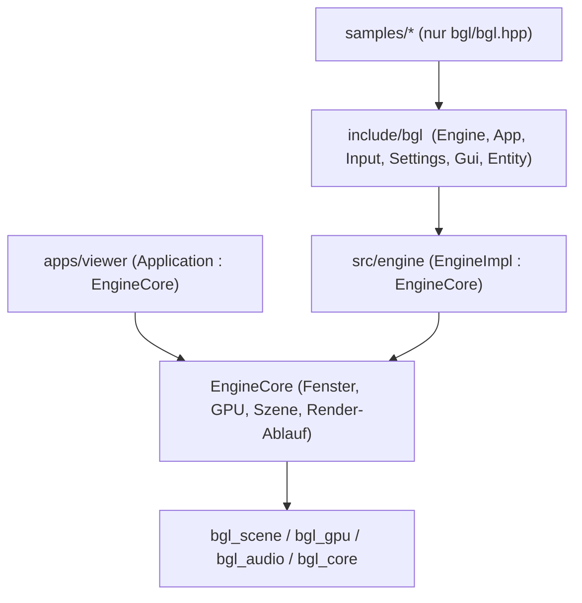

# bgl Engine – Umsetzungsanleitung (Schritt für Schritt)

> **Zweck:** Diese Anleitung ist für eine **mechanische Umsetzung durch ein Modell mit niedrigem Thinking-Effort** geschrieben.
> Das *Warum* steht in [ENGINE_ARCHITECTURE_PLAN.md](ENGINE_ARCHITECTURE_PLAN.md). Hier steht nur das *Was* und *Wie* – exakt, in fester Reihenfolge, mit Prüfbefehlen.
> **Stand der Analyse:** Arbeitsbaum vom 2026-11-16 (`src/app/Application.cpp` hat dort 1312 Zeilen). Zeilennummern sind nur Orientierung – **maßgeblich sind Funktionsnamen**.

---

## 0. Regeln für den Ausführenden (immer lesen)

1. **Reihenfolge einhalten.** Genau eine Aufgabe (`T00`, `T01`, …) zur Zeit. Nie Aufgaben mischen, nie vorziehen.
2. **Nach jeder Aufgabe:** Build + Tests + Format-Check (Abschnitt 0.1) → nur wenn grün: Commit mit der vorgegebenen Message.
3. **Reine Verschiebe-/Umbau-Aufgaben ändern kein Verhalten.** Keine „Verbesserungen“ nebenbei, keine Umbenennungen, die hier nicht stehen.
4. **Kommentare und Docstrings erhalten** (beim Verschieben mitnehmen, nicht löschen).
5. **Dateien verschieben nur mit `git mv`.**
6. **Nicht anfassen:** `web/`, `src/wasm/`, `third_party/`, `assets/`, die WASM-Schritte in `.github/workflows/ci.yml`, `CHANGELOG.md` (historische Einträge).
7. **Bei Fehlern:** höchstens 3 Korrekturversuche pro Aufgabe. Danach `git stash`-frei abbrechen, in `docs/PROGRESS.md` mit `BLOCKED` und der Fehlermeldung eintragen und **stoppen** (nicht weiterarbeiten).
8. **Wenn der Code von dieser Anleitung abweicht** (Funktion fehlt, andere Signatur): Ziel und Akzeptanzkriterium der Aufgabe gelten. Abweichung in `docs/PROGRESS.md` unter „Abweichungen“ notieren.
9. **Fortschritt protokollieren:** nach jeder Aufgabe eine Zeile in `docs/PROGRESS.md` (Vorlage am Ende, Abschnitt 6).
10. **Namenskonvention:** Typen/Funktionen `PascalCase`, Member `camelCase_` (mit Unterstrich bei privaten/protected), Namespaces `bgl::…`, Dateien `PascalCase.hpp/.cpp`. C++23. Doxygen-Kommentar (`/** @brief … */`) an jeder neuen öffentlichen Funktion.
11. **Die Sprache der Code-Kommentare ist Englisch**, wie im restlichen Repo.

### 0.1 Standard-Prüfbefehle („V-CMD“)

Aus dem Repo-Root ausführen. Das Build-Verzeichnis `build/Release` existiert bereits (Conan-Toolchain).

```bash
# 1) (nur nach Änderungen an CMakeLists.txt oder neuen Dateien) neu konfigurieren
cmake -B build/Release

# 2) bauen
cmake --build build/Release -j"$(nproc)" 2>&1 | tail -40

# 3) testen (Browser-E2E ist ausgenommen)
ctest --test-dir build/Release --output-on-failure -E BrowserE2ETest

# 4) Format prüfen (Verzeichnisse je nach Stand der Aufgaben, siehe T01/T09)
find src apps tests \( -name "*.cpp" -o -name "*.hpp" \) -print0 | xargs -0 clang-format --dry-run -Werror
# Formatieren (nur geänderte Dateien):  clang-format -i <datei>
```

Falls `build/Release` fehlt: `task configure` (führt `conan install` + `cmake` aus).

**Akzeptanz jeder Aufgabe:** (2) ohne Fehler, (3) gleiche Testergebnisse wie in `T00` gemessen, (4) ohne Befund.

---

## 1. Bereits getroffene Entscheidungen (nicht neu diskutieren)

| Thema | Entscheidung |
|-------|--------------|
| Reihenfolge | **Fassade zuerst** (sichtbare Engine-API), tiefe Entflechtung erst danach (Tier 3, optional). Grund: Risiko minimal, Build bleibt in jedem Schritt grün. |
| Aufspaltung `Application` | **„Extract Superclass“:** neue Basisklasse `bgl::engine::EngineCore`, `bgl::app::Application` erbt davon. Keine Umbenennung von Membern → kein sed nötig. |
| Verzeichnis `src/` | Bleibt. Neu: `include/bgl/` (öffentliche Header), `src/engine/`, `apps/viewer/`, `samples/`. |
| Öffentliche API | `bgl::Engine` (Pimpl), `bgl::App` + `BGL_RUN`, `bgl::Input`, `bgl::RenderSettings`, `bgl::gui::*`, `bgl::Entity`. **Kein** WebGPU/SDL in `include/bgl/`. |
| Szenenmodell | `Entity` ist ein dünner Wrapper um `scene::SceneNode` (Transform, Parent, Licht). **Keine** `Add<T>()/Get<T>()`-Komponenten, **kein EnTT** in diesem Durchgang. |
| Konsum durch Dritte | `add_subdirectory(...)` + `target_link_libraries(x PRIVATE bgl::engine)`. **Kein** `install(EXPORT)`/`find_package` in diesem Durchgang. |
| Web/WASM | **Unverändert lassen.** Öffentliche API wird nur für `BGL_PLATFORM_NATIVE` gebaut. |
| Singletons (`ShaderManager::Instance` …) | Bleiben in diesem Durchgang. |
| `gpu → scene`-Abhängigkeit, WGPU-Handles in `Scene.hpp` | Bleiben in diesem Durchgang (Tier 3). Wird nur durch ein Skript eingefroren (T02). |

---

## 2. Zielbild nach Tier 1 + 2

```text
include/bgl/                  ÖFFENTLICH: bgl.hpp Types.hpp Settings.hpp Input.hpp Engine.hpp App.hpp Gui.hpp Entity.hpp
src/core src/gpu src/scene …  unverändert (intern)
src/engine/                   EngineCore (intern, aus Application extrahiert), EngineImpl, Engine.cpp, App.cpp, Input.cpp, …
apps/viewer/                  bisherige Demo (Application, CommandLine, main.cpp) – nur noch „eine App auf der Engine“
samples/                      01_hello_engine, 02_entities_and_lights
scripts/check_layering.py     verhindert verbotene #includes (läuft als CTest)
```



---

# TIER 1 – Struktur und Engine-Kern (Pflicht)

## T00 – Vorbereitung und Messung

**Ziel:** Branch, Snapshot, Baseline der Tests.

**Schritte**
1. `git status --short` ausführen. Es gibt bereits uncommittete Änderungen (u. a. `README.md`, `src/app/Application.*`, `src/gpu/*`). **Nichts verwerfen.**
2. `git switch -c feature/engine-architecture`
3. `git add -A && git commit -m "chore: snapshot working tree before engine refactor"`
4. V-CMD (1)–(3) ausführen. Ergebnis (Anzahl bestanden/fehlgeschlagen **und Namen fehlgeschlagener Tests**) in `docs/PROGRESS.md` unter „Baseline“ eintragen (Datei anlegen mit der Vorlage aus Abschnitt 6).
   - Tests, die schon vor dem Umbau fehlschlagen (z. B. wegen fehlender GPU/Display), sind **kein** Regress; sie werden nur notiert.
5. Commit: `docs: add PROGRESS.md baseline`

**Akzeptanz:** Branch existiert, `docs/PROGRESS.md` enthält Baseline.

---

## T01 – Viewer nach `apps/viewer` verschieben (reines Verschieben)

**Ziel:** Die Demo liegt nicht mehr im Engine-Quellbaum.

**Schritte**
1. ```bash
   mkdir -p apps/viewer
   git mv src/app/Application.hpp src/app/Application.cpp src/app/CommandLine.hpp src/app/CommandLine.cpp apps/viewer/
   git mv src/main.cpp apps/viewer/main.cpp
   rmdir src/app 2>/dev/null || true
   ```
2. Include-Pfade ersetzen. Zuerst Fundstellen suchen: `grep -rn '"app/' src apps tests`. Dann ersetzen:
   - `#include "app/Application.hpp"` → `#include "viewer/Application.hpp"` (in `apps/viewer/Application.cpp`, `apps/viewer/main.cpp`, `tests/test_rendering_features.cpp`)
   - `#include "app/CommandLine.hpp"` → `#include "viewer/CommandLine.hpp"` (in `apps/viewer/CommandLine.cpp`, `apps/viewer/main.cpp`, `tests/test_command_line.cpp`)
   - Namespaces (`bgl::app`) **nicht ändern**.
3. `CMakeLists.txt`, Abschnitt `# 7. libbgl_app`:
   - Quellen `src/app/Application.cpp` → `apps/viewer/Application.cpp`, `src/app/CommandLine.cpp` → `apps/viewer/CommandLine.cpp`
   - Direkt nach `target_link_libraries(bgl_app PUBLIC …)` einfügen:
     ```cmake
     target_include_directories(bgl_app PUBLIC
         $<BUILD_INTERFACE:${CMAKE_CURRENT_SOURCE_DIR}/apps>
     )
     ```
   - Abschnitt `# 8.`: `add_executable(bgl_viewer src/main.cpp)` → `add_executable(bgl_viewer apps/viewer/main.cpp)`
4. Format-/Lint-Aufrufe aktualisieren:
   - `Taskfile.yml` (Task `format`): `find src tests` → `find src apps tests`
   - `.github/workflows/ci.yml` (Zeile mit `clang-format --dry-run`): ebenso
   - `scripts/run_ci_locally.sh` (Zeile mit `clang-format --dry-run`): ebenso
   - `Taskfile.yml` (Task `lint`, Zeile `run-clang-tidy …`): Muster `'src/(app|audio|core|gpu|scene|text|ui)/.*\.cpp$' src/main.cpp` → `'(src/(audio|core|gpu|scene|text|ui)|apps/viewer)/.*\.cpp$'`
5. Restverweise suchen und anpassen: `grep -rn "src/app\|src/main.cpp" --exclude-dir=build --exclude-dir=.git --exclude=CHANGELOG.md .` (Treffer in `README.md`, `.vscode/tasks.json`, `.clang-tidy` o. Ä. auf `apps/viewer/...` ändern).
6. V-CMD (1)–(4).

**Akzeptanz:** `src/app` und `src/main.cpp` existieren nicht mehr; Build/Tests wie Baseline; `bgl_viewer --headless assets/ToyCar.glb` verhält sich wie vorher.

**Commit:** `refactor(app): move viewer sources to apps/viewer`

---

## T02 – CMake-Targets benennen + Layering-Wächter

**Ziel:** Saubere Target-Namen (`bgl::…`), Viewer als eigenes Target, automatische Include-Regeln.

**Schritte**
1. In `CMakeLists.txt` **alle** Vorkommen des Targets `bgl_app` durch `bgl_viewer_lib` ersetzen (`add_library`, `target_link_libraries(bgl_app …)`, `target_include_directories(bgl_app …)`, Link von `bgl_viewer`, beide Zeilen `target_link_libraries(bgl_unit_tests …)`, `install(TARGETS …)`). Suche: `grep -n "bgl_app" CMakeLists.txt`. Außerhalb von `CMakeLists.txt`: `grep -rn "bgl_app" --exclude-dir=build --exclude-dir=.git --exclude=CHANGELOG.md .` und Treffer in Skripten/Doku ersetzen.
2. Alias-Targets direkt hinter dem jeweiligen `add_library(...)`-Block ergänzen:
   ```cmake
   add_library(bgl::core  ALIAS bgl_core)
   add_library(bgl::gpu   ALIAS bgl_gpu)
   add_library(bgl::audio ALIAS bgl_audio)
   add_library(bgl::scene ALIAS bgl_scene)
   add_library(bgl::text  ALIAS bgl_text)
   add_library(bgl::ui    ALIAS bgl_ui)
   ```
3. Datei `scripts/check_layering.py` anlegen (Inhalt unten, **unverändert übernehmen**). Ausführbar machen: `chmod +x scripts/check_layering.py`.
4. CTest-Eintrag in `CMakeLists.txt` direkt hinter `add_test(NAME AllUnitTests …)` / dessen `set_tests_properties` ergänzen (innerhalb `if(BGL_BUILD_TESTING)`):
   ```cmake
   find_package(Python3 COMPONENTS Interpreter)
   if(Python3_FOUND)
       add_test(NAME LayeringCheck COMMAND ${Python3_EXECUTABLE} "${CMAKE_CURRENT_SOURCE_DIR}/scripts/check_layering.py")
   endif()
   ```
5. In `.github/workflows/ci.yml` direkt nach dem `clang-format`-Schritt einen Schritt ergänzen, der `python3 scripts/check_layering.py` ausführt (Einrückung/Stil des Nachbarschritts kopieren).
6. V-CMD. `ctest -R LayeringCheck --test-dir build/Release` muss `layering check: OK` melden.

**`scripts/check_layering.py`** (getestet gegen den aktuellen Stand → 0 Verstöße):

```python
#!/usr/bin/env python3
"""Fails if a module includes a header from a module it must not depend on."""
import re
import sys
from pathlib import Path

ROOT = Path(__file__).resolve().parent.parent
INCLUDE_RE = re.compile(r'^\s*#\s*include\s+"([^"]+)"', re.MULTILINE)

# module directory (relative to ROOT) -> allowed include prefixes
RULES = {
    "src/core":    {"core"},
    "src/audio":   {"core", "audio"},
    "src/scene":   {"core", "scene"},
    "src/gpu":     {"core", "gpu", "scene"},   # known debt: gpu -> scene (see docs/ENGINE_ARCHITECTURE_PLAN.md)
    "src/text":    {"core", "gpu", "text"},
    "src/ui":      {"core", "gpu", "text", "ui"},
    "src/engine":  {"core", "gpu", "scene", "audio", "text", "ui", "engine", "bgl"},
    "apps/viewer": {"core", "gpu", "scene", "audio", "text", "ui", "engine", "bgl", "viewer"},
    "include/bgl": {"core", "bgl"},
}
FORBIDDEN_IN_PUBLIC = re.compile(r'webgpu|WGPU|SDL', re.IGNORECASE)


def main() -> int:
    errors = []
    for module, allowed in RULES.items():
        base = ROOT / module
        if not base.exists():
            continue
        for path in sorted(base.rglob("*")):
            if path.suffix not in {".hpp", ".cpp", ".h"}:
                continue
            text = path.read_text(encoding="utf-8", errors="replace")
            for inc in INCLUDE_RE.findall(text):
                prefix = inc.split("/")[0] if "/" in inc else None
                if prefix is None:
                    continue  # same-directory include
                if prefix not in allowed:
                    errors.append(f"{path.relative_to(ROOT)}: forbidden include \"{inc}\" (module {module})")
            if module == "include/bgl":
                for i, line in enumerate(text.splitlines(), 1):
                    if line.lstrip().startswith("#include") and FORBIDDEN_IN_PUBLIC.search(line):
                        errors.append(f"{path.relative_to(ROOT)}:{i}: public header includes backend header")
    for e in errors:
        print(e)
    print(f"layering check: {'FAILED' if errors else 'OK'} ({len(errors)} violation(s))")
    return 1 if errors else 0


if __name__ == "__main__":
    sys.exit(main())
```

**Akzeptanz:** Build/Tests grün, `LayeringCheck` grün, Target `bgl_app` kommt im Repo nicht mehr vor (außer CHANGELOG).

**Commit:** `build: rename bgl_app to bgl_viewer_lib, add bgl:: aliases and layering check`

---

## T03 – `EngineCore` aus `Application` extrahieren (Extract Superclass)

**Ziel:** Fenster-/GPU-/Szenen-/Render-Logik liegt in `bgl::engine::EngineCore` (`src/engine/`). `bgl::app::Application` (Viewer) erbt davon und enthält nur Viewer-Dinge (Hotkeys, Settings-UI, HUD, Turntable, Statistik).

> Dies ist die größte Aufgabe. Sie ist in **T03a–T03d** geteilt; **nach jedem Teil muss der Build grün sein**.

### Zuordnungstabelle

**Member → `EngineCore` (werden `protected`)**
`running_`, `showBoundingBoxes_`, `showQuadtreeBounds_`, `wireframeMode_`, `camera_`, `gamepad_`, `gpuContext_`, `pipelineManager_`, `skybox_`, `soundEngine_`, `nativeWindow_`, `assetManager_`, `gltfLoader_`, `activeScene_`, `quadtree_`, `selectedNode_`, `selectedNodeIndex_`, `activeCameraIndex_`, `timeOfDay_`, `dayNightCycleActive_`, `dayNightSpeed_`, `sunAzimuth_`, `sunElevation_`, `sunDir_`, `currentModelName_`, `totalPrimitives_`, `totalVertices_`, `totalIndices_`, `cachedQuadtreeNodeCount_`, `lastQuadtreeTransformVersion_`, `hotReloadPollTimer_`, `lastDeltaTime_`, `elapsedTime_`

**Member → bleiben in `Application`**
`debugOverlay_`, `settingsUi_`, `uiInput_`, `prevGamepadY_`, `prevGamepadX_`, `showSettingsUi_`, `selectedKtxOption_`, `lastVramBytes_`, `lastTextureVramBytes_`, `turntableActive_`, `turntableSpeed_`, `cachedOverlayStats_`, `cachedMemTelemetry_`, `memTelemetryTimer_`, `fpsSampleTimer_`, `fpsHistory_`, `fpsHistoryCount_`, `showSelectionAnchors_`, `uiAccentColor_`

**Funktionen → `EngineCore`** (Definition aus `Application.cpp` ausschneiden, `Application::` → `EngineCore::`)
`Render`, `ActivateScene`, `CacheSceneMetrics`, `PollShaderHotReload`, `LoadScene`, `LoadSceneFromUri`, `OnFileDrop`, `FocusSelection`, `FrameAll`, `SelectNodeByIndex`, `SelectNode`, `PickNodeAt`, `SelectCamera`, `CycleCamera`, `GetCameraCount`, `GetCameraName`, `SetTimeOfDay`, `SetSunAzimuthElevation`, `UpdateSunDirection`, `SetKtxCompressionTarget`
+ **geteilte** Funktionen `Initialize`, `Shutdown`, `Update` (siehe T03c)

**Inline-Deklarationen in `Application.hpp` → `EngineCore.hpp`** (Docblock mitnehmen, in `Application.hpp` löschen)
`ToggleBoundingBoxes`, `ToggleQuadtreeBounds`, `IsBoundingBoxesEnabled`, `IsQuadtreeBoundsEnabled`, `SetAnimation`, `GetActiveAnimationIndex`, `GetAnimationCount`, `SetAnimationPlaying`, `IsAnimationPlaying`, `FocusSelection`, `FrameAll`, `SelectNodeByIndex`, `SelectNode`, `ClearSelection`, `GetSelectedNode`, `GetSelectedNodeIndex`, `PickNodeAt`, `SelectCamera`, `CycleCamera`, `GetCameraCount`, `GetCameraName`, `GetActiveCameraIndex`, `SetTimeOfDay`, `GetTimeOfDay`, `ToggleDayNightCycle`, `SetDayNightCycle`, `IsDayNightCycleActive`, `SetDayNightSpeed`, `GetDayNightSpeed`, `SetSunAzimuthElevation`, `GetSunAzimuth`, `GetSunElevation`, `GetSunDirection`, `UpdateSunDirection`, `OnFileDrop`, `LoadScene`, `LoadSceneFromUri`, `IsRunning`, `RequestClose`, `GetCamera`, `GetGamepad`, `GetAssetManager`, `GetSoundEngine`, `SetKtxCompressionTarget`

Alles andere in `Application.hpp` (alle `Toggle*/Set*/Is*`-Weiterleitungen an `pipelineManager_`, `CycleEnvironmentPreset`, `RotateEnvironment`, `GetDebugOverlay`, `GetImmediateUI`, `ToggleSettingsUI`, `IsSettingsUIVisible`, Turntable-Funktionen, `ToggleCameraMode`, `ApplicationConfig`) **bleibt**.

### T03a – Header `src/engine/EngineCore.hpp` anlegen und `Application` ableiten

1. `mkdir -p src/engine`
2. Datei `src/engine/EngineCore.hpp` mit diesem Gerüst anlegen; die Platzhalter `/* MOVED … */` durch die aus `Application.hpp` ausgeschnittenen Deklarationen samt Docblock ersetzen (Namen siehe Tabelle):

   ```cpp
   /**
    * @file EngineCore.hpp
    * @brief Reusable engine runtime: native window, WebGPU context, scene loading, picking, sun/time-of-day
    *        and the full HDR frame render sequence. Contains no viewer UI or hotkeys.
    */
   #pragma once

   #include "audio/SoundEngine.hpp"
   #include "core/Camera.hpp"
   #include "core/Gamepad.hpp"
   #include "core/Types.hpp"
   #include "gpu/Context.hpp"
   #include "gpu/Pipeline.hpp"
   #include "gpu/Skybox.hpp"
   #include "scene/AssetManager.hpp"
   #include "scene/FastGltfLoader.hpp"
   #include "scene/Quadtree.hpp"
   #include "scene/RayPicker.hpp"
   #include "scene/Scene.hpp"
   #include <cstdint>
   #include <memory>
   #include <span>
   #include <string>
   #include <string_view>

   struct SDL_Window;

   namespace bgl::engine {

   /**
    * @struct EngineCoreConfig
    * @brief Minimal startup parameters of the engine runtime.
    */
   struct EngineCoreConfig {
       uint32_t width{1280};
       uint32_t height{720};
       std::string windowTitle{}; ///< Empty = bgl::kEngineName
   };

   /**
    * @class EngineCore
    * @brief Window + GPU + scene + render-sequence runtime shared by the viewer and the public bgl::Engine.
    */
   class EngineCore {
   public:
       EngineCore();
       virtual ~EngineCore();
       EngineCore(const EngineCore&) = delete;
       EngineCore& operator=(const EngineCore&) = delete;

       /** @brief Creates window (native), WebGPU context, pipelines, skybox, audio, glTF loader. Does NOT load a scene. */
       core::Result<void> Initialize(const EngineCoreConfig& config);

       /** @brief Advances engine simulation: shader hot-reload, animation, quadtree refit, weather, auto-LOD, day/night, camera matrices, audio listener. */
       void UpdateSimulation(float deltaTime);

       /** @brief Records and submits all rendering passes (shadow map, HDR clustered PBR, post-process, tonemap, overlay hook). */
       void Render();

       /** @brief Releases GPU resources and the native window. Safe to call twice. */
       void Shutdown();

       /* MOVED: all inline declarations listed in "Inline-Deklarationen -> EngineCore.hpp" (T03 table) */

       // Internal accessors for advanced users (viewer, EngineImpl). Not part of the public bgl/ API.
       [[nodiscard]] gpu::Context& GetContext() noexcept { return gpuContext_; }
       [[nodiscard]] gpu::PipelineManager& GetPipeline() noexcept { return pipelineManager_; }
       [[nodiscard]] gpu::Skybox& GetSkybox() noexcept { return skybox_; }
       [[nodiscard]] const std::shared_ptr<scene::Scene>& GetScene() const noexcept { return activeScene_; }

   protected:
       /** @brief Called inside Render() right before the swapchain pass is opened. Override to prepare overlay resources. */
       virtual void OnPrepareOverlay() {}
       /** @brief Called inside Render() after tonemapping, with the swapchain pass still open. Override to draw HUD/UI. */
       virtual void OnRenderOverlay(WGPURenderPassEncoder swapchainPass) { (void)swapchainPass; }

       void ActivateScene(std::shared_ptr<scene::Scene> scene, std::string_view sourceUri);
       void CacheSceneMetrics();
       void PollShaderHotReload(float deltaTime);

       /* MOVED: all members from the "Member -> EngineCore" list, with their default initializers, in the same order as before */
   };

   } // namespace bgl::engine
   ```
3. In `apps/viewer/Application.hpp`:
   - `#include "engine/EngineCore.hpp"` ergänzen.
   - `class Application {` → `class Application : public engine::EngineCore {`
   - Aus `Application.hpp` löschen: alle in der Tabelle genannten Inline-Deklarationen, alle „Member → EngineCore“, die Deklarationen `ActivateScene`, `CacheSceneMetrics`, `PollShaderHotReload`, `Render`.
   - `Application();` und `~Application();` bleiben.
   - `Initialize(...)`, `Update(float)`, `Shutdown()` bleiben deklariert.
   - Im `private:`-Bereich ergänzen:
     ```cpp
     protected:
         void OnPrepareOverlay() override;
         void OnRenderOverlay(WGPURenderPassEncoder swapchainPass) override;
     ```
     (nicht-`private`, wie in der Basis)
4. `CMakeLists.txt`: neue Library **vor** dem Block `# 7. libbgl_app/viewer_lib` einfügen:
   ```cmake
   # ==============================================================================
   # 6b. libbgl_engine (reusable runtime core)
   # ==============================================================================
   add_library(bgl_engine ${BGL_LIB_TYPE}
       src/engine/EngineCore.cpp
   )
   target_link_libraries(bgl_engine PUBLIC bgl_scene)
   add_library(bgl::engine ALIAS bgl_engine)
   ```
   und `bgl_viewer_lib` linkt zusätzlich `bgl_engine` (in dessen `target_link_libraries(... PUBLIC …)` ergänzen). `bgl_engine` zu den `install(TARGETS …)` hinzufügen.
5. Noch **nicht** bauen (Header-Teil allein kompiliert nicht); weiter mit T03b.

### T03b – Definitionen verschieben

1. `src/engine/EngineCore.cpp` anlegen mit Dateikopf-Docblock, Includes (`"engine/EngineCore.hpp"`, `"core/Log.hpp"`, `"core/MemoryTracker.hpp"`, `"core/NetworkFetcher.hpp"`, `"core/Version.hpp"`, `"gpu/ShaderManager.hpp"`, `<algorithm> <array> <cmath> <filesystem> <format> <numbers> <ranges>`, unter `#if defined(BGL_PLATFORM_NATIVE)` `<SDL2/SDL.h>`), `namespace bgl::engine {`.
2. Folgende Funktionen **unverändert** aus `apps/viewer/Application.cpp` ausschneiden und einfügen (`Application::` → `EngineCore::`): `ActivateScene`, `LoadScene`, `LoadSceneFromUri`, `OnFileDrop`, `CacheSceneMetrics`, `FocusSelection`, `FrameAll`, `SelectNodeByIndex`, `SelectNode`, `PickNodeAt`, `SelectCamera`, `CycleCamera`, `GetCameraCount`, `GetCameraName`, `SetTimeOfDay`, `SetSunAzimuthElevation`, `UpdateSunDirection`, `SetKtxCompressionTarget`, `PollShaderHotReload`.
3. `EngineCore::EngineCore() = default;` und `EngineCore::~EngineCore() = default;` ergänzen.
4. `Render()` ausschneiden, `Application::` → `EngineCore::`, und **genau zwei Stellen ändern**:
   - die Zeile `settingsUi_.SetBackdropTextureView(pipelineManager_.GetUiBackdropView());` → `OnPrepareOverlay();`
   - die vier Zeilen
     ```cpp
     debugOverlay_.Render(swapchainPass, gpuContext_.GetWidth(), gpuContext_.GetHeight());
     if (showSettingsUi_) {
         settingsUi_.Render(swapchainPass, gpuContext_.GetWidth(), gpuContext_.GetHeight());
     }
     ```
     → `OnRenderOverlay(swapchainPass);`
5. In `apps/viewer/Application.cpp` am Dateiende (innerhalb `namespace bgl::app`) die zwei Overrides ergänzen:
   ```cpp
   void Application::OnPrepareOverlay() {
       settingsUi_.SetBackdropTextureView(pipelineManager_.GetUiBackdropView());
   }

   void Application::OnRenderOverlay(WGPURenderPassEncoder swapchainPass) {
       debugOverlay_.Render(swapchainPass, gpuContext_.GetWidth(), gpuContext_.GetHeight());
       if (showSettingsUi_) {
           settingsUi_.Render(swapchainPass, gpuContext_.GetWidth(), gpuContext_.GetHeight());
       }
   }
   ```

### T03c – `Initialize`, `Shutdown`, `UpdateSimulation` teilen

**`EngineCore::Initialize`** (neu zusammensetzen aus den alten Zeilen von `Application::Initialize(const ApplicationConfig&)`; die Zeilen *verbatim* kopieren):

```cpp
core::Result<void> EngineCore::Initialize(const EngineCoreConfig& config) {
    const uint32_t width{config.width};
    const uint32_t height{config.height};
    BGL_LOG_INFO("Initializing {} v{} ({}x{})...", kEngineName, kEngineVersion, width, height);

#if defined(BGL_PLATFORM_NATIVE)
    // <VERBATIM: SDL_Init … SDL_EventState(...) … BGL_LOG_INFO("Created native SDL2 window …")>
    // ONLY CHANGE: window title = config.windowTitle.empty() ? std::string{kEngineName} : config.windowTitle
#endif
    // <VERBATIM: gpu::ContextConfig cfg … gpuContext_.Initialize(cfg)>
    // <VERBATIM: pipelineManager_.Initialize(...)>   (WITHOUT the following Set…Enabled(config.…) lines)
    // <VERBATIM: skybox_.Initialize(...) incl. warning log, and skybox_.SetEnvironmentCubemap(...)>
    //            (WITHOUT skybox_.SetEnabled(config.enableSkybox))
    // <VERBATIM: soundEngine_.Initialize() warning + gltfLoader_ = std::make_unique<scene::FastGltfLoader>(assetManager_)>
    // <VERBATIM: default quadtree creation "if (!quadtree_) { … }">

    running_ = true;
    BGL_LOG_INFO("bgl Engine initialized successfully.");
    return {};
}
```

**`Application::Initialize(const ApplicationConfig&)`** (Rest):

```cpp
core::Result<void> Application::Initialize(const ApplicationConfig& config) {
    engine::EngineCoreConfig coreConfig{};
    coreConfig.width = config.width;
    coreConfig.height = config.height;
    if (auto res = EngineCore::Initialize(coreConfig); !res) {
        return res;
    }

    showBoundingBoxes_ = config.enableBoundingBoxes;
    showQuadtreeBounds_ = config.enableQuadtreeBounds;
    // <VERBATIM: all pipelineManager_.Set…(config.…) lines, dayNightCycleActive_ = …, SetDayNightSpeed(…), SetTimeOfDay(…)>
    skybox_.SetEnabled(config.enableSkybox);
    // <VERBATIM: debugOverlay_.Initialize … SetVisible, settingsUi_.Initialize …, switch(GetDefaultKtxTarget) …>
    // <VERBATIM: asset path resolution (kSearchPaths) + LoadSceneFromUri(assetPathToLoad) warning>
    return {};
}
```
Die Überladung `Initialize(uint32_t, uint32_t)` bleibt unverändert in `Application`.

**`EngineCore::Shutdown`:** alter `Application::Shutdown`-Rumpf **ohne** `settingsUi_.Shutdown();`.
**`Application::Shutdown`:**
```cpp
void Application::Shutdown() {
    settingsUi_.Shutdown();
    EngineCore::Shutdown();
}
```

**`EngineCore::UpdateSimulation`:**
```cpp
void EngineCore::UpdateSimulation(float deltaTime) {
    lastDeltaTime_ = std::clamp(deltaTime, 0.0005f, 0.25f);
    elapsedTime_ += lastDeltaTime_;
    // <VERBATIM from Application::Update: from "PollShaderHotReload(deltaTime);" down to and including
    //  "soundEngine_.UpdateListener(camera_.GetPosition(), glm::normalize(camera_.GetTarget() - camera_.GetPosition()));"
    //  i.e. hot-reload, scene animation + quadtree refit, weather time, auto-LOD, day/night, camera_.Update(aspect), audio listener>
}
```
**`Application::Update` ändern:**
1. Die drei Zeilen
   ```cpp
   lastDeltaTime_ = std::clamp(deltaTime, 0.0005f, 0.25f);
   elapsedTime_ += lastDeltaTime_;
   fpsSampleTimer_ += lastDeltaTime_;
   ```
   → ersetzen durch
   ```cpp
   const float clampedDelta = std::clamp(deltaTime, 0.0005f, 0.25f);
   fpsSampleTimer_ += clampedDelta;
   ```
2. Den Block von `PollShaderHotReload(deltaTime);` bis einschließlich `soundEngine_.UpdateListener(...)` (siehe oben) durch **eine** Zeile ersetzen: `UpdateSimulation(deltaTime);`. Der Turntable-Block davor und der Statistik-Block danach bleiben unverändert.

### T03d – Bauen und prüfen

1. `cmake -B build/Release` (neue Datei/Library), danach V-CMD (2)–(4). Typische Fehler und Lösung:
   - *„X is private/protected“* → Member steht noch in `private:` der Basis. In `EngineCore.hpp` müssen alle Member unter `protected:` stehen.
   - *„undeclared identifier“ in `EngineCore.cpp`* → fehlendes `#include` (z. B. `<numbers>`, `scene/RayPicker.hpp`) ergänzen.
   - *„no member named Render in Application“* → richtig: `Render` kommt jetzt aus der Basis; `main.cpp` ruft `app.Render()` weiterhin korrekt auf.
2. Prüfungen per `grep` (alle müssen leer sein):
   - `grep -n "debugOverlay_\|settingsUi_\|showSettingsUi_\|ui::" src/engine/EngineCore.cpp src/engine/EngineCore.hpp`
   - `grep -n "Application::" src/engine/EngineCore.cpp`
3. `python3 scripts/check_layering.py` → OK.
4. Manueller Smoke-Test: `./build/Release/bgl_viewer --headless assets/ToyCar.glb` endet mit „Headless CI smoke test completed successfully“ (falls im Baseline funktionsfähig).

**Akzeptanz:** Verhalten unverändert, `EngineCore` enthält keine UI, `Application` enthält keine der verschobenen Funktionen.

**Commit:** `refactor(engine): extract EngineCore from Application`

---

## T04 – Branding

**Ziel:** Name nicht mehr „WebAssembly and WebGPU Demo“.

**Schritte**
1. `src/core/Version.hpp.in`: `kEngineName = "WebAssembly and WebGPU Demo"` → `"bgl Engine"`.
2. `grep -rn "WebAssembly and WebGPU Demo" tests src apps web README.md` und Treffer prüfen:
   - Tests, die den alten String erwarten, anpassen.
   - `web/` **nicht** ändern.
3. `src/core/Version.hpp` wird beim Konfigurieren neu erzeugt (`cmake -B build/Release`).
4. V-CMD.

**Commit:** `chore(branding): rename engine to "bgl Engine"`

---

## T05 – Öffentliche Basis-Header: `Types.hpp`, `Settings.hpp`, `bgl.hpp`

**Ziel:** `include/bgl/` existiert, `RenderSettings` ersetzt die Setter-Flut für neue Nutzer.

**Schritte**
1. Verzeichnis `include/bgl/` anlegen.
2. `CMakeLists.txt`: in `bgl_engine` ergänzen:
   ```cmake
   target_include_directories(bgl_engine PUBLIC
       $<BUILD_INTERFACE:${CMAKE_CURRENT_SOURCE_DIR}/include>
   )
   ```
3. `include/bgl/Types.hpp`:
   ```cpp
   /**
    * @file Types.hpp
    * @brief Fundamental public types of the bgl Engine API.
    */
   #pragma once

   #include "core/Types.hpp"
   #include <glm/glm.hpp>
   #include <glm/gtc/quaternion.hpp>

   namespace bgl {

   /** @brief Error-as-value result type used by all fallible public functions (std::expected<T, std::string>). */
   template <typename T>
   using Result = core::Result<T>;

   } // namespace bgl
   ```
4. `include/bgl/Settings.hpp` (Defaults entsprechen den heutigen Laufzeit-Defaults):
   ```cpp
   /**
    * @file Settings.hpp
    * @brief Plain-data render settings of the bgl Engine. Modify and the engine applies changes on the next frame.
    */
   #pragma once

   #include <cstdint>

   namespace bgl {

   /** @brief Tone mapping operator. Values match gpu::ToneMapOperator. */
   enum class ToneMap : uint32_t { KhronosPbrNeutral = 0, AgX = 1, ACES = 2 };
   /** @brief Weather effect. Values match gpu::WeatherMode. */
   enum class Weather : uint32_t { Clear = 0, Rain = 1, Snow = 2, Fog = 3, Smoke = 4 };
   /** @brief Diagnostic shading view. Values match gpu::DebugViewMode. */
   enum class DebugView : uint32_t {
       LitPbr = 0, LodHeatmap = 1, Normals = 2, MetallicRoughnessAo = 3, UvChecker = 4, ClayWireframe = 5, ToonCel = 6
   };
   /** @brief Built-in HDR environment. Values match gpu::EnvironmentPreset (without CustomHdr). */
   enum class Environment : uint32_t { MediterraneanCourtyard = 0, SunsetStudio = 1, OvercastAtelier = 2, NightNeon = 3 };
   /** @brief Skybox display mode. Values match gpu::SkyboxMode. */
   enum class SkyboxStyle : uint32_t { Sharp = 0, Blurred = 1, Hidden = 2 };

   /**
    * @struct RenderSettings
    * @brief All user-tunable rendering options. Defaults equal the engine's built-in defaults.
    */
   struct RenderSettings {
       // Lighting & materials
       bool shadows{true};
       bool reflections{true};
       bool bumpMapping{true};
       bool parallaxOcclusion{true};
       float parallaxScale{0.035f};
       bool mipmaps{true};
       bool materialAmbientOcclusion{true};
       float materialAoIntensity{1.0f};
       // Environment & sky
       Environment environment{Environment::MediterraneanCourtyard};
       float environmentRotationRad{0.0f};
       float timeOfDayHours{14.0f};
       bool skybox{true};
       SkyboxStyle skyboxStyle{SkyboxStyle::Sharp};
       // Tone mapping & post-processing
       ToneMap toneMap{ToneMap::KhronosPbrNeutral};
       float exposure{1.0f};
       bool bloom{/* default of PostProcessPass::bloomEnabled_ */ true};
       float bloomIntensity{0.65f};
       float bloomThreshold{1.05f};
       bool ssao{/* default of PostProcessPass::ssaoEnabled_ */ true};
       float ssaoIntensity{0.75f};
       float ssaoRadius{0.02f};
       bool lensFlare{/* default of PostProcessPass::lensFlareEnabled_ */ true};
       float lensFlareIntensity{0.75f};
       // Culling & level of detail
       bool occlusionCulling{true};
       bool lod{true};
       bool autoLod{false};
       float lodBias{1.0f};
       // Atmosphere
       Weather weather{Weather::Clear};
       float weatherIntensity{1.0f};
       float windStrength{0.3f};
       // Diagnostics
       DebugView debugView{DebugView::LitPbr};
   };

   } // namespace bgl
   ```
   **Pflicht:** Die drei mit `/* default of … */` markierten `bool`-Defaults (`bloom`, `ssao`, `lensFlare`) aus `src/gpu/PostProcessPass.hpp` ablesen (Members `bloomEnabled_`, `ssaoEnabled_`, `lensFlareEnabled_`) und eintragen; ebenso alle anderen Defaults mit dem Test unten verifizieren. Den Platzhalter-Kommentar anschließend entfernen.
5. `include/bgl/bgl.hpp`: Sammelheader, vorerst nur
   ```cpp
   /** @file bgl.hpp @brief Umbrella header of the bgl Engine public API. */
   #pragma once
   #include "bgl/Settings.hpp"
   #include "bgl/Types.hpp"
   ```
   (wird in T06–T11 erweitert).
6. Test `tests/test_render_settings.cpp` anlegen und in `CMakeLists.txt` zur Liste `bgl_unit_tests` hinzufügen:
   ```cpp
   #include "bgl/Settings.hpp"
   #include "gpu/Pipeline.hpp"
   #include "gpu/Skybox.hpp"
   #include <gtest/gtest.h>
   #include <utility>

   using namespace bgl;

   static_assert(std::to_underlying(ToneMap::AgX) == std::to_underlying(gpu::ToneMapOperator::AgX));
   static_assert(std::to_underlying(ToneMap::ACES) == std::to_underlying(gpu::ToneMapOperator::ACES));
   static_assert(std::to_underlying(Weather::Smoke) == std::to_underlying(gpu::WeatherMode::Smoke));
   static_assert(std::to_underlying(DebugView::ToonCel) == std::to_underlying(gpu::DebugViewMode::ToonCel));
   static_assert(std::to_underlying(Environment::NightNeon) == std::to_underlying(gpu::EnvironmentPreset::NightNeon));
   static_assert(std::to_underlying(SkyboxStyle::Hidden) == std::to_underlying(gpu::SkyboxMode::Hidden));

   TEST(RenderSettings, DefaultsMatchPipelineDefaults) {
       gpu::PipelineManager pipeline;
       const RenderSettings s{};
       EXPECT_EQ(s.shadows, pipeline.IsShadowsEnabled());
       EXPECT_EQ(s.reflections, pipeline.IsReflectionsEnabled());
       EXPECT_EQ(s.bumpMapping, pipeline.IsBumpMappingEnabled());
       EXPECT_EQ(s.parallaxOcclusion, pipeline.IsParallaxEnabled());
       EXPECT_FLOAT_EQ(s.parallaxScale, pipeline.GetParallaxScale());
       EXPECT_EQ(s.mipmaps, pipeline.IsMipmappingEnabled());
       EXPECT_EQ(s.materialAmbientOcclusion, pipeline.IsAmbientOcclusionEnabled());
       EXPECT_FLOAT_EQ(s.materialAoIntensity, pipeline.GetAoIntensity());
       EXPECT_EQ(std::to_underlying(s.environment), std::to_underlying(pipeline.GetEnvironmentPreset()));
       EXPECT_FLOAT_EQ(s.timeOfDayHours, pipeline.GetTimeOfDay());
       EXPECT_EQ(std::to_underlying(s.toneMap), std::to_underlying(pipeline.GetToneMapOperator()));
       EXPECT_FLOAT_EQ(s.exposure, pipeline.GetExposure());
       EXPECT_EQ(s.bloom, pipeline.IsBloomEnabled());
       EXPECT_FLOAT_EQ(s.bloomIntensity, pipeline.GetBloomIntensity());
       EXPECT_FLOAT_EQ(s.bloomThreshold, pipeline.GetBloomThreshold());
       EXPECT_EQ(s.ssao, pipeline.IsSsaoEnabled());
       EXPECT_FLOAT_EQ(s.ssaoIntensity, pipeline.GetSsaoIntensity());
       EXPECT_FLOAT_EQ(s.ssaoRadius, pipeline.GetSsaoRadius());
       EXPECT_EQ(s.lensFlare, pipeline.IsLensFlareEnabled());
       EXPECT_FLOAT_EQ(s.lensFlareIntensity, pipeline.GetLensFlareIntensity());
       EXPECT_EQ(s.occlusionCulling, pipeline.IsOcclusionCullingEnabled());
       EXPECT_EQ(s.lod, pipeline.IsLodEnabled());
       EXPECT_EQ(s.autoLod, pipeline.IsAutoLodEnabled());
       EXPECT_FLOAT_EQ(s.lodBias, pipeline.GetLodBias());
       EXPECT_EQ(std::to_underlying(s.weather), std::to_underlying(pipeline.GetWeatherMode()));
       EXPECT_FLOAT_EQ(s.weatherIntensity, pipeline.GetWeatherIntensity());
       EXPECT_FLOAT_EQ(s.windStrength, pipeline.GetWindStrength());
       EXPECT_EQ(std::to_underlying(s.debugView), std::to_underlying(pipeline.GetDebugViewMode()));
   }
   ```
   Schlägt eine Zeile fehl, ist der **Default in `Settings.hpp`** falsch (nicht den Test ändern).
7. V-CMD (inkl. `cmake -B`). Format-Kommando um `include` erweitern (`find src apps include tests …`) – in `Taskfile.yml`, `ci.yml`, `scripts/run_ci_locally.sh`.

**Akzeptanz:** Test `RenderSettings.DefaultsMatchPipelineDefaults` grün; `LayeringCheck` grün (Public-Header-Regel greift jetzt).

**Commit:** `feat(api): add public bgl/Types.hpp and bgl/Settings.hpp`

---

# TIER 2 – Öffentliche API, Samples, Doku

## T06 – Input

**Ziel:** `bgl::Input` (Polling-API wie Raylib/Unity), testbar ohne SDL/GPU.

**Dateien**
- `include/bgl/Input.hpp` (öffentlich)
- `src/engine/InputState.hpp` (intern, ohne SDL)
- `src/engine/Input.cpp` (verbindet `bgl::Input` mit `InputState`)
- `src/engine/InputBackendSdl.cpp` + `InputBackend.hpp` (SDL → `InputState`, nur `BGL_PLATFORM_NATIVE`)
- `tests/test_input_state.cpp`

**`include/bgl/Input.hpp`**
```cpp
/**
 * @file Input.hpp
 * @brief Polling-based keyboard and mouse input. Query state once per frame in App::OnUpdate().
 */
#pragma once

#include <cstdint>
#include <glm/glm.hpp>

namespace bgl {

enum class Key : uint16_t {
    Unknown = 0,
    A, B, C, D, E, F, G, H, I, J, K, L, M, N, O, P, Q, R, S, T, U, V, W, X, Y, Z,
    Num0, Num1, Num2, Num3, Num4, Num5, Num6, Num7, Num8, Num9,
    Space, Enter, Escape, Tab, Backspace, LeftShift, LeftCtrl, LeftAlt,
    Up, Down, Left, Right,
    F1, F2, F3, F4, F5, F6, F7, F8, F9, F10, F11, F12,
    Count
};

enum class MouseButton : uint8_t { Left = 0, Middle = 1, Right = 2, Count };

/** @brief Static polling API. State is updated by Engine::PollEvents(). */
class Input {
public:
    /** @brief True while the key is held down. */
    [[nodiscard]] static bool IsKeyDown(Key key) noexcept;
    /** @brief True only in the frame the key went down. */
    [[nodiscard]] static bool IsKeyPressed(Key key) noexcept;
    /** @brief True only in the frame the key was released. */
    [[nodiscard]] static bool IsKeyReleased(Key key) noexcept;
    [[nodiscard]] static bool IsMouseDown(MouseButton button) noexcept;
    [[nodiscard]] static bool IsMousePressed(MouseButton button) noexcept;
    [[nodiscard]] static bool IsMouseReleased(MouseButton button) noexcept;
    /** @brief Mouse position in window pixels (origin top-left). */
    [[nodiscard]] static glm::vec2 MousePosition() noexcept;
    /** @brief Mouse movement since the previous frame in pixels. */
    [[nodiscard]] static glm::vec2 MouseDelta() noexcept;
    /** @brief Vertical wheel movement since the previous frame (positive = away from user). */
    [[nodiscard]] static float MouseWheel() noexcept;
};

} // namespace bgl
```

**`src/engine/InputState.hpp`** (Logik; Schreiben nur über Setter):
```cpp
#pragma once
#include "bgl/Input.hpp"
#include <array>
#include <cstddef>
#include <glm/glm.hpp>

namespace bgl::engine {

class InputState {
public:
    /** @brief Call once per frame BEFORE feeding new events. */
    void BeginFrame() noexcept {
        previousKeys_ = keys_;
        previousMouse_ = mouse_;
        mouseDelta_ = glm::vec2{0.0f};
        wheel_ = 0.0f;
    }
    void SetKey(Key key, bool down) noexcept {
        if (const auto i = Index(key); i < keys_.size()) keys_[i] = down;
    }
    void SetMouseButton(MouseButton button, bool down) noexcept {
        if (const auto i = static_cast<size_t>(button); i < mouse_.size()) mouse_[i] = down;
    }
    void AddMouseMotion(glm::vec2 position, glm::vec2 delta) noexcept {
        mousePosition_ = position;
        mouseDelta_ += delta;
    }
    void SetMousePosition(glm::vec2 position) noexcept { mousePosition_ = position; }
    void AddWheel(float y) noexcept { wheel_ += y; }

    [[nodiscard]] bool IsKeyDown(Key k) const noexcept { return Get(keys_, Index(k)); }
    [[nodiscard]] bool IsKeyPressed(Key k) const noexcept { return Get(keys_, Index(k)) && !Get(previousKeys_, Index(k)); }
    [[nodiscard]] bool IsKeyReleased(Key k) const noexcept { return !Get(keys_, Index(k)) && Get(previousKeys_, Index(k)); }
    [[nodiscard]] bool IsMouseDown(MouseButton b) const noexcept { return Get(mouse_, static_cast<size_t>(b)); }
    [[nodiscard]] bool IsMousePressed(MouseButton b) const noexcept {
        return Get(mouse_, static_cast<size_t>(b)) && !Get(previousMouse_, static_cast<size_t>(b));
    }
    [[nodiscard]] bool IsMouseReleased(MouseButton b) const noexcept {
        return !Get(mouse_, static_cast<size_t>(b)) && Get(previousMouse_, static_cast<size_t>(b));
    }
    [[nodiscard]] glm::vec2 MousePosition() const noexcept { return mousePosition_; }
    [[nodiscard]] glm::vec2 MouseDelta() const noexcept { return mouseDelta_; }
    [[nodiscard]] float MouseWheel() const noexcept { return wheel_; }

private:
    static constexpr size_t kKeyCount = static_cast<size_t>(Key::Count);
    static constexpr size_t kMouseCount = static_cast<size_t>(MouseButton::Count);
    [[nodiscard]] static size_t Index(Key k) noexcept { return static_cast<size_t>(k); }
    template <size_t N>
    [[nodiscard]] static bool Get(const std::array<bool, N>& a, size_t i) noexcept { return i < N && a[i]; }

    std::array<bool, kKeyCount> keys_{};
    std::array<bool, kKeyCount> previousKeys_{};
    std::array<bool, kMouseCount> mouse_{};
    std::array<bool, kMouseCount> previousMouse_{};
    glm::vec2 mousePosition_{0.0f};
    glm::vec2 mouseDelta_{0.0f};
    float wheel_{0.0f};
};

/** @brief Process-wide input state read by bgl::Input and written by the engine event pump. */
[[nodiscard]] InputState& GetInputState() noexcept;

} // namespace bgl::engine
```

**`src/engine/Input.cpp`:** `GetInputState()` liefert `static InputState state;`; jede `bgl::Input::X(...)` ruft `engine::GetInputState().X(...)`.

**SDL-Backend** (`src/engine/InputBackend.hpp` + `InputBackendSdl.cpp`, ganz in `#if defined(BGL_PLATFORM_NATIVE)`):
- `void BeginInputFrame();` → `GetInputState().BeginFrame();`
- `void FeedSdlEvent(const SDL_Event&);` → `SDL_MOUSEMOTION`: `AddMouseMotion({x,y},{xrel,yrel})`; `SDL_MOUSEBUTTONDOWN/UP`: `SetMouseButton` (`SDL_BUTTON_LEFT→Left`, `MIDDLE→Middle`, `RIGHT→Right`) + `SetMousePosition`; `SDL_MOUSEWHEEL`: `AddWheel(event.wheel.y)`.
- `void SyncKeyboardState();` → `const Uint8* s = SDL_GetKeyboardState(nullptr);` und für jede `Key` `SetKey(key, s[ToScancode(key)] != 0)`.
- `ToScancode(Key)`: Buchstaben `SDL_SCANCODE_A + (k - Key::A)`; `F1..F12` `SDL_SCANCODE_F1 + (k - Key::F1)`; `Num0 → SDL_SCANCODE_0`, `Num1..Num9 → SDL_SCANCODE_1 + (k - Key::Num1)`; `Space/Enter(RETURN)/Escape/Tab/Backspace/LeftShift/LeftCtrl/LeftAlt/Up/Down/Left/Right` per `switch` auf die gleichnamigen `SDL_SCANCODE_*`-Konstanten; Default `SDL_SCANCODE_UNKNOWN`.

**Test `tests/test_input_state.cpp`:**
```cpp
#include "engine/InputState.hpp"
#include <gtest/gtest.h>

using namespace bgl;
using bgl::engine::InputState;

TEST(InputState, PressedOnlyInFirstFrame) {
    InputState in;
    in.BeginFrame();
    in.SetKey(Key::W, true);
    EXPECT_TRUE(in.IsKeyDown(Key::W));
    EXPECT_TRUE(in.IsKeyPressed(Key::W));
    in.BeginFrame();
    in.SetKey(Key::W, true);
    EXPECT_TRUE(in.IsKeyDown(Key::W));
    EXPECT_FALSE(in.IsKeyPressed(Key::W));
}

TEST(InputState, ReleasedOnlyInFrameOfRelease) {
    InputState in;
    in.BeginFrame();
    in.SetKey(Key::Space, true);
    in.BeginFrame();
    in.SetKey(Key::Space, false);
    EXPECT_FALSE(in.IsKeyDown(Key::Space));
    EXPECT_TRUE(in.IsKeyReleased(Key::Space));
    in.BeginFrame();
    EXPECT_FALSE(in.IsKeyReleased(Key::Space));
}

TEST(InputState, MouseDeltaAndWheelResetEachFrame) {
    InputState in;
    in.BeginFrame();
    in.AddMouseMotion({10.0f, 20.0f}, {3.0f, -2.0f});
    in.AddMouseMotion({12.0f, 21.0f}, {2.0f, 1.0f});
    in.AddWheel(1.0f);
    EXPECT_FLOAT_EQ(in.MouseDelta().x, 5.0f);
    EXPECT_FLOAT_EQ(in.MouseDelta().y, -1.0f);
    EXPECT_FLOAT_EQ(in.MouseWheel(), 1.0f);
    EXPECT_FLOAT_EQ(in.MousePosition().x, 12.0f);
    in.BeginFrame();
    EXPECT_FLOAT_EQ(in.MouseDelta().x, 0.0f);
    EXPECT_FLOAT_EQ(in.MouseWheel(), 0.0f);
}

TEST(InputState, UnknownKeyIsIgnored) {
    InputState in;
    in.BeginFrame();
    in.SetKey(Key::Unknown, true);
    EXPECT_FALSE(in.IsKeyDown(Key::Unknown) && in.IsKeyPressed(Key::A));
}
```

**CMake:** `src/engine/Input.cpp` und `src/engine/InputBackendSdl.cpp` zu `bgl_engine`; Test-Datei zu `bgl_unit_tests`. `include/bgl/bgl.hpp` um `#include "bgl/Input.hpp"` erweitern.

**Akzeptanz:** neue Tests grün; `LayeringCheck` grün (kein `SDL` in `include/bgl`).

**Commit:** `feat(api): add bgl::Input polling API`

---

## T07 – `bgl::Engine` (Pimpl) und `EngineImpl`

**Ziel:** Öffentliche Fassade ohne interne Typen.

**Dateien**
- `include/bgl/Engine.hpp`
- `src/engine/EngineImpl.hpp`, `src/engine/EngineImpl.cpp`
- `src/engine/Engine.cpp`

**`include/bgl/Engine.hpp`:**
```cpp
/**
 * @file Engine.hpp
 * @brief Public facade of the bgl Engine: window, rendering, model loading, camera and settings.
 */
#pragma once

#include "bgl/Input.hpp"
#include "bgl/Settings.hpp"
#include "bgl/Types.hpp"
#include "core/Camera.hpp"
#include <cstdint>
#include <functional>
#include <memory>
#include <string>
#include <string_view>

namespace bgl {

/** @brief Startup parameters of Engine::Create(). */
struct EngineConfig {
    uint32_t width{1280};
    uint32_t height{720};
    std::string title{"bgl Engine"};
    RenderSettings render{};
    bool defaultCameraControls{true}; ///< LMB orbit, RMB pan, wheel zoom, WASD/arrow keys move
    bool loadDroppedFiles{true};      ///< Dropping a .glb/.gltf onto the window loads it
};

/**
 * @class Engine
 * @brief Owns window, GPU device, renderer and the active scene. Create with Engine::Create().
 */
class Engine {
public:
    /** @brief Creates window and renderer. Returns an error string (e.g. no GPU adapter) on failure. */
    [[nodiscard]] static Result<std::unique_ptr<Engine>> Create(const EngineConfig& config = {});
    ~Engine();
    Engine(const Engine&) = delete;
    Engine& operator=(const Engine&) = delete;

    /** @brief Pumps window/input events. Returns false when the window was closed or Quit() was called. */
    bool PollEvents();
    /** @brief Advances simulation (animation, camera, sky). Call once per frame. */
    void Update(float deltaTime);
    /** @brief Renders one frame (including gui, see bgl/Gui.hpp). */
    void Render();

    [[nodiscard]] bool IsRunning() const noexcept;
    void Quit() noexcept;

    /** @brief Loads a glTF/GLB from a path, file:// URI or http(s):// URL and makes it the active scene. */
    Result<void> LoadModel(std::string_view pathOrUrl);

    /** @brief The orbit/fly camera. */
    [[nodiscard]] core::Camera& GetCamera() noexcept;
    /** @brief Moves the camera so the whole scene is visible. */
    void FrameAll() noexcept;

    /** @brief Mutable settings; changes are applied automatically at the start of the next Update(). */
    [[nodiscard]] RenderSettings& Settings() noexcept;

    [[nodiscard]] uint32_t Width() const noexcept;
    [[nodiscard]] uint32_t Height() const noexcept;

    /** @brief Called when the window is resized. */
    void SetResizeCallback(std::function<void(uint32_t width, uint32_t height)> callback);
    /** @brief Called for every dropped file/URL (in addition to the automatic load if loadDroppedFiles is set). */
    void SetFileDropCallback(std::function<void(std::string_view path)> callback);

    // Gui frame bracket, used by App (see bgl/Gui.hpp). Safe to ignore when not using bgl::gui.
    void BeginGui();
    void EndGui();

    struct Impl;
    [[nodiscard]] Impl& GetImpl() noexcept { return *impl_; } // internal use (Gui, Entity)

private:
    Engine();
    std::unique_ptr<Impl> impl_;
};

} // namespace bgl
```

**`src/engine/EngineImpl.hpp`:**
- `struct bgl::Engine::Impl final : engine::EngineCore` mit zusätzlichen Membern: `EngineConfig config_`, `RenderSettings settings_{}`, `RenderSettings applied_{}`, `bool settingsApplied_{false}`, `ui::ImmediateUI gui_{}`, `ui::UiInputState guiInput_{}`, `std::function<…> resizeCb_, dropCb_`, `bool guiFrameOpen_{false}`.
- Überschreibt `OnPrepareOverlay()` (`gui_.SetBackdropTextureView(pipelineManager_.GetUiBackdropView())`) und `OnRenderOverlay(pass)` (`gui_.Render(pass, gpuContext_.GetWidth(), gpuContext_.GetHeight())`).
- Methoden: `void ApplySettings()`, `bool PollEvents()`, `void Update(float)`, `void Shutdown()`.

**`ApplySettings()` (diff-basiert, vollständig):**
```cpp
void Engine::Impl::ApplySettings() {
    const bool force = !settingsApplied_;
    auto changed = [&](const auto& a, const auto& b) { return force || a != b; };
    const RenderSettings& n = settings_;
    const RenderSettings& p = applied_;

    if (changed(n.shadows, p.shadows)) pipelineManager_.SetShadowsEnabled(n.shadows);
    if (changed(n.reflections, p.reflections)) pipelineManager_.SetReflectionsEnabled(n.reflections);
    if (changed(n.bumpMapping, p.bumpMapping)) pipelineManager_.SetBumpMappingEnabled(n.bumpMapping);
    if (changed(n.parallaxOcclusion, p.parallaxOcclusion)) pipelineManager_.SetParallaxEnabled(n.parallaxOcclusion);
    if (changed(n.parallaxScale, p.parallaxScale)) pipelineManager_.SetParallaxScale(n.parallaxScale);
    if (changed(n.mipmaps, p.mipmaps)) pipelineManager_.SetMipmappingEnabled(n.mipmaps, activeScene_.get());
    if (changed(n.materialAmbientOcclusion, p.materialAmbientOcclusion))
        pipelineManager_.SetAmbientOcclusionEnabled(n.materialAmbientOcclusion);
    if (changed(n.materialAoIntensity, p.materialAoIntensity)) pipelineManager_.SetAoIntensity(n.materialAoIntensity);
    if (changed(n.environment, p.environment)) {
        pipelineManager_.SetEnvironmentPreset(static_cast<gpu::EnvironmentPreset>(n.environment), activeScene_.get());
        skybox_.SetEnvironmentCubemap(pipelineManager_.GetEnvironmentCubemapView(), pipelineManager_.GetDefaultSampler());
    }
    if (changed(n.environmentRotationRad, p.environmentRotationRad)) {
        pipelineManager_.SetEnvironmentRotation(n.environmentRotationRad);
        skybox_.SetRotation(n.environmentRotationRad);
    }
    if (changed(n.timeOfDayHours, p.timeOfDayHours)) SetTimeOfDay(n.timeOfDayHours);
    if (changed(n.skybox, p.skybox)) skybox_.SetEnabled(n.skybox);
    if (changed(n.skyboxStyle, p.skyboxStyle)) skybox_.SetMode(static_cast<gpu::SkyboxMode>(n.skyboxStyle));
    if (changed(n.toneMap, p.toneMap)) pipelineManager_.SetToneMapOperator(static_cast<gpu::ToneMapOperator>(n.toneMap));
    if (changed(n.exposure, p.exposure)) pipelineManager_.SetExposure(n.exposure);
    if (changed(n.bloom, p.bloom)) pipelineManager_.SetBloomEnabled(n.bloom);
    if (changed(n.bloomIntensity, p.bloomIntensity)) pipelineManager_.SetBloomIntensity(n.bloomIntensity);
    if (changed(n.bloomThreshold, p.bloomThreshold)) pipelineManager_.SetBloomThreshold(n.bloomThreshold);
    if (changed(n.ssao, p.ssao)) pipelineManager_.SetSsaoEnabled(n.ssao);
    if (changed(n.ssaoIntensity, p.ssaoIntensity)) pipelineManager_.SetSsaoIntensity(n.ssaoIntensity);
    if (changed(n.ssaoRadius, p.ssaoRadius)) pipelineManager_.SetSsaoRadius(n.ssaoRadius);
    if (changed(n.lensFlare, p.lensFlare)) pipelineManager_.SetLensFlareEnabled(n.lensFlare);
    if (changed(n.lensFlareIntensity, p.lensFlareIntensity)) pipelineManager_.SetLensFlareIntensity(n.lensFlareIntensity);
    if (changed(n.occlusionCulling, p.occlusionCulling)) pipelineManager_.SetOcclusionCullingEnabled(n.occlusionCulling);
    if (changed(n.lod, p.lod)) pipelineManager_.SetLodEnabled(n.lod);
    if (changed(n.autoLod, p.autoLod)) pipelineManager_.SetAutoLodEnabled(n.autoLod);
    if (changed(n.lodBias, p.lodBias)) pipelineManager_.SetLodBias(n.lodBias);
    if (changed(n.weather, p.weather)) pipelineManager_.SetWeatherMode(static_cast<gpu::WeatherMode>(n.weather));
    if (changed(n.weatherIntensity, p.weatherIntensity)) pipelineManager_.SetWeatherIntensity(n.weatherIntensity);
    if (changed(n.windStrength, p.windStrength)) pipelineManager_.SetWindStrength(n.windStrength);
    if (changed(n.debugView, p.debugView)) pipelineManager_.SetDebugViewMode(static_cast<gpu::DebugViewMode>(n.debugView));

    applied_ = settings_;
    settingsApplied_ = true;
}
```
(`RenderSettings` braucht dafür `operator==`: in `Settings.hpp` am Ende der Struct `bool operator==(const RenderSettings&) const = default;` ergänzen.)

**`Engine::Create`:** `new Engine` → `impl_ = std::make_unique<Impl>()`; `EngineCoreConfig` aus `EngineConfig` (`width`, `height`, `windowTitle = title`); `impl_->Initialize(coreConfig)`; Fehler zurückgeben; `impl_->settings_ = config.render`; `impl_->gui_.Initialize(device, queue, preferredFormat, 1)` (Warnung loggen bei Fehler, wie im Viewer); `impl_->ApplySettings()`.

**`Impl::PollEvents()` (nur `BGL_PLATFORM_NATIVE`)** – Logik aus `Application::Update` (SDL-Schleife) übernehmen:
1. `BeginInputFrame();`
2. `while (SDL_PollEvent(&e))`: `FeedSdlEvent(e)`; `SDL_QUIT` → `RequestClose()`; `SDL_WINDOWEVENT_RESIZED` → `gpuContext_.Resize(w,h)` + `resizeCb_`; `SDL_MOUSEBUTTONDOWN/UP/MOTION` → `guiInput_` füllen (`mouseX/mouseY`, `mouseDown`, `mousePressed`, `mouseReleased` genau wie im Viewer); `SDL_MOUSEWHEEL` → `guiInput_.wheelDelta += y`; `SDL_DROPFILE/SDL_DROPTEXT` → `core::NetworkFetcher::SanitizeUri(...)`, `dropCb_`, bei `config_.loadDroppedFiles` `LoadSceneFromUri(...)`, danach `SDL_free`.
3. `SyncKeyboardState();`
4. `return IsRunning();`

**`Impl::Update(dt)`:**
1. `ApplySettings();`
2. Wenn `config_.defaultCameraControls` **und** `!gui wants mouse`: Kamera steuern aus `Input` – Werte exakt wie im Viewer: Orbit bei `Left` gedrückt: `camera_.Orbit(delta.x*0.005f, -delta.y*0.005f)`; Pan bei `Right`: `camera_.Pan(-delta.x*0.0005f*dist, delta.y*0.0005f*dist)`; Zoom: `camera_.Zoom(wheel*dist*0.12f)`; Bewegung `speed = max(dist*1.5f, 1.0f)*dt` mit `W/Up → MoveForward(+speed)`, `S/Down → -speed`, `A/Left → MoveRight(-speed)`, `D/Right → MoveRight(+speed)` (`dist = camera_.GetDistance()`).
3. `UpdateSimulation(dt);`
4. `gamepad_.Update(dt);` ist **nicht** nötig.

**`Engine`-Methoden:** jede delegiert an `impl_` (`IsRunning → impl_->IsRunning()`, `Quit → impl_->RequestClose()`, `LoadModel → impl_->LoadSceneFromUri(...)`, `GetCamera → impl_->GetCamera()`, `FrameAll → impl_->FrameAll()`, `Settings → impl_->settings_`, `Width/Height → impl_->GetContext().GetWidth()/GetHeight()`, `Render → impl_->Render()`).
`Engine::~Engine()` ruft `impl_->Shutdown()` (siehe unten; `gui_.Shutdown()` **vor** `EngineCore::Shutdown()`).

**Bauen:** `src/engine/Engine.cpp`, `EngineImpl.cpp`, ggf. `src/engine/*Backend*` zu `bgl_engine`; `bgl_engine` muss zusätzlich `bgl_ui` und `bgl_text` linken (`target_link_libraries(bgl_engine PUBLIC bgl_scene bgl_text bgl_ui)`). `bgl.hpp` um `#include "bgl/Engine.hpp"` erweitern.

**Akzeptanz:** Build grün; `LayeringCheck` grün; Datei `include/bgl/Engine.hpp` enthält kein `WGPU`/`SDL`.

**Commit:** `feat(api): add bgl::Engine facade`

---

## T08 – `bgl::App` und `BGL_RUN`

**Dateien:** `include/bgl/App.hpp`, `src/engine/App.cpp`

**`include/bgl/App.hpp`:**
```cpp
/**
 * @file App.hpp
 * @brief Base class with lifecycle hooks (OnStart/OnUpdate/OnGui/...) and the BGL_RUN entry-point macro.
 */
#pragma once

#include "bgl/Engine.hpp"
#include <memory>
#include <string_view>

namespace bgl {

/**
 * @class App
 * @brief Derive from this class, override the hooks you need and use BGL_RUN(MyApp).
 */
class App {
public:
    virtual ~App() = default;

    /** @brief Override to change window size, title or initial render settings. */
    virtual EngineConfig Configure() { return {}; }
    /** @brief Called once after the engine was created. */
    virtual void OnStart() {}
    /** @brief Called once per frame with the elapsed time in seconds. */
    virtual void OnUpdate(float deltaTime) { (void)deltaTime; }
    /** @brief Called once per frame between BeginGui/EndGui. Use bgl::gui::* here. */
    virtual void OnGui() {}
    virtual void OnResize(uint32_t width, uint32_t height) { (void)width; (void)height; }
    virtual void OnFileDrop(std::string_view path) { (void)path; }
    /** @brief Called once before the engine is destroyed. */
    virtual void OnShutdown() {}

protected:
    [[nodiscard]] Engine& GetEngine() noexcept { return *engine_; }
    void Quit() noexcept { engine_->Quit(); }

private:
    friend int RunApp(std::unique_ptr<App> app, int argc, char** argv);
    Engine* engine_{nullptr};
};

/** @brief Runs the main loop (native). Returns the process exit code. */
int RunApp(std::unique_ptr<App> app, int argc, char** argv);

} // namespace bgl

/** @brief Defines main() that runs the given App subclass. */
#define BGL_RUN(AppClass)                                                                                              \
    int main(int argc, char** argv) { return ::bgl::RunApp(std::make_unique<AppClass>(), argc, argv); }
```

**`RunApp` (in `src/engine/App.cpp`) – Ablauf exakt:**
1. `core::InstallCrashHandler();` `core::InitLogging("info");` (Header `core/CrashHandler.hpp`, `core/Log.hpp`)
2. `auto config = app->Configure();` `auto created = Engine::Create(config);` bei Fehler `BGL_LOG_ERROR("Engine creation failed: {}", created.error()); return 1;`
3. `app->engine_ = created->get();` Callbacks setzen: `SetResizeCallback → app->OnResize`, `SetFileDropCallback → app->OnFileDrop`.
4. `app->OnStart();`
5. Schleife (`std::chrono::steady_clock`):
   ```text
   while (engine.PollEvents()) {
       dt = seconds since previous frame
       engine.Update(dt);
       app->OnUpdate(dt);
       engine.BeginGui(); app->OnGui(); engine.EndGui();
       engine.Render();
   }
   ```
6. `app->OnShutdown(); app->engine_ = nullptr; created->reset(); core::UninstallCrashHandler(); return 0;`
7. Unter `#if !defined(BGL_PLATFORM_NATIVE)`: `RunApp` gibt `-1` zurück (Web nicht unterstützt in diesem Durchgang).

`BeginGui/EndGui` in `Impl`: `BeginGui()` = Teil von `UpdateSettingsUI` des Viewers: `gui_.BeginFrame(guiInput_, vpW, vpH)` (Fenstergröße via `GetContext().GetWidth()/GetHeight()`), `guiInput_.mousePressed/mouseReleased/wheelDelta` danach zurücksetzen (wie im Viewer); `EndGui()` = `gui_.EndFrame()`. `gui_.WantsMouse()` verhindert Kamerasteuerung in `Update` (Wert vom letzten Frame merken).

`bgl.hpp` um `#include "bgl/App.hpp"` erweitern.

**Commit:** `feat(api): add bgl::App lifecycle and BGL_RUN`

---

## T09 – Sample 01 + CMake-Option

**Dateien:** `samples/CMakeLists.txt`, `samples/01_hello_engine/main.cpp`

1. `CMakeLists.txt` (Root) vor dem Abschnitt `# 10. Fuzzing` ergänzen:
   ```cmake
   option(BGL_BUILD_SAMPLES "Build engine samples" ON)
   if(BGL_BUILD_SAMPLES AND NOT EMSCRIPTEN)
       add_subdirectory(samples)
   endif()
   ```
2. `samples/CMakeLists.txt`:
   ```cmake
   function(bgl_add_sample name)
       add_executable(${name} ${ARGN})
       target_link_libraries(${name} PRIVATE bgl::engine)
       # Same directory as libbgl_*.so so that $ORIGIN RPATH resolves
       set_target_properties(${name} PROPERTIES RUNTIME_OUTPUT_DIRECTORY "${CMAKE_BINARY_DIR}")
   endfunction()

   bgl_add_sample(sample_01_hello_engine 01_hello_engine/main.cpp)
   ```
3. `samples/01_hello_engine/main.cpp` (ohne GUI-Aufruf; GUI kommt in T10):
   ```cpp
   // Minimal bgl Engine app: load a glTF model and slowly orbit around it.
   // Run from the repository root:  ./build/Release/sample_01_hello_engine
   #include <bgl/bgl.hpp>

   class HelloEngine : public bgl::App {
   public:
       void OnStart() override {
           if (auto result = GetEngine().LoadModel("assets/ToyCar.glb"); !result) {
               BGL_LOG_ERROR("Could not load model: {}", result.error());
               Quit();
           }
       }

       void OnUpdate(float deltaTime) override {
           if (bgl::Input::IsKeyPressed(bgl::Key::Escape)) {
               Quit();
           }
           GetEngine().GetCamera().Orbit(0.3f * deltaTime, 0.0f);
       }
   };

   BGL_RUN(HelloEngine)
   ```
   (`BGL_LOG_ERROR` kommt aus `core/Log.hpp`; dazu in `bgl/Types.hpp` `#include "core/Log.hpp"` ergänzen.)
4. Format-Befehle um `samples` erweitern (`Taskfile.yml`, `ci.yml`, `scripts/run_ci_locally.sh`) und `scripts/check_layering.py` um `"samples": {"bgl"}` in `RULES`; ergänzend verbietet diese Regel, dass Samples interne Header (`gpu/`, `scene/` …) inkludieren.
5. V-CMD. Manuell starten: `./build/Release/sample_01_hello_engine` → Fenster zeigt ToyCar, ESC beendet.

**Akzeptanz:** Sample baut, kompiliert nur mit `#include <bgl/bgl.hpp>`, `LayeringCheck` grün.

**Commit:** `feat(samples): add 01_hello_engine`

---

## T10 – `bgl::gui` (ImGui-ähnliche Debug-UI)

**Dateien:** `include/bgl/Gui.hpp`, `src/engine/Gui.cpp`

1. Zuerst `src/ui/ImmediateUI.hpp` lesen; verwendet werden: `ImmediateUI::BeginWindow(title, x, y, width)`, `EndWindow()` und die statischen Widgets `bgl::ui::UI::Label/Button/Checkbox/SliderFloat` (siehe Verwendung in `Application::UpdateSettingsUI`).
2. `include/bgl/Gui.hpp`:
   ```cpp
   /**
    * @file Gui.hpp
    * @brief Immediate-mode debug UI. Call only inside App::OnGui().
    */
   #pragma once
   #include <string_view>

   namespace bgl::gui {

   /** @brief Opens a window at the top-right corner. Must be paired with End(). */
   void Begin(std::string_view title);
   void End();
   void Label(std::string_view text);
   /** @brief Returns true in the frame the button was clicked. */
   bool Button(std::string_view label);
   /** @brief Returns true when the value changed. */
   bool Checkbox(std::string_view label, bool& value);
   /** @brief Returns true when the value changed. */
   bool Slider(std::string_view label, float& value, float minValue, float maxValue);

   } // namespace bgl::gui
   ```
3. `src/engine/Gui.cpp`: Funktionen rufen die internen UI-Funktionen auf. Zugriff auf das aktuelle `ImmediateUI`: `Engine::Impl` setzt in `BeginGui()` einen `thread_local ui::ImmediateUI* g_currentGui` (in `Gui.cpp` definiert, über `src/engine/GuiInternal.hpp` zugänglich) und in `EndGui()` zurück auf `nullptr`. Alle `gui::*` machen bei `nullptr` nichts (Rückgabe `false`).
   - `Begin(title)` → `g->BeginWindow(std::string{title}, std::max(16.0f, float(width) - 356.0f), 14.0f, 340.0f)` (Breite aus `GetContext().GetWidth()`, deshalb `GuiInternal.hpp` zusätzlich `g_currentViewportWidth`).
   - `Slider` → `bgl::ui::UI::SliderFloat(label, value, min, max, "{:.2f}")`.
4. `bgl.hpp` um `#include "bgl/Gui.hpp"` erweitern. In `samples/01_hello_engine/main.cpp` ergänzen:
   ```cpp
   void OnGui() override {
       bgl::gui::Begin("Hello bgl");
       bgl::gui::Slider("Exposure", GetEngine().Settings().exposure, 0.2f, 4.0f);
       bgl::gui::End();
   }
   ```
5. V-CMD; manuell prüfen, dass der Slider die Helligkeit ändert.

**Commit:** `feat(api): add bgl::gui immediate-mode helpers`

---

## T11 – `bgl::Entity` + Sample 02

**Ziel:** Gängiges Szenen-Konzept (Entity mit Transform, Parent/Child, Licht) auf Basis von `scene::SceneNode`.

**Dateien:** `include/bgl/Entity.hpp`, `src/engine/Entity.cpp`, `samples/02_entities_and_lights/main.cpp`, `tests/test_entity.cpp`

**`include/bgl/Entity.hpp`:**
```cpp
/**
 * @file Entity.hpp
 * @brief Lightweight handle to a node in the active scene (transform, hierarchy, lights).
 */
#pragma once

#include "bgl/Types.hpp"
#include <cstdint>
#include <memory>
#include <string>
#include <string_view>

namespace bgl {

enum class LightType : uint32_t { Directional = 0, Point = 1, Spot = 2 }; ///< matches scene::LightType

struct LightDesc {
    LightType type{LightType::Point};
    glm::vec3 color{1.0f, 0.98f, 0.95f};
    float intensity{1.0f};
    float range{0.0f};
    float innerConeAngle{0.0f};
    float outerConeAngle{0.785398f};
};

/**
 * @class Entity
 * @brief Copyable handle. Becomes invalid (IsValid() == false) when the scene is replaced by Engine::LoadModel().
 */
class Entity {
public:
    Entity() = default;
    [[nodiscard]] bool IsValid() const noexcept;
    [[nodiscard]] std::string Name() const;
    void SetPosition(const glm::vec3& position);
    [[nodiscard]] glm::vec3 Position() const;
    /** @brief Euler angles in degrees (XYZ order). */
    void SetRotationEuler(const glm::vec3& degrees);
    void SetRotation(const glm::quat& rotation);
    [[nodiscard]] glm::quat Rotation() const;
    void SetScale(const glm::vec3& scale);
    [[nodiscard]] glm::vec3 Scale() const;
    /** @brief Reparents this entity under `parent` (or to the scene root if `parent` is invalid). */
    void SetParent(const Entity& parent);
    /** @brief Attaches a punctual light to this entity (KHR_lights_punctual semantics). */
    void AddLight(const LightDesc& desc);

    struct Impl;
private:
    friend class Engine;
    std::shared_ptr<Impl> impl_;
};

} // namespace bgl
```

**`Engine` ergänzen** (`Engine.hpp`, nach `LoadModel`):
```cpp
/** @brief Creates an empty entity in the active scene (an empty scene is created if none is loaded). */
Entity CreateEntity(std::string_view name);
/** @brief Finds an entity (e.g. a glTF node) by name; returns an invalid Entity if not found. */
Entity FindEntity(std::string_view name);
```
(`#include "bgl/Entity.hpp"` in `Engine.hpp`.)

**Implementierung (Hinweise, die Reihenfolge einhalten):**
1. `Entity::Impl` = `{ std::weak_ptr<scene::SceneNode> node; std::weak_ptr<scene::Scene> scene; }`.
2. Jede Setter-Methode: Knoten via `node.lock()`, Feld setzen (`translation`, `rotation`, `scale`), `UpdateLocalTransform()`, dann `scene->Update()` (berechnet Welt-Transforms und `sceneAABB`, erhöht `transformVersion_` → Quadtree-Refit passiert in `UpdateSimulation`).
3. `Engine::Impl::CreateEntity(name)`: Falls `activeScene_` leer: `auto s = std::make_shared<scene::Scene>(); activeScene_ = s; quadtree_` bleibt der Standard-Quadtree aus `Initialize` (±100). Neuen `SceneNode` anlegen: `name`, `nodeIndex = static_cast<int>(scene.allNodes.size())`; in `scene.rootNodes` **und** `scene.allNodes` einfügen; `scene.Update()`.
   - Ist `activeScene_` neu angelegt, `pipelineManager_.PrepareScene(*activeScene_)` aufrufen (wie `ActivateScene`), **aber ohne** die Kamera neu zu setzen.
4. `FindEntity(name)`: linear über `scene.allNodes` (Name exakt).
5. `SetParent`: aus bisherigem Parent (`rootNodes` oder `children` des alten Parents) entfernen, in `children` des neuen einfügen (oder `rootNodes`), `scene->Update()`. Parent-Zeiger werden im Knotenmodell nicht gespeichert → alten Parent durch Suche in `allNodes` finden.
6. `AddLight`: `scene::PunctualLight` aus `LightDesc` füllen (`type` per `static_cast<scene::LightType>`), `scene.lights.push_back(...)`, `node->lightIndex = scene.lights.size()-1`.
7. Nach `LoadModel` sind alte Entities automatisch ungültig (weak_ptr auf alte Szene).
8. `ActivateScene`-Pfad bei Dropped-Files bleibt unverändert.

**Test `tests/test_entity.cpp`** (kein GPU nötig): Testet ausschließlich die Szenen-Logik, deshalb diese Logik als freie Hilfsfunktionen in `src/engine/EntityOps.hpp/.cpp` (ohne GPU) implementieren: `std::shared_ptr<scene::SceneNode> AddNode(scene::Scene&, std::string_view)`, `void Reparent(scene::Scene&, scene::SceneNode& child, scene::SceneNode* newParent)`, `void AttachLight(scene::Scene&, scene::SceneNode&, const scene::PunctualLight&)`. `Entity`/`Engine` rufen diese auf. Tests:
- `AddNode` erhöht `allNodes` und `rootNodes`, setzt `nodeIndex == index`.
- `Reparent` entfernt Kind aus `rootNodes`, ergänzt `children` des Parents; Welt-Transform des Kindes enthält Parent-Translation nach `scene.Update()`.
- `AttachLight` setzt `lightIndex` gültig.

**Sample `samples/02_entities_and_lights/main.cpp`:**
```cpp
// Loads a model, adds a red point light above it and rotates the model's root entity.
#include <bgl/bgl.hpp>

class EntitiesAndLights : public bgl::App {
public:
    void OnStart() override {
        if (auto result = GetEngine().LoadModel("assets/ToyCar.glb"); !result) {
            BGL_LOG_ERROR("Could not load model: {}", result.error());
            Quit();
            return;
        }
        // Entities created after LoadModel() belong to the loaded scene.
        light_ = GetEngine().CreateEntity("RedLight");
        light_.SetPosition({0.0f, 0.5f, 0.0f});
        light_.AddLight({.type = bgl::LightType::Point, .color = {1.0f, 0.1f, 0.1f}, .intensity = 5.0f, .range = 3.0f});
    }

    void OnUpdate(float deltaTime) override {
        time_ += deltaTime;
        light_.SetPosition({std::cos(time_) * 0.4f, 0.5f, std::sin(time_) * 0.4f});
        if (bgl::Input::IsKeyPressed(bgl::Key::Escape)) {
            Quit();
        }
    }

private:
    bgl::Entity light_{};
    float time_{0.0f};
};

BGL_RUN(EntitiesAndLights)
```
(`#include <cmath>` ergänzen.) In `samples/CMakeLists.txt` `bgl_add_sample(sample_02_entities_and_lights 02_entities_and_lights/main.cpp)` ergänzen.

**Akzeptanz:** Tests grün, Sample zeigt ein rotes, kreisendes Licht; `LayeringCheck` grün.

**Commit:** `feat(api): add bgl::Entity (transform, hierarchy, lights) and sample 02`

---

## T12 – Viewer auf öffentliche Infrastruktur prüfen (nur Kontrolle)

**Ziel:** Sicherstellen, dass nichts Verbotenes eingeschlichen ist.

1. `python3 scripts/check_layering.py` → OK.
2. `grep -rn "WGPU\|webgpu\|SDL" include/bgl` → leer.
3. `grep -rn "Application\|apps/viewer" src include samples` → leer (Engine kennt den Viewer nicht).
4. Vollständiger Lauf V-CMD (1)–(4) + `ctest` (alle Tests, außer `BrowserE2ETest`).

**Commit** nur falls Korrekturen nötig waren: `chore: fix layering findings`

---

## T13 – Dokumentation

**Ziel:** Das Repo liest sich wie eine Engine.

1. **README.md** (oben, vor allen Feature-Listen) neuer Abschnitt `## bgl Engine`:
   - 3 Sätze: Was die Engine ist (C++23, WebGPU, glTF-2.0-PBR, IBL, Forward+, Schatten, Post-Processing).
   - **Quickstart:** den Quelltext von `samples/01_hello_engine/main.cpp` einbetten (ein Code-Block, identisch mit der Datei) + Befehle `task build` und `./build/Release/sample_01_hello_engine`.
   - Tabelle **„Konzepte“**: `App` (Lifecycle), `Engine` (Fassade), `Input`, `RenderSettings`, `gui`, `Entity` – je 1 Zeile + Dateiverweis auf `include/bgl/…`.
   - Abschnitt **„Als Bibliothek nutzen“** mit
     ```cmake
     add_subdirectory(bgl-engine)                       # or FetchContent
     target_link_libraries(my_game PRIVATE bgl::engine)
     ```
     und dem Hinweis, dass Conan-Abhängigkeiten und `third_party/wgpu-native` bereitstehen müssen.
   - Abschnitt **„Viewer“**: `apps/viewer` ist die Referenz-App (Tastenkürzel-Tabelle bleibt dort).
   - Die bestehende Struktur-Übersicht (`Repository Structure`) um `include/bgl`, `src/engine`, `apps/viewer`, `samples` ergänzen.
2. **docs/ARCHITECTURE.md** anlegen: Modul-Diagramm aus Abschnitt 2 dieses Dokuments, Schichtregeln (Abschnitt 1 von `ENGINE_ARCHITECTURE_PLAN.md`, Regeln 1–5) und Tabelle „Welche Datei macht was“ (`EngineCore` = Fenster+GPU+Szene+Render-Ablauf, `Engine::Impl` = öffentliche API-Logik, `Application` = Viewer).
3. **docs/CHEATSHEET.md** anlegen (1 Seite): häufigste Aufrufe (`LoadModel`, `Settings()`, `GetCamera().Orbit`, `Input::IsKeyDown`, `gui::Slider`, `CreateEntity`) mit je einer Zeile Beispiel.
4. **docs/GETTING_STARTED.md**: Voraussetzungen (siehe README), Build (`task build`), Sample starten, eigenes Projekt via `add_subdirectory`, „Wie füge ich ein neues Sample hinzu“ (`bgl_add_sample`).
5. `AGENT_INSTRUCTIONS.md`: Abschnitt „Layering“ ergänzen mit der `RULES`-Tabelle aus `scripts/check_layering.py` und dem Satz „`include/bgl` darf weder WebGPU noch SDL inkludieren“.
6. `CHANGELOG.md`: neuer Eintrag `## [Unreleased]` mit Stichpunkten (Engine-API, Viewer nach `apps/viewer`, Samples, Layering-Check).
7. Doxygen-Check: `grep -L "@brief" include/bgl/*.hpp` → leer.

**Commit:** `docs: present bgl as an engine (README, architecture, getting started, cheatsheet)`

---

# TIER 3 – Optional / nur mit Review (nicht für „low effort“-Ausführung)

Diese Punkte sind **nicht** Teil der obigen Pflichtaufgaben. Sie sind riskant und müssen einzeln mit einem Menschen oder einem High-Effort-Modell geplant werden. Detailbegründung: [ENGINE_ARCHITECTURE_PLAN.md](ENGINE_ARCHITECTURE_PLAN.md).

| ID | Thema | Warum nicht mechanisch |
|----|-------|------------------------|
| X1 | WGPU-Handles aus `scene::Scene`/`MeshPrimitive` entfernen (`GpuScene`-Cache) | Rohe `WGPU*`-Handles werden in `Pipeline*.cpp`, `ShadowPass`, `GpuCuller` direkt gelesen; Besitz/Release liegt in `Scene.cpp` |
| X2 | `gpu` in `rhi` + `renderer` aufspalten (zyklische `gpu ↔ scene`-Abhängigkeit auflösen) | Hängt an X1; viele Header verschieben |
| X3 | `RenderGraph`/`RenderPass`-Interface, `PipelineManager` zerlegen (`EnvironmentSystem`, `WeatherSystem`, `LodSystem`) | Golden-Image-Test muss pixelgleich bleiben; 2000+ Zeilen Umbau |
| X4 | Singletons (`ShaderManager::Instance`, `ThreadPool::Instance`, `MemoryTracker::Instance`) entfernen | Globaler Zugriff an vielen Stellen, u. a. Tests |
| X5 | Komponenten-API (`Add<T>/Get<T>`) mit EnTT | Ersetzt `SceneNode`-Modell; Quadtree/Picker/Renderer betroffen |
| X6 | Einheitliche C++-Engine für Web (Emscripten + emdawnwebgpu), JS-Renderer entfernen | `Context` ist für `BGL_PLATFORM_WASM` nicht implementiert; `TextureDecoder` nutzt dort Dummies; CI baut nur `wasm_bridge.cpp` |
| X7 | `install(EXPORT)`/`find_package(bgl)` | Öffentliche Header referenzieren `core/…`-Header; Installationslayout muss entschieden werden |
| X8 | `ReadbackFrame()` / Headless-Rendering für Tests | Neue GPU-Readback-Pfade im `Context` |

---

## 6. Vorlage `docs/PROGRESS.md`

```markdown
# Fortschritt Engine-Umbau

## Baseline (T00)
- Datum: <YYYY-MM-DD>
- Build: OK / FAIL
- Tests: <n> bestanden, <m> fehlgeschlagen
- Bereits vorher fehlgeschlagen: <Testnamen oder "keine">

## Aufgaben
| Task | Status | Commit | Notiz |
|------|--------|--------|-------|
| T01 | DONE / BLOCKED / TODO | <hash> | |
| T02 | TODO | | |
| T03 | TODO | | |
| T04 | TODO | | |
| T05 | TODO | | |
| T06 | TODO | | |
| T07 | TODO | | |
| T08 | TODO | | |
| T09 | TODO | | |
| T10 | TODO | | |
| T11 | TODO | | |
| T12 | TODO | | |
| T13 | TODO | | |

## Abweichungen von der Anleitung
- (Task, was war anders, wie gelöst)
```

---

## 7. Gesamt-Akzeptanz (nach T13)

- [ ] `src/app` und `src/main.cpp` existieren nicht mehr; Viewer liegt in `apps/viewer` und erbt von `engine::EngineCore`.
- [ ] `samples/01_hello_engine` und `samples/02_entities_and_lights` bauen und laufen; sie inkludieren nur `<bgl/bgl.hpp>`.
- [ ] `include/bgl/*` enthält weder `WGPU`/`webgpu` noch `SDL` (CTest `LayeringCheck`).
- [ ] Neue Unit-Tests grün: `RenderSettings`, `InputState`, `Entity`-Operationen.
- [ ] Alle bisherigen Tests wie in der Baseline (T00).
- [ ] README beginnt mit „bgl Engine“, Quickstart und Konzept-Tabelle; `docs/ARCHITECTURE.md`, `GETTING_STARTED.md`, `CHEATSHEET.md` existieren.
- [ ] `web/` und `src/wasm/` unverändert (`git diff --stat -- web src/wasm` leer).
