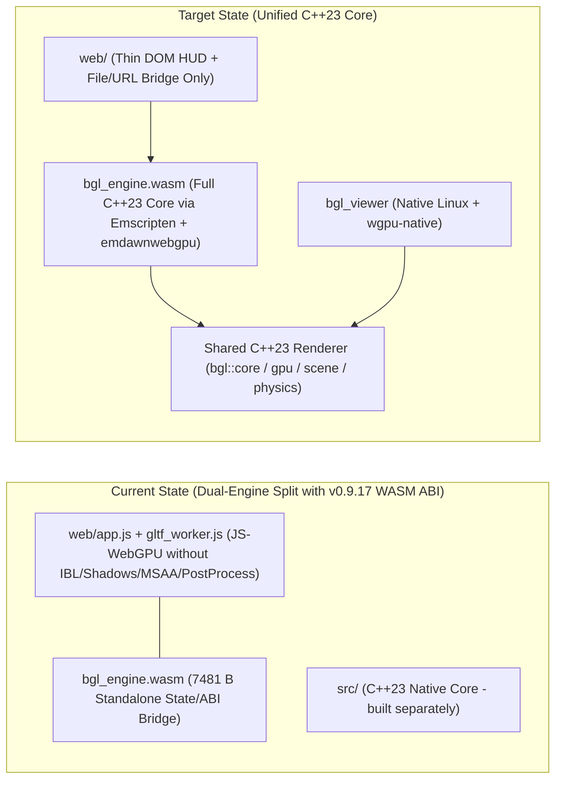
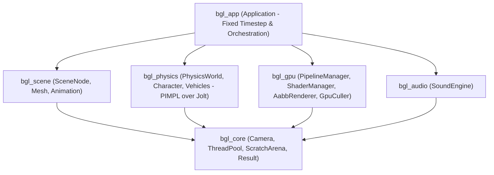

# Feature Roadmap & Physics Integration Analysis for `bgl-Engine`

This report summarizes an in-depth codebase audit of the C++23 core (`src/`) and web client (`web/`) on branch `develop` (`v0.9.17+`). All findings, statuses, and architectural recommendations are grounded directly in verified implementations, pipeline bottlenecks, open subsystems, and build/CI configurations in the repository.

> [!NOTE]
> `bgl-Engine` already provides a comprehensive rendering and asset foundation: an `RGBA16Float` HDR target with split Opaque/Skybox/Transparent+Transmission passes (`BeginTransparentPass` + `opaqueColorCopyTexture_` resolve snapshot), Compute IBL with GGX prefiltering, L2 Spherical Harmonics and Split-Sum BRDF LUT, Clustered Forward+ `SceneLightingUniforms`, POM, KTX2 transcoding, GPU mipmap generation (`mipgen.wgsl`), modular external `.wgsl` shaders with `#include`/`#pragma once` preprocessing, `#embed` fallback, and hot-reload (`ShaderManager`), separated 4-group bindings with `DynamicUniformRing<PerDrawUniforms>`, hardware `EXT_mesh_gpu_instancing` (`DynamicInstanceBuffer`), GPU skinning SSBOs (`Skin::gpuJointBuffer`), GPU morph targets (`MorphDeltas_SSBO` up to 8 targets), per-channel `KHR_texture_transform` including rotation, a work-stealing `ThreadPool`, light-frustum culling in `ShadowPass`, dynamic `Quadtree::Refit()` on transform changes, web-worker offloading (`gltf_worker.js`) + `BglFrameScheduler` with JS frustum culling, a standalone freestanding C++23 `wasm_bridge.cpp` ABI (`7,481` bytes, 54 exports), SDL2/Gamepad input, and FreeType/HarfBuzz SDF UI. The highest-leverage next steps are closing the remaining gaps (true C++23 -> WASM/WebGPU unification replacing the dual-engine split, indirect GPU-driven culling + async picking readbacks, depth/normal GTAO, cascaded shadow maps, QEM LODs, 3D BVH) and optional modular physics integration.

---

## Table of Contents

1. [Part I — High-Impact New Features & Architectural Upgrades](#part-i--high-impact-new-features--architectural-upgrades)
   - [A. Architecture Convergence & Completing Partially Wired Core Subsystems (Priority 1)](#a-architecture-convergence--completing-partially-wired-core-subsystems-priority-1)
   - [B. Graphics & Rendering Pipeline Upgrades](#b-graphics--rendering-pipeline-upgrades)
   - [C. Asset Pipeline, Geometry, glTF Completeness & Spatial/Animation](#c-asset-pipeline-geometry-gltf-completeness--spatialanimation)
   - [D. Editor UX, Interaction, Audio & Developer Tooling](#d-editor-ux-interaction-audio--developer-tooling)
   - [E. Quality Assurance, Profiling & CI/CD](#e-quality-assurance-profiling--cicd)
2. [Part II — Physics Engine: Feasibility & Integration Blueprint](#part-ii--physics-engine-feasibility--integration-blueprint)
   - [1. Executive Assessment: Should a Physics Engine Be Added?](#1-executive-assessment-should-a-physics-engine-be-added)
   - [2. Selecting the Right Physics Engine](#2-selecting-the-right-physics-engine)
   - [3. Integration Architecture in `bgl-Engine`](#3-integration-architecture-in-bgl-engine)
3. [Part III — Prioritized Implementation Roadmap (Waves 1–4)](#part-iii--prioritized-implementation-roadmap-waves-14)

---

## Part I — High-Impact New Features & Architectural Upgrades

### A. Architecture Convergence & Completing Partially Wired Core Subsystems (Priority 1)

#### A1. True C++23 -> WASM/WebGPU Convergence Replacing the Dual-Engine Split
* **Verified Current State:**
  * In `v0.9.17`, the earlier 421-byte stub was replaced by [`wasm_bridge.cpp`](../src/wasm/wasm_bridge.cpp) ([`bgl_engine.wasm`](../web/dist/bgl_engine.wasm), **7,481 bytes**), built by the `wasm-emscripten` job in [ci.yml](../.github/workflows/ci.yml) using `em++ -O3 -std=c++23 -ffreestanding` and `wasm-ld`. It exports a custom first-fit heap allocator (`malloc`/`free` over `{ env: { memory } }`), a lightweight glTF/GLB JSON scanner (`bgl_load_file_buffer`), camera bookmarks, and `bgl_*` C-ABI toggles/setters (`bgl_init`, `bgl_resize`, `bgl_toggle_*`, `bgl_set_*`, `bgl_camera_*`, `bgl_gamepad_state`).
  * **Remaining Split:** `wasm_bridge.cpp` currently wraps an isolated `EngineState` struct without linking `src/core/`, `src/gpu/`, `src/scene/`, `src/text/`, `src/ui/`, or `fastgltf`, and [ci.yml](../.github/workflows/ci.yml) does not yet run `emcmake cmake` over the full C++23 engine libraries.
  * In [Context.cpp](../src/gpu/Context.cpp), the WebGPU runtime implementation remains guarded under `#if defined(BGL_PLATFORM_NATIVE)` (`PrepareFrame()` returns `false` and `BeginFrame()` returns `nullptr` outside native builds). In [TextureDecoder.cpp](../src/scene/TextureDecoder.cpp), `DecodePNG`, `DecodeWebP`, and `DecodeJPEG` fall back to 2x2 white dummies outside native builds, and [main.cpp](../apps/viewer/main.cpp) is not linked into the browser WASM bundle.
  * Meanwhile, [`BglWebGpuRenderer`](../web/app.js) in [app.js](../web/app.js) (assisted by [gltf_worker.js](../web/gltf_worker.js) with JS frustum culling, batched GPU mipmaps, and per-channel `KHR_texture_transform`) maintains a parallel JavaScript WebGPU renderer without 4x MSAA, IBL cubemaps/BRDF LUT, `ShadowPass`, `PostProcessPass`, 2D `Quadtree` / Hi-Z `OcclusionBuffer`, Forward+ clusters, or `Clearcoat`/`Sheen`/`Transmission`/`Volume`.
* **Target Architecture:** **Unified WASM/WebGPU Runtime (`emdawnwebgpu` + Browser Codec Bridge).**
  * Implement the `BGL_PLATFORM_WASM` path in [`gpu::Context`](../src/gpu/Context.cpp), link the full C++23 engine via `emcmake cmake`, and route image decoding through browser APIs (`createImageBitmap`/`ImageDecoder`) or compiled C decoders inside `TextureDecoder`.
  * **Rationale:** Eliminates duplicate renderer/shader maintenance, closes the visual parity gap between desktop and browser, and shares all C++ subsystems (`ShaderManager`, `Quadtree`, PBR, shadows, IBL) identically across targets.



#### A2. GPU-Driven `DrawIndexedIndirect`, Wired `GpuCuller`/`GpuRayPicker` & `ScratchArena`
* **Already Implemented Foundation:**
  * [`Uniforms.hpp`](../src/gpu/Uniforms.hpp) and [`DrawHelpers.hpp`](../src/gpu/DrawHelpers.hpp) provide separated 4-group bindings (`@group(0)` SceneGlobals, `@group(1)` `DynamicUniformRing<PerDrawUniforms>`, `@group(2)` Material + `MorphDeltas_SSBO`, `@group(3)` [`Skin::gpuJointBuffer`](../src/scene/Animation.hpp)), persistent scratch vectors in [`PipelineManager`](../src/gpu/Pipeline.cpp), and hardware **`EXT_mesh_gpu_instancing`** via [`DynamicInstanceBuffer`](../src/gpu/DrawHelpers.hpp) (`instanceTransforms` on `SceneNode`).
* **Remaining Gaps:**
  * Individual `SceneNode`s still emit separate draw calls unless using `EXT_mesh_gpu_instancing`, and GPU-driven **`DrawIndexedIndirect`** driven by [`GpuCuller`](../src/gpu/GpuCuller.hpp) / [`gpu_cull.wgsl`](../src/gpu/shaders/gpu_cull.wgsl) is not yet wired into the main render pass.
  * [`gpuCuller_`](../src/gpu/Pipeline.cpp) and [`gpuRayPicker_`](../src/gpu/Pipeline.cpp) are lazily initialized on access, but `UploadSceneBounds` / `Dispatch` and asynchronous GPU readback (`wgpuBufferMapAsync`) are not yet connected to the live pick/render loop.
  * [`ScratchArena`](../src/core/MemoryPool.hpp) is not yet used as a shared transient frame allocator across render subsystems.
* **Target Architecture:** Complete GPU-driven indirect culling (`DrawIndexedIndirect` populated by [`GpuCuller`](../src/gpu/GpuCuller.hpp)) and connect [`GpuRayPicker`](../src/gpu/GpuRayPicker.hpp) with non-blocking asynchronous `wgpuBufferMapAsync` readbacks for large CAD/city scenes.

#### A3. Split-Pass `AlphaMode::Blend` & `opaqueColorCopyTexture_` (Core Implemented)
* **Implemented in Current Branch:**
  * [`Application::Render`](../apps/viewer/Application.cpp) and [`gpu::Context`](../src/gpu/Context.cpp) now execute [`RenderOpaqueScene`](../src/gpu/Pipeline.cpp) -> [`Skybox::Render`](../src/gpu/Skybox.cpp) -> [`BeginTransparentPass`](../src/gpu/Context.cpp) (resolving and copying HDR color into `opaqueColorCopyTexture_` for accurate glass refraction including the skybox) -> [`RenderTransparentScene`](../src/gpu/Pipeline.cpp) using [`GetTransparentBlendState()`](../src/gpu/Pipeline.hpp) (`SrcAlpha` / `OneMinusSrcAlpha`, `depthWriteEnabled = false`).
* **Optional Future Enhancement:** Add downsampled roughness-aware blur mipmaps on `opaqueColorCopyTexture_` for frosted glass refraction and optional Weighted Blended OIT for dense overlapping foliage.

---

### B. Graphics & Rendering Pipeline Upgrades

#### B1. True Depth/Normal GTAO + Dual-Kawase/Mip HDR Bloom + SSR
* **Verified Current State:**
  * [`tonemap.wgsl`](../src/gpu/shaders/tonemap.wgsl) evaluates screen-space occlusion (`evaluateSSAO`) from `hdrTexture` luminance gradients rather than a hardware depth/normal prepass (which can over-darken dark albedos) and evaluates `evaluateBloom` with a 12-tap full-res scatter directly inside the tonemap fragment shader.
* **Target Feature:** **Depth/Normal Prepass -> Half-Res GTAO (Ground-Truth AO) + Bilateral Blur -> 6-Mip Jimenez/Dual-Kawase Bloom -> Hi-Z Screen-Space Reflections (SSR).**

#### B2. Cascaded Shadow Maps (CSM) + Spot/Point Light Shadow Atlas + PCSS
* **Implemented Foundation:** [`ShadowPass::Render`](../src/gpu/ShadowPass.cpp) and [`shadow.wgsl`](../src/gpu/shaders/shadow.wgsl) support GPU morph targets, `Skin` SSBOs, dynamic `PerDrawUniforms`, hardware instancing, and `Quadtree` light-frustum culling for static scenes.
* **Remaining Gaps:** Directional shadows use a single `2048x2048` orthographic depth map ([`ShadowPass.hpp`](../src/gpu/ShadowPass.hpp)) forced to `LOD1`, producing aliasing on large scenes (`Sponza.glb`), and punctual/spot lights do not cast shadows yet.
* **Target Feature:** **4-Cascade Directional CSM (`texture_depth_2d_array`) with texel snapping + `4096x4096` shadow atlas for `KHR_lights_punctual` + optional PCSS.**

#### B3. Full Reverse-Z (`[1, 0]`) & Temporal Anti-Aliasing (TAA) / SMAA
* **Verified Current State:** Camera projection ([Camera.cpp](../src/core/Camera.cpp)), [`Context::BeginFrame`](../src/gpu/Context.cpp) (`depthClearValue = 1.0f`), pipelines (`WGPUCompareFunction_LessEqual`), and [`skybox.wgsl`](../src/gpu/shaders/skybox.wgsl) use standard `[0, 1]` depth precision, while 4x MSAA does not smooth specular aliasing or alpha-tested foliage edges.
* **Target Feature:** **End-to-end Reverse-Z (`Depth32Float`, `GreaterEqual`, clear `0.0`) + Motion Vectors + TAA (subpixel jitter + variance clamping) or SMAA.**

#### B4. GPU Compute Particle System & Froxel Volumetric Fog
* **Verified Current State:** Rain, snow, fog, and smoke are evaluated analytically per surface fragment ([common/weather.wgsl](../src/gpu/shaders/common/weather.wgsl)), so they do not react to local light sources or fill empty sky regions in volumetric shafts.
* **Target Feature:** **GPU Compute Particle Simulation (`DrawIndirect` particles with depth collisions) and Froxel Volumetric Lighting for directional/spot god rays.**

---

### C. Asset Pipeline, Geometry, glTF Completeness & Spatial/Animation

#### C1. Closing Verified glTF 2.0/2.1, Material & Texture Decoder Gaps
* **Implemented Foundation:** Per-channel `KHR_texture_transform` (offset, scale, rotation) for `baseColor`, `metallicRoughness`, `normal`, `occlusion`, and `emissive` ([`FastGltfLoader.cpp`](../src/scene/FastGltfLoader.cpp), [`pbr.wgsl`](../src/gpu/shaders/pbr.wgsl)), `EXT_mesh_gpu_instancing`, and batched GPU mipmap generation ([`mipgen.wgsl`](../src/gpu/shaders/mipgen.wgsl)) are implemented.
* **Remaining Gaps:**
  * **`KHR_materials_iridescence`:** Enabled in parser flags ([`FastGltfLoader.cpp`](../src/scene/FastGltfLoader.cpp)), pending material extraction and thin-film interference shading in `pbr.wgsl`.
  * **Additional PBR Extensions:** **`KHR_materials_anisotropy`**, **`KHR_materials_dispersion`**, **`KHR_materials_diffuse_transmission`**, plus independent UV transforms for **`clearcoat`**, **`transmission`**, and **`sheen`** (currently sampling `uvBase` in `pbr.wgsl`).
  * **Mesh Compression:** **`KHR_draco_mesh_compression`** and **`EXT_meshopt_compression`** for faster network/WASM loading.
  * **Standard glTF Loader & Sampler Gaps:** Support for **`LINES` & `POINTS`** topologies, **`COLOR_0`, `TEXCOORD_1..N`, `JOINTS_1`/`WEIGHTS_1`** (8-bone skinning), per-texture **glTF `Sampler`** wrap/filter states (instead of global `defaultSampler_`), dedicated height maps, and compressed **EXR** decoding (`ZIP`/`PIZ`/`PXR24`).

#### C2. Quadric Error Metric (QEM) Simplifier & Compute Morph Baking (>8 Targets)
* **Implemented Foundation:** GPU vertex-shader morphing via `MorphDeltas_SSBO` handles up to 8 simultaneous targets across main, transparent, shadow, and wireframe passes, falling back to CPU [`ApplyMorphTargets`](../src/scene/Scene.cpp) only when no GPU buffer is bound.
* **Target Feature:** Replace spatial grid clustering in [`GenerateLODs`](../src/scene/Scene.cpp) with a **Quadric Error Metric (QEM)** simplifier preserving UV seams and material boundaries, plus an optional **compute-shader morph baking pass** supporting >8 simultaneous morph targets.

#### C3. Dynamic 3D BVH + 2-Pass GPU Hi-Z Occlusion Culling
* **Implemented Foundation:** [`Quadtree::Refit()`](../src/scene/Quadtree.cpp) updates item AABBs, recomputes `looseBounds_`, and relocates translated/animated nodes across quadrants each frame whenever `Scene::transformVersion_` increments ([`Application::Update`](../apps/viewer/Application.cpp)), preventing stale culling for dynamic objects.
* **Remaining Evolution:** Upgrade from 2D XZ-plane `Quadtree` + CPU `32x16` [`OcclusionBuffer`](../src/scene/Quadtree.hpp) to a **3D TLAS/BLAS BVH** for multi-story vertical scenes paired with **2-pass GPU Hi-Z pyramid occlusion culling**.

#### C4. Animation Crossfade Blending, State Machine & Inverse Kinematics (IK)
* **Target Feature:** Evolve single-clip playback ([`Scene.hpp`](../src/scene/Scene.hpp)) into **multi-track animation blending, bone masks, timeline events, and Two-Bone / Look-At IK**.

---

### D. Editor UX, Interaction, Audio & Developer Tooling

#### D1. Expanding `ImmediateUI`, 3D Transform Gizmos, Scene Inspector & GLB Export
* **Verified Current State:** [`ImmediateUI`](../src/ui/ImmediateUI.cpp) supports `Label`, `Button`, `Checkbox`, and `Dropdown` alongside node picking and selection highlighting.
* **Target Feature:** Add `Slider`/`DragFloat`, `ColorPicker`, `TextInput`, scrollable `TreeView` outliner, **3D Translate/Rotate/Scale Gizmos**, command **Undo/Redo**, live material/light editing, and binary `.glb` export.

#### D2. Modular WGSL Pipeline, Live Hot-Reload (Implemented) & Render-Pass Inspector
* **Implemented in Current Branch:** [`ShaderManager`](../src/gpu/ShaderManager.hpp) ([`ShaderManager.cpp`](../src/gpu/ShaderManager.cpp)) loads modular external `.wgsl` files from `src/gpu/shaders/` with `#include`/`#pragma once` preprocessing, C++23 `#embed` compile-time fallback bundles, validation error scopes, and live file-timestamp **hot-reload** in [`Application::PollShaderHotReload`](../apps/viewer/Application.cpp) across PBR, shadow, skybox, tonemap, AABB, wireframe, GPU culler, and GPU ray picker pipelines.
* **Remaining Tooling:** **Screenshot / HDR EXR Capture** from swapchain/HDR targets and an in-engine **Render-Pass Debug Minimap** (Shadow Map, Depth, Normals, Forward+ cluster heatmap).

#### D3. Embedded `KHR_audio` Memory Decoding & WebAudio Backend
* **Verified Current State:** [`SoundEngine::PlaySound3D`](../src/audio/SoundEngine.cpp) requires regular files on disk (`std::filesystem::is_regular_file`), and browser audio playback is not yet bridged.
* **Target Feature:** **`KHR_audio` glTF extension parsing**, in-memory decoding via `ma_decoder`, distance attenuation / directional cones / Doppler, and an **Emscripten WebAudio backend**.

---

### E. Quality Assurance, Profiling & CI/CD

#### E1. Real Headless GPU Golden Images, Timestamp Queries & Full Engine WASM CI
* **Verified Current State:**
  * [`test_golden_image.cpp`](../tests/test_golden_image.cpp) validates deterministic buffer hashing on CPU rather than reading back actual rendered pixels from Dawn/wgpu-native offscreen targets.
  * [`Application.cpp`](../apps/viewer/Application.cpp) estimates MSAA VRAM assuming 4x samples instead of querying actual pass sizes, and lacks per-pass GPU hardware timings.
* **Target Feature:**
  * **Headless Offscreen GPU Render Tests** comparing Dawn/Vulkan output PNGs (SSIM/FLIP) against golden reference images.
  * **WebGPU Timestamp Queries (`WGPUQuerySet`)** for per-pass GPU profiling in the HUD.
  * **Full `emcmake cmake` Engine Build + Headless Playwright/Chromium WebGPU E2E** in [ci.yml](../.github/workflows/ci.yml).

---

## Part II — Physics Engine: Feasibility & Integration Blueprint

### 1. Executive Assessment: Should a Physics Engine Be Added?

**Short answer: Yes — provided it is integrated as a clean, optional module (`BGL_ENABLE_PHYSICS` -> `libbgl_physics`).**

| Use Case / Scenario | Assessment | Architectural Rationale |
| :--- | :--- | :--- |
| **Pure Static Model Inspector (Minimal Download)** | Keep optional | Static glTF inspection must keep WASM downloads lean; physics must remain toggleable via [conanfile.py](../conanfile.py) and [CMakeLists.txt](../CMakeLists.txt) (mirroring `with_audio` / `BGL_ENABLE_AUDIO`). |
| **Architectural & Interior Walkthroughs (`Sponza.glb`)** | **High Value** | In [`CameraMode::Fly`](../src/core/Camera.hpp), cameras currently pass freely through walls and floors. A physics **Character Controller** enables gravity, stair stepping, and wall sliding. |
| **Interactive Product & Vehicle Demos (`ToyCar.glb`, `RobotExpressive.glb`)** | **High Value** | Enables ground snapping, **raycast vehicle physics**, articulated joints/constraints, physical object interaction, and impact audio via [`SoundEngine`](../src/audio/SoundEngine.cpp). |
| **Future glTF Standard Alignment** | **Strategic** | Extensions such as `KHR_physics_rigid_bodies` and `OMI_collider` make physics metadata native to glTF assets. |

> [!IMPORTANT]
> **Renderer Prerequisites Already Satisfied:** With [`DynamicUniformRing<PerDrawUniforms>`](../src/gpu/Uniforms.hpp), [`DrawHelpers.hpp`](../src/gpu/DrawHelpers.hpp), hardware `EXT_mesh_gpu_instancing`, and [`Quadtree::Refit()`](../src/scene/Quadtree.cpp), hundreds of dynamically moving rigid bodies sharing the same mesh can update world transforms independently each frame while keeping frustum and shadow culling synchronized.

---

### 2. Selecting the Right Physics Engine

| Criterion | **Jolt Physics (Recommended)** | Bullet Physics (Bullet 3) | NVIDIA PhysX 5 | Custom (BVH + Swept Sphere) |
| :--- | :--- | :--- | :--- | :--- |
| **License** | MIT (permissive) | zlib | BSD-3 (heavy SDK/build setup) | Internal |
| **C++23 Compatibility** | Modern C++17+, clean custom allocators & `JobSystem` API | Legacy C++ patterns, global state | Complex CMake/CUDA ecosystem | Clean, but extreme dev cost |
| **Conan 2 & Emscripten/WASM** | Available on ConanCenter (`joltphysics`), strong WASM/SIMD support | Portable, heavier threading model | Difficult to maintain in [emscripten_wasm](../profiles/emscripten_wasm) | Trivial |
| **Fit with `bgl-Engine`** | **`JobSystem` -> [`ThreadPool`](../src/core/ThreadPool.hpp); `TempAllocator` -> PMR/Arena; `CharacterVirtual` + `VehicleConstraint`** | Usable, less deterministic out of the box | Overkill for compact C++/WASM renderer | Insufficient beyond basic camera collision |
| **Debug Rendering** | Built-in `DebugRenderer` interface (maps cleanly to `AabbRenderer`) | `btIDebugDraw` | Visual Debugger / custom render API | Custom |

**Conclusion:** **Jolt Physics** fits `bgl-Engine`'s architecture cleanly: it is lock-free and job-system friendly, cross-platform deterministic (`JPH_CROSS_PLATFORM_DETERMINISTIC`), includes production-grade `CharacterVirtual` and `VehicleConstraint` controllers, and targets both Linux `amd64` and Emscripten WebAssembly.

---

### 3. Integration Architecture in `bgl-Engine`

#### 3.1 Build, Conan & Module Dependencies (`libbgl_physics`)
To preserve the strict acyclic module layering in [AGENT_INSTRUCTIONS.md](../AGENT_INSTRUCTIONS.md), physics should be introduced as a dedicated target **`bgl_physics`** mirroring [`bgl_audio`](../CMakeLists.txt):

1. **Conan Recipe ([conanfile.py](../conanfile.py)):**
   * Add option `"with_physics": [True, False]` (default `True` on desktop, optionally `False` for minimal WASM).
   * Require `joltphysics/...` and propagate `BGL_ENABLE_PHYSICS` via `CMakeToolchain`.
2. **CMake Target ([CMakeLists.txt](../CMakeLists.txt)):**
   * `add_library(bgl_physics ${BGL_LIB_TYPE} src/physics/PhysicsWorld.cpp ...)` — `SHARED` on Linux, `STATIC` under Emscripten.
   * Export Jolt ABI-affecting compile definitions (`JPH_OBJECT_STREAM`, `JPH_DEBUG_RENDERER`, precision, SIMD flags) as `PUBLIC` on `bgl_physics` so struct layouts match in `bgl_app`.
3. **Acyclic Dependency Graph:** `bgl_physics` depends only on `bgl_core`; `bgl_app` orchestrates `bgl_scene`, `bgl_physics`, `bgl_camera`, `bgl_audio`, and `bgl_gpu` without introducing physics dependencies into `bgl_gpu`.



#### 3.2 `bgl::physics` Interface, `ThreadPool` & Arena Integration
* **Encapsulation / PIMPL & Error Handling:** Never leak `<Jolt/...>` headers into public engine headers; return `bgl::core::Result<T>` (`std::expected<T, std::string>`) across all boundaries.
* **JobSystem Adapter -> [`bgl::core::ThreadPool`](../src/core/ThreadPool.hpp):** Map Jolt `CreateJob`/`QueueJobs` calls onto the work-stealing `ThreadPool` to avoid duplicate thread pools and oversubscription. Under `BGL_PLATFORM_WASM`, default to a single-threaded Jolt job backend unless `BGL_WASM_THREADS` (`COOP`/`COEP` + `SharedArrayBuffer`) is enabled.
* **Pre-Allocated `TempAllocator`:** Back `JPH::TempAllocatorImpl` with a fixed pre-allocated block (e.g., 8–16 MB), matching the engine's zero-uncontrolled-heap policy.

#### 3.3 Fixed-Timestep Accumulator in Frame Loop
* **Current Gap:** The native loop in [main.cpp](../apps/viewer/main.cpp) passes variable wall-clock `deltaTime` directly into [`Application::Update(deltaTime)`](../apps/viewer/Application.cpp) (while `EmscriptenMainLoop` passes a fixed `1.0f / 60.0f`). Variable timesteps cause solver instability and tunneling.
* **Recommended Pattern:**
  1. Clamp incoming delta (`dt = std::min(deltaTime, 0.1f)`) to prevent a spiral of death after stalls.
  2. Step physics at fixed intervals (`constexpr float kFixedPhysicsDt = 1.0f / 60.0f`, or `1/120` s).
  3. Store `prevPos`/`prevRot` before stepping and interpolate (`glm::mix` / `glm::slerp` with `alpha = accumulator / kFixedPhysicsDt`) into visible `SceneNode`s for smooth high-refresh rendering.

```mermaid
sequenceDiagram
    participant Loop as "main.cpp / Application::Update"
    participant Anim as "Scene::EvaluateAnimation"
    participant Phys as "bgl::physics::PhysicsWorld"
    participant Scene as "SceneNode & Spatial Index"
    participant Audio as "SoundEngine & GPU"

    Loop->>Loop: "accumulator += clamp(deltaTime, 0.1s)"
    loop "while accumulator >= 1/60s"
        Loop->>Anim: "Sample kinematic animations"
        Anim->>Phys: "MoveKinematic(bodyId, targetPos, targetRot, dt)"
        Loop->>Phys: "Step(1/60s) + CharacterVirtual::Update()"
        Phys-->>Audio: "OnContactAdded -> PlaySound3D(hitPoint, impulse)"
        Loop->>Loop: "accumulator -= 1/60s"
    end
    Phys->>Scene: "Dynamic bodies (interpolated by alpha) -> translation/rotation"
    Scene->>Scene: "UpdateTransforms() & Quadtree/BVH Refit()"
    Loop->>GPU: "Camera walkthrough pose + DebugLines -> Render()"
```

#### 3.4 Data Synchronization Across `Scene`, `Camera`, `AabbRenderer` & `SoundEngine`
1. **Collider Creation in `ActivateScene` ([Application.cpp](../apps/viewer/Application.cpp)):**
   * Static world meshes (`Sponza`): build `JPH::MeshShapeSettings` directly from `MeshPrimitive::vertices` / `indices` in a `Static` broadphase layer.
   * Dynamic/kinematic nodes: classify via `KHR_physics_rigid_bodies` / `OMI_collider` or naming/extras conventions, mapping hierarchical scale via `JPH::ScaledShape`.
2. **Writeback & Spatial Refit:** Dynamic bodies update `SceneNode::translation` / `rotation`, trigger `UpdateLocalTransform()` + `Scene::Update()`, and automatically drive [`Quadtree::Refit()`](../src/scene/Quadtree.cpp). Animated kinematic nodes push dynamic rigid bodies cleanly.
3. **Walkthrough Character Controller:** Add `CameraMode::Walkthrough` in [`CameraMode`](../src/core/Camera.hpp), driving `JPH::CharacterVirtual` velocity from WASD/Gamepad inputs and writing eye position back to `Camera::SetPositionAndTarget()`.
4. **Debug Visualization & Audio:** Expose line batching in [`AabbRenderer`](../src/gpu/AabbRenderer.hpp) for collision shapes and contacts, and drain Jolt `ContactListener` events on the main thread into [`SoundEngine::PlaySound3D`](../src/audio/SoundEngine.cpp).
5. **WASM Determinism & Binary Budget:** Enable `JPH_CROSS_PLATFORM_DETERMINISTIC` + optional `-msimd128` in [`profiles/emscripten_wasm`](../profiles/emscripten_wasm) with `JPH_OBJECT_STREAM=OFF` in minimal Web Release builds.

---

## Part III — Prioritized Implementation Roadmap (Waves 1–4)

| Wave | Focus | Concrete Work Packages | Strategic Impact |
| :--- | :--- | :--- | :--- |
| **Wave 1: Pipeline Foundations & Dev Workflow** *(Mostly Complete)* | Correctness, Instancing & Iteration | `AlphaMode::Blend` split pass + `opaqueColorCopyTexture_` snapshot *(Done)*; `EXT_mesh_gpu_instancing` via `DynamicInstanceBuffer` *(Done)*; `Quadtree::Refit()` *(Done)*; modular `src/gpu/shaders/*.wgsl` + `ShaderManager` hot-reload *(Done)*; remaining: `DrawIndexedIndirect` + wired `GpuCuller`/`GpuRayPicker` + `ScratchArena` | Resolves transparency/refraction & dynamic culling; next unlocks GPU-driven indirect drawing & async GPU picking |
| **Wave 2: Unified WASM & Graphics Leap** | Browser Parity & Visual Fidelity | Full C++23 Emscripten WebGPU port (retiring duplicate JS renderer & standalone `wasm_bridge.cpp`); Depth/Normal GTAO + Mip-Bloom + SSR; 4-Cascade CSM + Point/Spot atlas; Reverse-Z + TAA/SMAA | Turns Web client into an exact desktop twin with AAAA lighting/shadows/post-processing |
| **Wave 3: glTF Completeness & Performance** | Asset Coverage & Bandwidth | `KHR_draco_mesh_compression` / `EXT_meshopt_compression`; `KHR_materials_iridescence`/`anisotropy`/`dispersion`/`diffuse_transmission`; `LINES`/`POINTS`/`COLOR_0`/`TEXCOORD_1+`/8-bone; per-texture glTF `Sampler` + clearcoat/transmission/sheen UV transforms; compressed EXR; QEM LODs & >8 compute morph targets; 3D BVH + 2-pass GPU Hi-Z | Opens complex production assets and slashes WASM load sizes |
| **Wave 4: Physics, Editor, Audio & QA** | Interaction & Reliability | Optional **`libbgl_physics` (Jolt)** with `CameraMode::Walkthrough`, rigid bodies, fixed-timestep & contact audio; `ImmediateUI` inspector + 3D gizmos + Undo/Redo; GPU particles & froxel fog; `KHR_audio` + WebAudio; headless GPU golden images + timestamp profiler + full `emcmake cmake` WASM CI | Elevates `bgl-Engine` from a viewer to an interactive 3D/simulation platform with automated visual QA |
