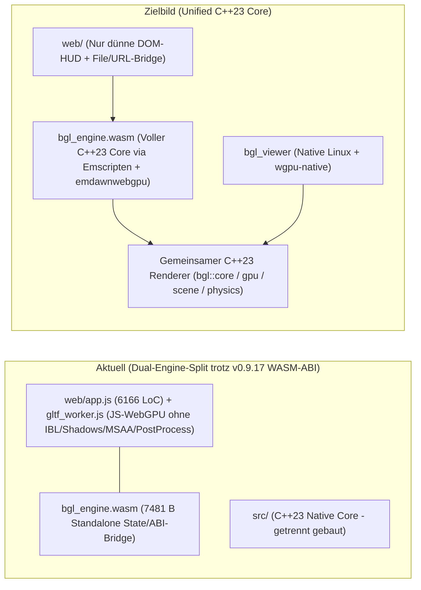
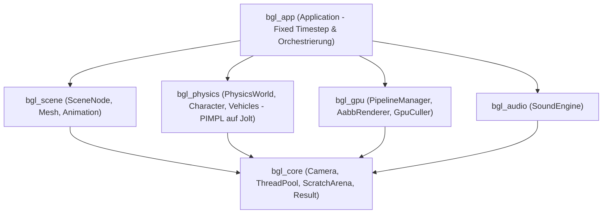

# Feature-Roadmap & Physik-Integrationsanalyse für `bgl-Engine`

Dieser Bericht fasst die Ergebnisse einer tiefgehenden Codebase-Analyse des gesamten C++23-Kerns (`src/`) sowie des Web-Clients (`web/`) auf Basis des finalen Stands **`v0.9.17`** (`develop`) zusammen. Alle Empfehlungen und Bewertungen stützen sich direkt auf verifizierte Implementierungsdetails, Pipeline-Engpässe, noch offene Teilsysteme und Build-Konfigurationen im Repository.

> [!NOTE]
> Die Engine verfügt mit `v0.9.17` bereits über eine starke Grundlage: `RGBA16Float`-HDR-Target, Compute-IBL mit GGX-Prefiltering, L2 Spherical Harmonics und Split-Sum BRDF LUT, Clustered Forward+ `SceneLightingUniforms`, POM, KTX2-Transcoding, GPU-Hardware-Mipmapping (`kMipGenShaderWGSL`), getrennte 4-Gruppen-Bindings mit dynamischem `DynamicUniformRing<PerDrawUniforms>`, GPU-Skinning-SSBOs (`Skin::gpuJointBuffer`), GPU-Morph-Targets (`morphDeltas`-SSBO bis 8 Targets), per-Kanal `KHR_texture_transform` inkl. Rotation, Work-Stealing-`ThreadPool`, Light-Frustum-Culling im `ShadowPass`, Web-Worker-Offloading (`gltf_worker.js`) + `BglFrameScheduler` inkl. JS-Frustum-Culling, eine eigenständige freestanding C++23-`wasm_bridge.cpp`-ABI (`7.481` Bytes), SDL2/Gamepad-Input sowie FreeType/HarfBuzz-SDF-UI. Die größten verbleibenden Hebel liegen im Schließen verifizierter Brüche (u. a. echte C++23→WASM/WebGPU-Konvergenz statt Dual-Engine-Split, `AlphaMode::Blend`/Transmission-Copy, GPU-Driven Instancing/Culling, Depth/Normal-GTAO, CSM, QEM-LODs, Dynamic BVH) sowie in einer modularen Physik-Anbindung.

---

## Inhaltsverzeichnis

1. [Teil I — Sinnvolle neue Features & Architektur-Ausbau](#teil-i--sinnvolle-neue-features--architektur-ausbau)
   - [A. Architektur-Konvergenz & Fertigstellung halb verdrahteter Kernsysteme (Priorität 1)](#a-architektur-konvergenz--fertigstellung-halb-verdrahteter-kernsysteme-priorität-1)
   - [B. Grafik- & Rendering-Pipeline-Upgrades](#b-grafik--rendering-pipeline-upgrades)
   - [C. Asset-Pipeline, Geometrie, glTF-Komplettierung & Spatial/Animation](#c-asset-pipeline-geometrie-gltf-komplettierung--spatialanimation)
   - [D. Editor-UX, Interaktion, Audio & Developer Tooling](#d-editor-ux-interaktion-audio--developer-tooling)
   - [E. Qualitätssicherung, Profiling & CI/CD](#e-qualitätssicherung-profiling--cicd)
2. [Teil II — Physik-Engine: Sinnhaftigkeit & konkreter Integrations-Blueprint](#teil-ii--physik-engine-sinnhaftigkeit--konkreter-integrations-blueprint)
   - [1. Grundsatzbewertung: Ist eine Physik-Engine sinnvoll?](#1-grundsatzbewertung-ist-eine-physik-engine-sinnvoll)
   - [2. Auswahl der passenden Physik-Engine](#2-auswahl-der-passenden-physik-engine)
   - [3. Integrations-Architektur in `bgl-Engine`](#3-integrations-architektur-in-bgl-engine)
3. [Teil III — Priorisierte Gesamt-Roadmap (Wellen 1–4)](#teil-iii--priorisierte-gesamt-roadmap-wellen-14)

---

## Teil I — Sinnvolle neue Features & Architektur-Ausbau

### A. Architektur-Konvergenz & Fertigstellung halb verdrahteter Kernsysteme (Priorität 1)

#### A1. Echte C++23→WASM/WebGPU-Konvergenz statt Dual-Engine-Split
* **Verifizierter Ist-Befund:**
  * Mit `v0.9.17` wurde zwar der frühere 421-Byte-Stub durch [`wasm_bridge.cpp`](../src/wasm/wasm_bridge.cpp#L369-L637) ersetzt ([`bgl_engine.wasm`](../web/dist/bgl_engine.wasm), **7.481 Bytes**), das der CI-Job `wasm-emscripten` in [ci.yml](../.github/workflows/ci.yml#L51-L103) via `em++ -O3 -std=c++23 -ffreestanding` + `wasm-ld` kompiliert. Es exportiert einen eigenen First-Fit-Heap-Allocator (`malloc`/`free` auf `{ env: { memory } }`), einen leichten glTF/GLB-JSON-Scanner (`bgl_load_file_buffer`), Kamera-Bookmarks und die `bgl_*`-C-ABI-Toggles/Setter (`bgl_init`, `bgl_resize`, `bgl_toggle_*`, `bgl_set_*`, `bgl_camera_*`, `bgl_gamepad_state`).
  * **Verbleibender Bruch:** `wasm_bridge.cpp` kapselt jedoch lediglich ein isoliertes `EngineState`-Cache-Struct — es linkt **weder** `src/core/`, `src/gpu/`, `src/scene/`, `src/text/`, `src/ui/` noch `fastgltf`, kompiliert in [ci.yml](../.github/workflows/ci.yml#L51-L103) weiter **kein** `emcmake cmake` über die Engine-Bibliotheken und exportiert weder `bgl_update` noch `bgl_render`.
  * In [Context.cpp](../src/gpu/Context.cpp#L143-L507) liegt der komplette WebGPU-Code weiter hinter `#if defined(BGL_PLATFORM_NATIVE)` ([`PrepareFrame()`](../src/gpu/Context.cpp#L378) liefert außerhalb Native `false`, [`BeginFrame()`](../src/gpu/Context.cpp#L426) `nullptr`). In [TextureDecoder.cpp](../src/scene/TextureDecoder.cpp#L188-L286) liefern `DecodePNG`, `DecodeWebP` und `DecodeJPEG` außerhalb `BGL_PLATFORM_NATIVE` weiter nur 2×2-Weiß-Dummies zurück, und [main.cpp](../src/main.cpp#L14-L95) wird unter Emscripten weiterhin nicht in das Web-Bundle gelinkt.
  * Parallel unterhält [`BglWebGpuRenderer`](../web/app.js#L1389) in [app.js](../web/app.js) (`6.166` Zeilen gesamt, unterstützt durch [gltf_worker.js](../web/gltf_worker.js) mit JS-Frustum-Culling, GPU-Mipmaps und per-Kanal `KHR_texture_transform`) über seine [`draw()`](../web/app.js#L4201)-Schleife weiterhin einen eigenen JavaScript-WebGPU-Renderer **ohne** 4× MSAA, **ohne** IBL-Cubemap/BRDF-LUT (nur Hemisphären-Ambient in [app.js](../web/app.js#L2477)), **ohne** `ShadowPass` (nur lokales POM-Self-Shadowing), **ohne** `PostProcessPass`, **ohne** 2D-`Quadtree`-Hierarchie / Hi-Z-`OcclusionBuffer`, **ohne** Forward+ (`SceneLightingUniforms`) und **ohne** `Clearcoat`/`Sheen`/`Transmission`/`Volume`.
* **Neues Feature / Zielbild:** **Unified WASM/WebGPU Runtime (`emdawnwebgpu` + Browser-Codec-Bridge).**
  * Implementierung des `BGL_PLATFORM_WASM`-Pfads in [`gpu::Context`](../src/gpu/Context.cpp#L143-L507), Durchlinken der vollen C++23-Engine über `emcmake cmake` statt isolierter `wasm_bridge.cpp`-Duplikation sowie Anbindung von Browser-Decodern (`createImageBitmap`/`ImageDecoder`) bzw. einkompilierten C-Decodern in `TextureDecoder`.
  * **Begründung:** Beseitigt tausende Zeilen doppelte Renderer-/Shader-Pflege, schließt die Qualitätskluft zwischen Desktop und Browser und ermöglicht echte Cross-Platform-Feature-Parität.



#### A2. Hardware-Instancing, `DrawIndexedIndirect`, aktivierter `GpuCuller`/`GpuRayPicker` & `ScratchArena`
* **Bereits umgesetzte Vorstufe:** Durch die Umstellung auf [`Uniforms.hpp`](../src/gpu/Uniforms.hpp), [`DrawHelpers.hpp`](../src/gpu/DrawHelpers.hpp), 4-Gruppen-Bindings (`@group(0)` SceneGlobals, `@group(1)` `DynamicUniformRing<PerDrawUniforms>`, `@group(2)` Material + `morphDeltas`-SSBO, `@group(3)` [`Skin::gpuJointBuffer`](../src/scene/Animation.hpp)) wurde das alte `8.608-Byte`-`PrimitiveUniforms`-Überschreibungsproblem bei geteilten Meshes bereits behoben, und [`PipelineManager::RenderScene`](../src/gpu/Pipeline.cpp#L2428) nutzt bereits persistente Scratch-Vektoren (`renderItemsScratch_`, `drawCallsScratch_`, `mainPerDrawScratch_`).
* **Verifizierter offener Ist-Befund:**
  * Jede Mesh-Instanz erzeugt in [`PipelineManager::RenderScene`](../src/gpu/Pipeline.cpp#L2680) sowie [`ShadowPass::Render`](../src/gpu/ShadowPass.cpp#L457) weiterhin einen eigenen `wgpuRenderPassEncoderDrawIndexed(..., instanceCount = 1, ...)`-Draw-Call. Echtes GPU-Instancing (`instanceCount > 1`), **`EXT_mesh_gpu_instancing`** und GPU-driven **`DrawIndexedIndirect`** fehlen weiterhin.
  * [`gpuCuller_`](../src/gpu/Pipeline.cpp#L248-L253) und [`gpuRayPicker_`](../src/gpu/Pipeline.cpp#L257-L262) werden bei Zugriff zwar initialisiert, aber im Render- bzw. Picking-Pfad weiterhin **nicht** über `UploadSceneBounds` / `Dispatch` aufgerufen; es fehlt das async GPU-Readback (`wgpuBufferMapAsync`) für Ray-Picking.
  * [`ScratchArena`](../src/core/MemoryPool.hpp#L117) wird noch nicht zur temporären Frame-Allokation über die Render-Subsysteme hinweg verwendet.
* **Neues Feature / Zielbild:** **Hardware-Instancing (`EXT_mesh_gpu_instancing`) + Indirect-Draw-Pipeline + verdrahteter `GpuCuller`/`GpuRayPicker`.**
  * Batching identischer `MeshPrimitive`s auf GPU-Instance-Buffer mit `DrawIndexed(..., instanceCount, ...)` bzw. indirekten Compute-gefüllten Draw-Buffern (`DrawIndexedIndirect`), gespeist durch [`GpuCuller`](../src/gpu/GpuCuller.hpp#L38-L83), sowie Aktivierung von [`GpuRayPicker`](../src/gpu/GpuRayPicker.hpp) mit asynchronem Readback.
  * **Begründung:** Drückt CPU-Draw-Call-Overhead bei Wäldern, Stadtblöcken oder Mechanik-Baugruppen um Größenordnungen nach unten und belebt bereits im Repo angelegte GPU-Compute-Bausteine.

#### A3. Split-Pass für `AlphaMode::Blend` & aktive Befüllung von `opaqueColorCopyTexture_`
* **Verifizierter Ist-Befund:**
  * [`PipelineManager::RenderScene`](../src/gpu/Pipeline.cpp#L2470-L2550) erkennt zwar `AlphaMode::Blend` und sortiert transparente Draw-Calls back-to-front, doch [`PipelineManager::Initialize`](../src/gpu/Pipeline.cpp#L1322-L1346) erzeugt ausschließlich `opaquePipeline_` und `opaqueBackCulledPipeline_` **ohne `WGPUBlendState`** und mit aktivem Depth-Write (`WGPUOptionalBool_True`).
  * [`Application::Render`](../src/app/Application.cpp#L568) allokiert über [`EnsureOpaqueCopyTexture`](../src/gpu/Pipeline.cpp#L2722-L2746) zwar `opaqueColorCopyTexture_` (`@group(0) @binding(5) opaqueColorTexture`), kopiert `hdrResolveTexture_` aber **niemals** per `wgpuCommandEncoderCopyTextureToTexture` hinein. Die Snell-Refraktion in [`fs_main`](../src/gpu/Shaders.hpp#L1672-L1699) sampelt daher weiterhin eine leere Textur.
* **Neues Feature / Zielbild:** **Zweistufiger HDR-Render-Graph (Opaque Pass → Resolve + Mipmap-Copy → Blend/Transmission Pass).**
  * Trennung des HDR-Render-Passes: Nach den Opaques folgt ein `Resolve` + `CopyTextureToTexture` (plus optionale Downsample-Mip-Pyramide für roughness-abhängig unscharfe Milchglas-Refraktion), gefolgt von einem zweiten HDR-Pass mit echtem `SrcAlpha`/`OneMinusSrcAlpha`-Blending und `depthWriteEnabled = false` (bzw. optional **Weighted Blended OIT** für überlappende Vegetation/Folien).

---

### B. Grafik- & Rendering-Pipeline-Upgrades

#### B1. Echtes Tiefen-/Normalen-basiertes GTAO/SSAO + Dual-Kawase/Mip HDR-Bloom + SSR
* **Verifizierter Ist-Befund:**
  * [`evaluateSSAO`](../src/gpu/Shaders.hpp#L368-L397) liest ausschließlich Luminanzdifferenzen aus `hdrTexture` – ohne Tiefenpuffer oder Normalen (obwohl [`EvaluateScreenSpaceOcclusionFactor`](../src/gpu/Pipeline.cpp#L2771) im C++-Testcode schon eine tiefenbasierte Formel andeutet). Dunkle Albedo-Bereiche werden dadurch künstlich weiter abgedunkelt statt geometrisch korrekt verdeckt.
  * [`evaluateBloom`](../src/gpu/Shaders.hpp#L400-L427) berechnet nur 12 Taps direkt im Tonemap-Pass bei Vollauflösung statt einer Energie-konservierenden Downsample-/Upsample-Kette.
* **Neues Feature / Zielbild:** **Depth-/Normal-Prepass → Half-Res GTAO (Ground-Truth AO) + bilaterale Unschärfe → 6-Mip Jimenez/Dual-Kawase Bloom → Hi-Z Screen-Space Reflections (SSR).**
  * **Begründung:** Eliminiert False-AO-Artefakte auf dunklen Materialien, liefert sauberes, flimmerfreies Emissive-Bloom und ergänzt die vorhandene IBL um lokale Spiegelungen auf Böden, Glas und Karosserielack.

#### B2. Cascaded Shadow Maps (CSM) + Spot-/Point-Light Shadow Atlas + PCSS
* **Bereits umgesetzte Vorstufe:** [`ShadowPass::Render`](../src/gpu/ShadowPass.cpp#L325-L473) unterstützt inzwischen GPU-Morph-Targets ([`vs_shadow`](../src/gpu/Shaders.hpp#L552-L571)), `Skin`-SSBOs, dynamische `PerDrawUniforms` und für statische Szenen Frustum-Culling per `Quadtree` (`#L365`).
* **Verifizierter offener Ist-Befund:**
  * Die Engine verwendet weiterhin exakt **eine** `2048×2048`-Orthomap ([`ShadowPass.hpp`](../src/gpu/ShadowPass.hpp#L19), [`ComputeDirectionalLightMatrix`](../src/gpu/ShadowPass.cpp#L252-L301)) über die gesamte `sceneAABB`, was auf großen Szenen (z. B. `Sponza.glb`) zu starkem Shadow-Aliasing führt. Zudem wird hart `GetLodSlice(1u)` bei `WGPUCullMode_None` ([`ShadowPass.cpp`](../src/gpu/ShadowPass.cpp#L226)) erzwungen, und für Punkt- sowie Spotlichter existieren keinerlei Schatten.
* **Neues Feature / Zielbild:** **4-Cascade Directional CSM (`texture_depth_2d_array`) mit Texel-Snapping + 4096×4096 Shadow-Atlas für `KHR_lights_punctual` (Spot/Point) + optionales PCSS** (Percentage-Closer Soft Shadows) sowie konfigurierbares Front-/Backface-Bias-Handling.

#### B3. Durchgängiges Reverse-Z (`[1,0]`) & Temporales Anti-Aliasing (TAA) / SMAA
* **Verifizierter Ist-Befund:** [Camera.cpp](../src/core/Camera.cpp#L178), [`Context::BeginFrame`](../src/gpu/Context.cpp#L447) (`depthClearValue = 1.0f`), [`Pipeline.cpp`](../src/gpu/Pipeline.cpp#L1325) (`WGPUCompareFunction_LessEqual`) und [`Skybox.cpp`](../src/gpu/Skybox.cpp#L45-L48) (`Z = 1.0`) nutzen standardmäßiges `[0,1]`-Depth-Mapping. 4× MSAA erfasst zudem keine Specular- oder Alpha-Test-Kanten.
* **Neues Feature / Zielbild:** **Konsequente Reverse-Z-Tiefe (`Depth32Float`, `GreaterEqual`, Clear `0.0`) + Motion-Vector-Target + TAA (mit Subpixel-Jitter & Variance Clamping) oder SMAA.**

#### B4. Compute-GPU-Partikelsystem & Froxel Volumetric Fog
* **Verifizierter Ist-Befund:** Regen, Schnee, Nebel und Rauch werden pro Fragment im Oberflächen-Shader berechnet ([Shaders.hpp](../src/gpu/Shaders.hpp#L1142-L1331)), reagieren aber nicht auf lokale Lichtquellen und erscheinen nicht vor leeren Himmelsbereichen.
* **Neues Feature / Zielbild:** **GPU-Compute-Partikelsystem (`Indirect Draw` Quads/Meshes mit Tiefenpuffer-Kollision)** sowie **Froxel-basiertes Volumetric Lighting** für echte God Rays durch CSM und Spotlights.

---

### C. Asset-Pipeline, Geometrie, glTF-Komplettierung & Spatial/Animation

#### C1. Schließen verifizierter glTF-2.0/2.1-, Material- & Decoder-Lücken
* **Bereits umgesetzte Vorstufe:** Per-Kanal `KHR_texture_transform` inkl. `rotation` für `baseColor`, `metallicRoughness`, `normal`, `occlusion` und `emissive` ([`FastGltfLoader.cpp`](../src/scene/FastGltfLoader.cpp#L335-L365), [`Shaders.hpp`](../src/gpu/Shaders.hpp#L868-L880) & `#L1385`) sowie GPU-Hardware-Mipmapping ([`InitMipGenPipelines`](../src/gpu/Pipeline.cpp#L1486-L1559), [`kMipGenShaderWGSL`](../src/gpu/Shaders.hpp#L1845-L1880)) wurden bereits erfolgreich integriert.
* **Verifizierte offene Lücken:**
  * **`KHR_materials_iridescence`:** Im Parser bereits aktiviert ([FastGltfLoader.cpp](../src/scene/FastGltfLoader.cpp#L69)), aber bei Material-Extraktion und in WGSL komplett fehlend → Implementierung der physikalischen Dünnschicht-Interferenz (Effektlacke, Ölschichten, Insektenpanzer).
  * **Weitere moderne PBR-Extensions:** **`KHR_materials_anisotropy`** (gebürstetes Metall, Haare, Stoff), **`KHR_materials_dispersion`** (echtes RGB-Spektral-Refraction-Sampling statt einer gemeinsamen UV-Verschiebung in [`Shaders.hpp`](../src/gpu/Shaders.hpp#L1682-L1686)), **`KHR_materials_diffuse_transmission`** (Subsurface-Scattering) sowie eigene UV-Transforms auch für **`clearcoat`**, **`transmission`** und **`sheen`** (sampeln in [`Shaders.hpp`](../src/gpu/Shaders.hpp#L1403-L1405) aktuell noch `uvBase`).
  * **Geometrie-Kompression (Web-Booster):** **`KHR_draco_mesh_compression`** und **`EXT_meshopt_compression`** – entscheidend für schnelle WASM-/HTTP-Ladezeiten großer Modelle.
  * **Standard-glTF-Lücken im Loader & Sampler:**
    * **Topologien `LINES` & `POINTS`:** [FastGltfLoader.cpp](../src/scene/FastGltfLoader.cpp#L558) überspringt alles außer `Triangles` – Point-Clouds und CAD-Drahtmodelle gehen aktuell verloren.
    * **Attribute `COLOR_0`, `TEXCOORD_1..N`, `JOINTS_1`/`WEIGHTS_1`:** Aktuell nur `TEXCOORD_0` und 4-Bone-Skinning ([FastGltfLoader.cpp](../src/scene/FastGltfLoader.cpp#L590-L635)).
    * **glTF-Sampler pro Textur:** [Pipeline.cpp](../src/gpu/Pipeline.cpp#L1377-L1387) erzwingt global `defaultSampler_` (`Repeat`/`Linear`) statt der in der glTF-Datei definierten `Sampler`-Wrap-/Filter-Modi (wichtig bei Decals/`ClampToEdge` und Pixel-Art/`Nearest`).
  * **Dedizierter Height-Map-Slot & komprimiertes EXR:** [`getSurfaceHeight`](../src/gpu/Shaders.hpp#L1018-L1035) belegt fälschlich `occlusionTexture.r` oder Luma; [`DecodeEXR`](../src/scene/TextureDecoder.cpp#L765-L767) lehnt komprimierte EXR-Dateien (`compression != 0`) ab, obwohl fast alle PolyHaven-/Studio-HDRIs ZIP/PIZ-komprimiert sind.

#### C2. Quadric Error Metric (QEM) LOD-Simplifier & Compute-Morph-Support >8 Targets
* **Bereits umgesetzte Vorstufe:** **GPU-Vertex-Shader-Morphing** via [`gpuMorphDeltaBuffer`](../src/gpu/Pipeline.cpp#L2183-L2195) ist nun für bis zu **8** simultane Morph-Targets (inkl. Shadow- und Wireframe-Pass) umgesetzt; das CPU-Fallback [`ApplyMorphTargets`](../src/scene/Scene.cpp#L458) greift nur noch, wenn kein GPU-Delta-Buffer vorliegt ([`Scene.cpp`](../src/scene/Scene.cpp#L509)).
* **Verifizierter offener Ist-Befund:** [`GenerateLODs`](../src/scene/Scene.cpp#L261-L380) nutzt weiterhin einfaches Grid-Clustering plus Flächen-Sortierungs-Fallback ohne Schutz von UV-Seams und Materialgrenzen. Zudem begrenzt das `PerDrawUniforms`-Layout aktive GPU-Morph-Weights derzeit auf 8 Targets (`morphWeights0`/`1`).
* **Neues Feature / Zielbild:** **Quadric Error Metric (QEM) Mesh Simplifier** (`meshoptimizer`-Qualität) mit Seam- und Boundary-Erhalt sowie ein optionaler **Compute-Shader-Morph-Baking-Pfad** für komplexe Facial-Rigs mit >8 gleichzeitigen Morph-Targets.

#### C3. Dynamisches 3D-BVH + 2-Pass GPU Hi-Z Occlusion Culling
* **Verifizierter Ist-Befund:** [`Application::ActivateScene`](../src/app/Application.cpp#L659) baut den 2D-XZ-`Quadtree` einmalig beim Laden; [`Application::Update`](../src/app/Application.cpp#L161) aktualisiert ihn bei Animationen **nicht**. Bewegte Knoten werden dadurch falsch frustum-gecullt, und mehrstöckige/vertikale Szenen werden in XZ schlecht partitioniert. Das CPU-[`OcclusionBuffer`](../src/scene/Quadtree.hpp#L45-L74) (`32×16`) in [`QuadtreeNode::QueryFrustum`](../src/scene/Quadtree.cpp#L202-L255) testet nur gegen große Quader (`ndcArea > 0.035`).
* **Neues Feature / Zielbild:** **Dynamischer TLAS/BLAS 3D-BVH mit schnellem Per-Frame-Refit** + **2-Pass GPU Hi-Z Occlusion Culling** (Reprojektion der Vorframe-Depth-Pyramide im Compute Shader).

#### C4. Animations-Blending, State-Machine & Inverse Kinematics (IK)
* **Neues Feature:** Übergang vom einzelnen aktiven Clip ([Scene.hpp](../src/scene/Scene.hpp#L287-L300)) zu **Multi-Track Crossfade-Blending, Bone-Masks, Animation-Events** sowie **Two-Bone / Look-At-IK** (z. B. für Fuß-Bodenkontakt und Kopfverfolgung).

---

### D. Editor-UX, Interaktion, Audio & Developer Tooling

#### D1. Ausbau von `ImmediateUI` + 3D-Transform-Gizmos + Scene-Inspector & GLB-Export
* **Verifizierter Ist-Befund:** [`ImmediateUI`](../src/ui/ImmediateUI.cpp#L449-L525) beherrscht bisher `Label`, `Button`, `Checkbox`, `Dropdown`, obwohl bereits Node-Picking (`RayPicker::Pick`) und Selection-Highlighting (goldene AABB in [Application.cpp](../src/app/Application.cpp#L601-L604)) existieren.
* **Neues Feature / Zielbild:**
  * Neue UI-Primitiven: `Slider`/`DragFloat`, `ColorPicker`, `TextInput`, `TreeView` (Outliner), scrollbare Container.
  * **3D-Transform-Gizmos** (Translate/Rotate/Scale im Lokal- und Weltsystem) + **Command-Undo/Redo** + **Live Material-/Licht-Inspector** + **glTF/GLB-Exporter**.

#### D2. WGSL Shader-Hot-Reload, Render-Pass-Inspektor & Screenshot/EXR-Export
* **Verifizierter Ist-Befund:** Alle Hauptshader stecken hart im 1.882 Zeilen langen String-Literal in [Shaders.hpp](../src/gpu/Shaders.hpp) (nur `ui.wgsl` nutzt `#embed`).
* **Neues Feature / Zielbild:** Auslagerung in modulare `.wgsl`-Dateien mit `#include`-Präprozessor und **Dateisystem-Watcher für Live-Hot-Reload** (Native Dev), **Screenshot-/EXR-Capture** aus dem Swapchain-/HDR-Buffer sowie eine **Render-Pass-Debug-Minimap** (Shadow-Map, Depth, Normals, Forward+-Cluster-Heatmap).

#### D3. Echtes `KHR_audio` (Memory Decoding) & WebAudio-Backend
* **Verifizierter Ist-Befund:** [`SoundEngine::PlaySound3D`](../src/audio/SoundEngine.cpp#L60-L75) erfordert zwingend eine reguläre Datei (`std::filesystem::is_regular_file`), [`Application::PickNodeAt`](../src/app/Application.cpp#L811-L812) prüft nur hardcoded `"assets/audio/click.wav"`, und im Browser fehlt die Audio-Brücke.
* **Neues Feature / Zielbild:** **`KHR_audio`-Parsing in `FastGltfLoader`**, **In-Memory-Decoding über `ma_decoder`** (für eingebettete GLB-Audiospuren), **Distance Attenuation / Directional Cones / Doppler** sowie **Emscripten-WebAudio-Backend**.

---

### E. Qualitätssicherung, Profiling & CI/CD

#### E1. Echte Headless-GPU-Golden-Images, Timestamp Queries & WASM-CI
* **Verifizierter Ist-Befund:**
  * Obwohl `WebGPUPipelineTest` bereits headless 103 Draw-Calls gegen die GPU absetzt, prüft [`test_golden_image.cpp`](../tests/test_golden_image.cpp#L58-L91) mit `HeadlessOffscreenBufferGoldenDeterminism` **keine GPU-Render-Ausgabe**, sondern rechnet einen synthetischen CPU-Verlauf und vergleicht die Prüfsumme mit sich selbst (`expectedHash = frameChecksum; EXPECT_EQ(frameChecksum, expectedHash);`).
  * [`Application.cpp`](../src/app/Application.cpp#L514-L515) schätzt MSAA-VRAM hartcodiert mit Faktor `4` unabhängig von `sampleCount_`, und echte GPU-Pass-Laufzeiten fehlen.
* **Neues Feature / Zielbild:**
  * **Headless-Dawn/Vulkan-Offscreen-Render-Tests** mit Bildvergleich (SSIM/FLIP) gegen Referenz-PNGs auf Basis der vorhandenen `bgl_viewer --headless`-Infrastruktur.
  * **WebGPU Timestamp Queries (`WGPUQuerySet`)** für Shadow/Main/PostProcess/UI im HUD + exakte VRAM-Buchhaltung.
  * **Aktiver `emcmake cmake`-Build + Playwright/Chromium WebGPU-Smoke-Test** in [ci.yml](../.github/workflows/ci.yml#L46-L80).

---

## Teil II — Physik-Engine: Sinnhaftigkeit & konkreter Integrations-Blueprint

### 1. Grundsatzbewertung: Ist eine Physik-Engine sinnvoll?

**Kurze Antwort: Ja – sofern sie modular und optional (`BGL_ENABLE_PHYSICS`) als eigenes Subsystem `libbgl_physics` integriert wird.**

| Szenario / Nutzungskontext | Bewertung | Begründung auf Basis der Engine-Architektur |
| :--- | :--- | :--- |
| **Reiner Web-Model-Inspektor (minimaler Download)** | Optional abwählbar halten | Für reines Betrachten statischer glTF-Dateien sollte der WASM-Payload schlank bleiben; daher muss Physik über [conanfile.py](../conanfile.py#L11-L48) / [CMakeLists.txt](../CMakeLists.txt#L247-L253) per Option abschaltbar sein (analog `with_audio` / `BGL_ENABLE_AUDIO`). |
| **Architektur- & Innenraum-Walkthroughs (z. B. `Sponza.glb`)** | **Sehr sinnvoll** | In [`CameraMode::Fly`](../src/core/Camera.hpp#L18-L21) durchfliegt die Kamera derzeit ungehindert Wände, Säulen und Böden. Ein physikalischer **Character Controller** ermöglicht echtes Begehen mit Gravitation, Treppensteigen und Wandgleiten. |
| **Interaktive Produkt-/Fahrzeug-Demos (`ToyCar.glb`, `RobotExpressive.glb`)** | **Sehr sinnvoll** | Ermöglicht Bodenkontakt/Snap-to-Floor beim Platzieren, **Raycast-Fahrzeugphysik**, schwingende Scharniere/Constraints, präzises Multi-Objekt-Picking, Umgebungs-Interaktion und Aufprall-Audio über [`SoundEngine`](../src/audio/SoundEngine.cpp#L60). |
| **Zukunftssicherheit für glTF-Standards** | **Zukunftsweisend** | Erweiterungen wie `KHR_physics_rigid_bodies` / `OMI_collider` machen glTF zunehmend zu einem Austauschformat für interaktive und simulierte Szenen. |

> [!IMPORTANT]
> **Bereits erreichte Renderer-Vorbedingung:** Durch den neuen dynamischen Per-Draw-UBO-Ring ([`DynamicUniformRing<PerDrawUniforms>`](../src/gpu/Uniforms.hpp) und [`DrawHelpers.hpp`](../src/gpu/DrawHelpers.hpp)) überschreiben sich mehrere Instanzen desselben `Mesh` (z. B. hunderte dynamisch fallende Rigid-Bodies) beim Rendern **nicht mehr** gegenseitig ihre Weltmatrizen. Für sehr große Physik-Szenen bleiben jedoch **Per-Frame-BVH/Quadtree-Refit** (Abschnitt C3) sowie **Hardware-/Indirect-Instancing** (Abschnitt A2) die entscheidenden nächsten Performance-Hebel.

---

### 2. Auswahl der passenden Physik-Engine

| Kriterium | **Jolt Physics (Empfehlung)** | Bullet Physics (Bullet 3) | NVIDIA PhysX 5 | Eigenbau (BVH + Swept-Sphere) |
| :--- | :--- | :--- | :--- | :--- |
| **Lizenz** | MIT (sehr permissiv) | zlib | BSD-3 (SDK/Build-Schwergewicht) | Intern |
| **C++23 / Modernität** | Modernes C++17+, saubere Custom-Allocators & JobSystem-API | Älteres C++-Design, globale States | Komplexes CMake-/GPU-CUDA-Ökosystem | Sauber, aber extremer Eigenaufwand |
| **Conan 2 & Emscripten/WASM** | Auf Conan Center (`joltphysics`) verfügbar, erstklassiger WASM/SIMD-Support | Portabel, aber schwerfälliger im Job-Threading | Deutlich schwerer unter [emscripten_wasm](../profiles/emscripten_wasm) zu pflegen | Trivial |
| **Fit zu `bgl-Engine`** | **`JobSystem` → [`ThreadPool`](../src/core/ThreadPool.hpp#L24); `TempAllocator` → PMR/Arena; `CharacterVirtual` + `VehicleConstraint`** | Möglich, aber weniger deterministisch ohne Feintuning | Overkill für kompakten C++/WASM-Renderer | Nur für reine Kamera-Kollision ausreichend, skaliert nicht für Rigid-Bodies/Constraints |
| **Debug-Rendering** | Eingebautes `DebugRenderer`-Interface (direkt in Batch-Line-Pass leitbar) | `btIDebugDraw` | Visual Debugger / Render-API | Eigenbau |

**Fazit der Auswahl:** **Jolt Physics** passt architektonisch ideal zur `bgl-Engine`, da es Lock-Free-/JobSystem-freundlich ist, deterministisch über Plattformen hinweg arbeitet (`JPH_CROSS_PLATFORM_DETERMINISTIC`), bereits einen erstklassigen **Virtual Character Controller** für Architektur-Walkthroughs sowie **Vehicle Constraints** mitbringt und sowohl unter Linux amd64 (`.so` / `.a`) als auch unter WebAssembly exzellent läuft.

---

### 3. Integrations-Architektur in `bgl-Engine`

#### 3.1 Build-, Conan- & Modul-Abhängigkeiten (`libbgl_physics`)
Um die strikte Schichtenarchitektur aus [AGENT_INSTRUCTIONS.md](../AGENT_INSTRUCTIONS.md#L10-L43) einzuhalten, sollte die Physik als separates Target **`bgl_physics`** analog zu [`bgl_audio`](../CMakeLists.txt#L249-L253) aufgebaut werden:

1. **Conan-Rezept ([conanfile.py](../conanfile.py#L11-L48)):**
   * Neue Option `"with_physics": [True, False]` (Default `True` auf Desktop, optional `False` für Minimal-WASM).
   * `self.requires("joltphysics/...")` inkl. Propagierung von `BGL_ENABLE_PHYSICS` über `CMakeToolchain`.
2. **CMake-Target ([CMakeLists.txt](../CMakeLists.txt#L85-L91)):**
   * `add_library(bgl_physics ${BGL_LIB_TYPE} src/physics/PhysicsWorld.cpp ...)` – **SHARED** auf Linux, **STATIC** unter Emscripten.
   * Wichtig: Jolt-Compile-Definitions (z. B. `JPH_OBJECT_STREAM`, `JPH_DEBUG_RENDERER`, Precision, SIMD-Flags) müssen als `PUBLIC` über `bgl_physics` exportiert werden, damit ABI/Struct-Größen zwischen Library und `bgl_app` exakt übereinstimmen.
3. **Azyklischer Abhängigkeitsgraph:** `bgl_physics` hängt nur von `bgl_core` (und optional Daten-Read-Only-Interfaces) ab; `bgl_app` orchestriert `bgl_scene`, `bgl_physics`, `bgl_camera`, `bgl_audio` und `bgl_gpu`. So bleibt `bgl_gpu` frei von Physik-Abhängigkeiten.



#### 3.2 `bgl::physics` Interface, ThreadPool- & Arena-Anbindung
* **Kapselung / PIMPL & Fehlerbehandlung:** Keine Jolt-Header (`<Jolt/...>`) in öffentlichen Engine-Headern leaken; alle Init-/Import-Methoden nutzen `bgl::core::Result<T>` (`std::expected<T, std::string>`) ohne Exceptions über Modulgrenzen hinweg.
* **JobSystem-Adapter → [`bgl::core::ThreadPool`](../src/core/ThreadPool.hpp#L24):**
  * Jolt-Jobs (`CreateJob`, `QueueJobs`) werden direkt auf das bereits work-stealing-fähige `ThreadPool::Instance().Enqueue(...)` / [`ParallelFor`](../src/core/ThreadPool.hpp#L86) abgebildet (vermeidet doppelte Worker-Thread-Pools und Thread-Oversubscription).
  * **WASM-Sonderfall:** Im Browser erfordert echtes Multithreading (`-pthread`) `SharedArrayBuffer` samt `COOP`/`COEP`-HTTP-Headern. Unter `BGL_PLATFORM_WASM` sollte standardmäßig ein Single-Threaded Jolt-JobSystem-Backend aktiv sein (oder optional über `BGL_WASM_THREADS` schaltbar), damit die Web-App auf jedem Standard-Static-Hosting (GitHub Pages, Python HTTP Server) startet.
* **TempAllocator:** Kopplung von `JPH::TempAllocatorImpl` an einen festen Pre-Allocated-Block (z. B. 8–16 MB) – vollständig konsistent mit der PMR-/No-Uncontrolled-Heap-Vorgabe in [AGENT_INSTRUCTIONS.md](../AGENT_INSTRUCTIONS.md#L30-L33).

#### 3.3 Frame-Loop: Fixed-Timestep-Accumulator statt variablem `deltaTime`
* **Aktuelles Problem:** Die native Hauptschleife in [main.cpp](../src/main.cpp#L517-L523) misst rohes Wall-Clock-`deltaTime` und reicht es direkt an [`Application::Update(deltaTime)`](../src/app/Application.cpp#L161) durch (während `EmscriptenMainLoop` in [main.cpp](../src/main.cpp#L14-L19) starr `1.0f / 60.0f` übergibt). Variierende Frame-Zeiten führen in Physik-Solvern zu instabilen Gelenken, federnden Stapeln und Tunneling.
* **Lösung in `Application::Update`:**
  1. Frame-Delta clampen (`dt = std::min(deltaTime, 0.1f)`) zur Vermeidung einer „Spiral of Death“ nach kurzen Hängern (z. B. Shader-/Asset-Load).
  2. Akumulator-Schleife mit fester Schrittweite (`constexpr float kFixedPhysicsDt = 1.0f / 60.0f`, optional 120 Hz):
     * Pro Step: `physicsWorld_->Step(kFixedPhysicsDt)` ausführen.
  3. **Transform-Interpolation für Render-Glätte:** Vor dem Step vorherige Posen (`prevPos`, `prevRot`) sichern und zum Renderzeitpunkt mit `alpha = accumulator / kFixedPhysicsDt` (`glm::mix` / `glm::slerp`) für alle sichtbaren `SceneNode`s interpolieren, damit 120/144-Hz-Displays absolut ruckelfrei bleiben.

```mermaid
sequenceDiagram
    participant Loop as "main.cpp / Application::Update"
    participant Anim as "Scene::EvaluateAnimation"
    participant Phys as "bgl::physics::PhysicsWorld"
    participant Scene as "SceneNode & Spatial Index"
    participant Audio as "SoundEngine & GPU"

    Loop->>Loop: "accumulator += clamp(deltaTime, 0.1s)"
    loop "while accumulator >= 1/60s"
        Loop->>Anim: "Kinematische Animationen sampeln"
        Anim->>Phys: "MoveKinematic(bodyId, targetPos, targetRot, dt)"
        Loop->>Phys: "Step(1/60s) + CharacterVirtual::Update()"
        Phys-->>Audio: "OnContactAdded -> PlaySound3D(hitPoint, impulse)"
        Loop->>Loop: "accumulator -= 1/60s"
    end
    Phys->>Scene: "Dynamic Bodies (Interpoliert mit alpha) -> translation/rotation"
    Scene->>Scene: "UpdateTransforms() & BVH/Quadtree Refit"
    Loop->>GPU: "Camera Walkthrough Pose + DebugLines -> Render()"
```

#### 3.4 Daten-Synchronisation zwischen `Scene`, `Camera`, `AabbRenderer` & `SoundEngine`
1. **Collider-Erzeugung beim `ActivateScene` ([Application.cpp](../src/app/Application.cpp#L629)):**
   * **Statische Weltgeometrie (z. B. `Sponza`):** Alle statischen Meshes werden über Vertex-/Index-Spans (`MeshPrimitive::vertices`, `indices`) in Jolt-`MeshShapeSettings` (optimiert in einer `Static`-Broadphase-Layer) konvertiert – ohne Duplizierung ungenutzter Normalen/UVs.
   * **Dynamische/Kinematische Nodes:** Unterscheidung über glTF-Extensions (`KHR_physics_rigid_bodies` / `OMI_collider` – erfordert ggf. Update von `fastgltf` bzw. Extras-JSON-Parsing in `FastGltfLoader`) oder zunächst Konventionen über `extras`/Node-Namen (`_box`, `_sphere`, `_hull`, `_kinematic`).
   * **Achtung bei Node-Skalierung:** [`SceneNode`](../src/scene/Scene.hpp#L248-L256) trennt `translation`, `rotation`, `scale`, aber hierarchische Parent-Scales stecken in `worldTransform`. Beim Übergeben an Jolt muss Scale sauber über `JPH::ScaledShape` abgebildet werden, während Rotation/Position als normierte Rigid-Transform an den `Body` gehen.
2. **Writeback & Spatial-Refit:**
   * Dynamische `SceneNode`s aktualisieren `translation` und `rotation` aus dem Physik-Body, rufen [`UpdateLocalTransform()`](../src/scene/Scene.cpp#L496) und [`Scene::Update()`](../src/scene/Scene.cpp#L542) auf und stoßen ein **BVH-/Quadtree-Refit** an, sodass fliegende/rollende Objekte korrekt gerendert und von Schatten erfasst werden.
   * Animierte Nodes ([`EvaluateAnimation`](../src/scene/Scene.cpp#L620)) steuern als `EMotionType::Kinematic` die Physik-Welt, sodass Roboterarme oder Türen dynamische Kisten wegschieben können.
3. **Walkthrough Character Controller → `Camera`:**
   * Erweiterung von [`CameraMode`](../src/core/Camera.hpp#L18-L21) um `CameraMode::Walkthrough`.
   * WASD-/Gamepad-Bewegung in [`Application::Update`](../src/app/Application.cpp#L401-L421) steuert statt direkter `camera_.MoveForward(...)` die gewünschte Horizontalgeschwindigkeit von `JPH::CharacterVirtual` (Kapsel z. B. Höhe 1,75 m, Radius 0,35 m, Max-Steigung 45°, Treppen-Offset 0,35 m); die resultierende Augenhöhe wird über `camera_.SetPositionAndTarget(...)` zurückgeschrieben.
4. **Debug-Visualisierung & Audio-Events:**
   * Erweiterung von [`AabbRenderer`](../src/gpu/AabbRenderer.hpp#L36-L74) um `AppendLine(p0, p1, color)` zur Darstellung von Kollisions-Shapes, Kontaktpunkten, Geschwindigkeitsvektoren und Raycasts im bereits vorhandenen Single-Draw-Line-Pass.
   * Jolt-`ContactListener` triggert über eine lockfreie Event-Queue auf dem Main-Thread [`SoundEngine::PlaySound3D`](../src/audio/SoundEngine.cpp#L60) exakt am Welt-Kontaktpunkt `contactPoint` (mit Stoßimpuls als Lautstärke-/Pitch-Modulator).
5. **WASM-Determinismus & Binary-Budget:**
   * Einsatz von `JPH_CROSS_PLATFORM_DETERMINISTIC` + optional `-msimd128` in [`profiles/emscripten_wasm`](../profiles/emscripten_wasm), Deaktivierung nicht benötigter Jolt-Serialisierung (`JPH_OBJECT_STREAM=OFF` im Web-Release) zur Minimierung des `.wasm`-Downloads.

---

## Teil III — Priorisierte Gesamt-Roadmap (Wellen 1–4)

| Welle | Fokus | Konkrete Arbeitspakete | Strategischer Nutzen |
| :--- | :--- | :--- | :--- |
| **Welle 1: Offene Pipeline-Bugs & Workflow** | Korrektheit, Instancing & Iteration | `AlphaMode::Blend`-Pipeline & `opaqueColorCopyTexture_`-Copy; Hardware-Instancing / `DrawIndexedIndirect` + `GpuCuller` / `GpuRayPicker` + `ScratchArena`; Dynamic BVH/Quadtree-Refit; `.wgsl`-Dateien mit Hot-Reload | Behebt verbliebene Rendering-/Transparenz-Lücken (auf Basis des neuen `PerDrawUniforms`-Rings) und beschleunigt Shader-Iteration |
| **Welle 2: Unified WASM & Grafik-Sprung** | Browser-Parität & Bildqualität | Voller C++23 Emscripten-WebGPU-Port (JS-Renderer ablösen); Depth/Normal-GTAO + Mip-Bloom + SSR; 4-Cascade CSM + Point/Spot-Atlas; Reverse-Z + TAA/SMAA | Macht den Web-Client zum exakten Desktop-Twin und hebt Bildqualität auf Engine-Niveau |
| **Welle 3: glTF-Komplettierung & Performance** | Asset-Breite & Bandbreite | `KHR_draco_mesh_compression` / `EXT_meshopt_compression`; `EXT_mesh_gpu_instancing`; `KHR_materials_iridescence`/`anisotropy`/`dispersion`/`diffuse_transmission`; `LINES`/`POINTS`/`COLOR_0`/`TEXCOORD_1+`/8-Bone; glTF-Sampler pro Textur + Clearcoat/Transmission/Sheen-UV-Transforms; EXR-Compression; QEM-LODs & >8 Compute-Morph-Targets; GPU Hi-Z Culling | Öffnet reale Produktions-Assets und reduziert WASM-Transfergrößen massiv |
| **Welle 4: Physik, Editor, Audio & QA** | Interaktion & Verlässlichkeit | Optionales **`libbgl_physics` (Jolt)** mit `CameraMode::Walkthrough`, Rigid-Bodies, Fixed-Timestep & Contact-Audio; `ImmediateUI`-Inspector + 3D-Gizmos + Undo/Redo; GPU-Partikel & Froxel-Fog; `KHR_audio` + WebAudio; echte Headless-GPU-Golden-Images + Timestamp-Profiler + aktive WASM-CI | Verwandelt `bgl` vom Viewer in eine interaktive 3D-/Simulations-Plattform mit verlässlicher CI |
